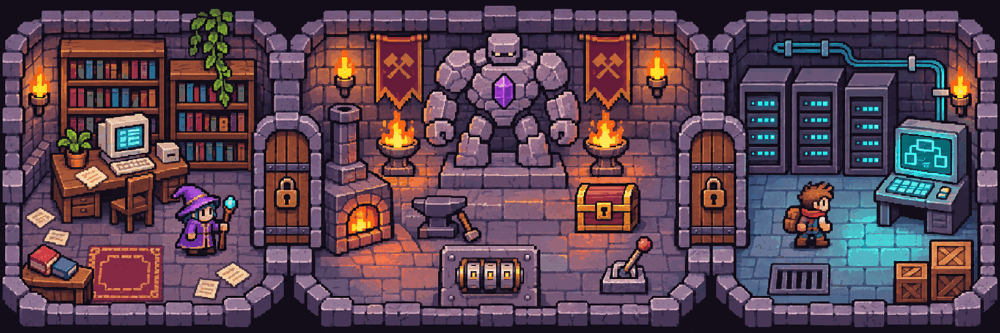
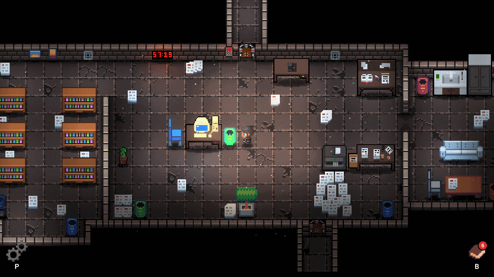
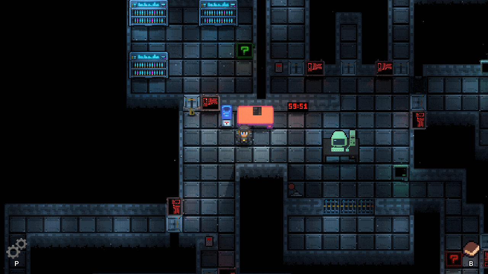
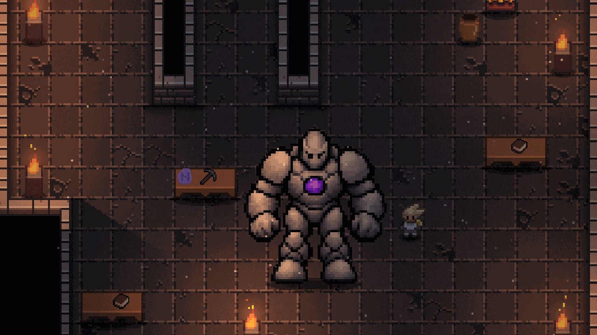
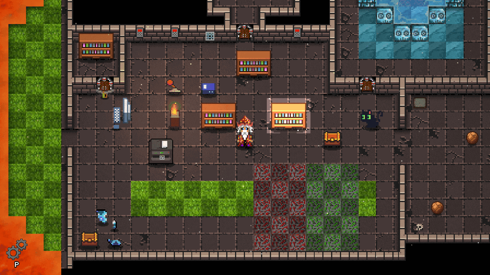

<!--  pandoc -s -f markdown -t markdown+smart+four_space_rule-grid_tables-multiline_tables-simple_tables --columns=94 --reference-links=true  README.md  -o xxx.md  -->

<h1 align="center">Dungeon</h1>
<p align="center"></p>

Dungeon is a Java framework for the gamification of educational content, and its main use is
didactic escape rooms. Step into a vanished scientist's office and tell real clues from
manipulation, program your way through a facility run by an AI that does not tell you
everything, or bring a stone golem to life with variables, loops and methods. Students play
alone or together over the network and solve subject-related puzzles to get out. A low-code
wizard lets educators build their own rooms without programming.

<table>
  <tr>
    <td width="50%"><a href="game/src/rooms/lasthour/README.md"></a><br><a href="game/src/rooms/lasthour/README.md"><b>The Last Hour</b></a> (cybersecurity)<br><a href="https://github.com/Dungeon-CampusMinden/Dungeon/releases?q=The+Last+Hour"></a></td>
    <td width="50%"><a href="game/src/rooms/systemRecovery/README.md"></a><br><a href="game/src/rooms/systemRecovery/README.md"><b>System Recovery</b></a> (arrays in Java)<br><a href="https://github.com/Dungeon-CampusMinden/Dungeon/releases?q=System+Recovery"></a></td>
  </tr>
  <tr>
    <td width="50%"><a href="game/src/rooms/soulweaver/README.md"></a><br><a href="game/src/rooms/soulweaver/README.md"><b>Das Erbe der Seelenweber</b></a> (introduction to programming)<br><a href="https://github.com/Dungeon-CampusMinden/Dungeon/releases?q=Seelenweber"></a></td>
    <td width="50%"><a href="game/src/rooms/gameofgames/README.md"></a><br><a href="game/src/rooms/gameofgames/README.md"><b>Game of Games</b></a> (work in progress, no release yet)</td>
  </tr>
</table>

## Quick start

The fastest way in is a ready-made package from the [releases]. For Windows
(`<Name>-win-x86_64.zip`) and Linux (`<Name>-linux-x86_64.tar.gz`), Java is included: extract
the archive and start `<Name>/<Name>.exe` on Windows or `<Name>/bin/<Name>` on Linux. The
platform-independent `<Name>.jar`, for example for macOS, needs the
[Java SE Development Kit 25 LTS] and starts with `java -jar <Name>.jar`.

To play from source, you also need JDK 25. Clone the repository; Gradle comes with it.

``` bash
git clone https://github.com/Dungeon-CampusMinden/Dungeon.git
cd Dungeon
./gradlew :game:runTheLastHour
```

On Windows, use `gradlew.bat` instead of `./gradlew`. Every room in the overview below starts
the same way with its own task.

### Known limitations

Currently the path to the project files cannot contain any spaces, special characters or
umlauts.

This project is intended as supplementary teaching material for German-language university
courses and is therefore aimed at German-speaking students. If you have any questions,
problems or suggestions, please feel free to contact us in English or German.

## Escape rooms

| Room | Topic | Players | Start | Download |
|------|-------|---------|-------|----------|
| [The Last Hour] | Cybersecurity: a scientist has vanished. Players search his office, crack codes and tell real clues from manipulation attempts. | 1–2 | `./gradlew :game:runTheLastHour` | [Release][The Last Hour release] |
| [System Recovery] | Programming 1, arrays in Java: energy fields, modules, sorting and two-dimensional data become puzzles in a damaged facility. | 1–2 | `./gradlew :game:runSystemRecovery` | [Release][System Recovery release] |
| [Das Erbe der Seelenweber][Soulweaver] (Soulweaver) | Introduction to programming, first semester: variables and data types, loops, methods and nested conditions, which players use to instruct the golem Nox. | 1–2 | `./gradlew :game:runSoulweaver` | [Release][Soulweaver release] |
| [Game of Games] | Work in progress without a subject concept yet: levers, keypads, pressure plates and pushable stones placed in the level editor. | 1–2 | `./gradlew :game:runGameOfGames` | none yet |

Each room has its own README with a story teaser for players and a section for educators. The
detailed concept documents behind them are in German.

## Build your own escape room

### Wizard: no programming needed

Turn your own course material into an escape room. The [Wizard][low-code wizard] guides
educators page by page through story, puzzles and game flow in the browser: number codes,
multiple-choice questions, matching tasks and information sources to discover, with graded
hints for every puzzle. A check in the background points to anything missing, and at the end
the Wizard packs the room into a single JAR file that you hand out to all players. Start with
the [step-by-step guide][Wizard guide].

### DEER-Editor: build levels inside the game

The DEER-Editor (DEER = Digital Educational Escape Room) is the level editor built into
Dungeon. Paint the map, place decorations and connect ready-made prefabs such as doors, levers,
keypads and pressure plates into puzzles, then press `F4` and play what you just built. Every
room above has its own editor task, for example `./gradlew :game:runSoulweaverLevelEditor`.
The [DEER-Editor guide] explains modes, controls and saving.

## For educators and developers

-   [Framework documentation] and [quickstart guide] (German)
-   [Escape room concepts] and [escape room research and design notes] (German)
-   [Wizard guide] and the [technical Wizard documentation][low-code wizard] (German)
-   [DEER-Editor guide]
-   [Contributing] and [license rules] for assets (German)
-   [Publications][`doc/publication/`] and [citation]

## Press

You can find an [interesting report](https://www.hsbi.de/presse/pressemitteilungen/informatik-studierende-am-campus-minden-entwickeln-2d-rollenspiel-zum-lehren-und-lernen) on our project in the news section of Bielefeld University of Applied Sciences (04 April 2024, in German), as well as [another press release](https://www.hsbi.de/presse/pressemitteilungen/hsbi-informatiker-entwickeln-ein-tool-mit-dem-die-erstellung-von-escape-rooms-fuer-die-lehre-auch-ohne-programmier-kenntnisse-gelingt) (19 December 2025, in German).
Additionally, a local school has published an [article](https://www.herder-gymnasium-minden.de/allgemein/projekt-produs/) about the project (March 2026, in German).

## Funding

It is acknowledged that parts of the materials contained in this repository have been
developed as part of various publicly funded projects.

<details>
<summary><b>Lehr-Escape-Rooms mit LowCode im Dungeon (L&lt;ESC&gt;ROD)</b></summary>

04/2025 - 03/2027, 3003-1271, [Freiraum 2025], [Stiftung Innovation in der Hochschullehre]

Building on the earlier *"Dungeon: Learning by Questing"* initiative, the project uses the
*Dungeon* framework to design didactic escape rooms in which students collaborate to solve
subject-related puzzles. It extends the framework with remote multiplayer and develops a
low-code approach that enables educators without programming experience to create their own
escape rooms.

</details>

<details>
<summary><b>Programming Dungeon Adventures at School (PRODUS)</b></summary>

12/2024 - 08/2026, EFRE-20300105, [Pakt für Informatik 2.0], [EFRE/JTF NRW 2021--27]

The project aims to interest school students in the region in STEM subjects, especially
computer science, through game-based programming workshops built on *Dungeon*: Blockly-Dungeon
(no-code), Java-Dungeon (low-code, with a Visual Studio Code plugin) and Advanced Dungeon
(in-game coding challenges and selected AI topics). It is a collaboration between local
schools, companies in the OWL (Ostwestfalen-Lippe) region and Bielefeld University of Applied
Sciences (HSBI). Documentation and results are in the dedicated [produs repository]; more
information is on our [project page].

</details>

<details>
<summary><b>Spiele-Framework für Digital Game Based Learning</b></summary>

09/2022 - 11/2023, FRFMM-623/2022, [Freiraum 2022][Freiraum 2025], [Stiftung Innovation in der
Hochschullehre]

Instead of programming their own games, students solved subject-specific challenges inside a
fully developed game, and an automated analysis detected whether solutions were correct and
where students struggled. The tasks were defined in a custom domain-specific language (DSL)
that non-programmers can use, and a Petri net-based system adapted the learning paths to the
learner.

</details>

<details>
<summary><b>PM-Dungeon</b></summary>

10/2021 - 11/2022, [Fellowships für Innovationen in der digitalen Hochschullehre
(digi-Fellows)], Ministerium für Kultur und Wissenschaft (MKW) in NRW im Einvernehmen mit der
Digitalen Hochschule NRW (DH.NRW)

The project created Open Educational Resources (OER) for teaching programming with Java and
built the libGDX-based Dungeon framework, which students of the "Programming Methods" course
at HSBI used to develop their own 2D rogue-like games. A submission process called "Deploy to
Grading", based on GitHub Actions, gave students immediate feedback on their code through
JUnit tests, Checkstyle and similar tools.

</details>

## Licenses

Unless otherwise noted, this [work] by [contributors] is licensed under [MIT].

All files in [`doc/publication/`] are licensed under [CC BY-SA 4.0].

<p align="right"></p>

  [Java SE Development Kit 25 LTS]: https://jdk.java.net/25/
  [releases]: https://github.com/Dungeon-CampusMinden/Dungeon/releases
  [The Last Hour]: game/src/rooms/lasthour/README.md
  [System Recovery]: game/src/rooms/systemRecovery/README.md
  [Soulweaver]: game/src/rooms/soulweaver/README.md
  [Game of Games]: game/src/rooms/gameofgames/README.md
  [The Last Hour release]: https://github.com/Dungeon-CampusMinden/Dungeon/releases?q=The+Last+Hour
  [System Recovery release]: https://github.com/Dungeon-CampusMinden/Dungeon/releases?q=System+Recovery
  [Soulweaver release]: https://github.com/Dungeon-CampusMinden/Dungeon/releases?q=Seelenweber
  [Framework documentation]: game/doc/readme.md
  [quickstart guide]: game/doc/quickstart.md
  [Escape room concepts]: doc/escape_room/room_concepts/
  [escape room research and design notes]: game/doc/escapeRoom/readme.md
  [low-code wizard]: wizard/doc/README.md
  [Wizard guide]: wizard/doc/teacher-guide.md
  [DEER-Editor guide]: game/doc/deer-editor.md
  [Contributing]: CONTRIBUTING.md
  [license rules]: doc/license_rules.md
  [citation]: CITATION.cff
  [project page]: https://www.hsbi.de/minden/produs/home
  [Freiraum 2025]: https://stiftung-hochschullehre.de/foerderung/freiraum/
  [Stiftung Innovation in der Hochschullehre]: https://stiftung-hochschullehre.de/
  [Pakt für Informatik 2.0]: https://www.efre.nrw/einfach-machen/foerderung-finden/pakt-fuer-informatik-20
  [EFRE/JTF NRW 2021--27]: https://www.efre.nrw/
  [produs repository]: https://github.com/Dungeon-CampusMinden/PRODUS
  [Fellowships für Innovationen in der digitalen Hochschullehre (digi-Fellows)]: https://www.dh.nrw/kooperationen/Digi-Fellows-2
  [work]: https://github.com/Dungeon-CampusMinden/Dungeon
  [contributors]: https://github.com/Dungeon-CampusMinden/Dungeon/graphs/contributors
  [MIT]: LICENSE.md
  [`doc/publication/`]: doc/publication/
  [CC BY-SA 4.0]: LICENSE-PAPER.md
