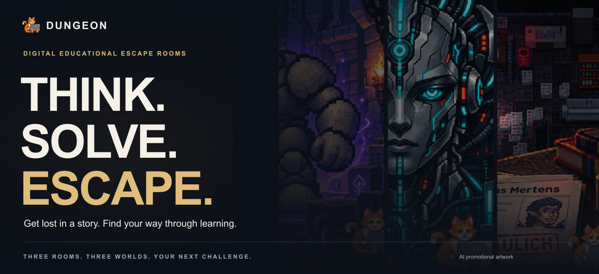
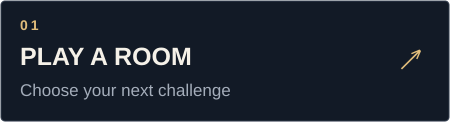
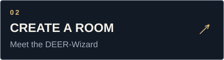
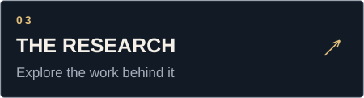
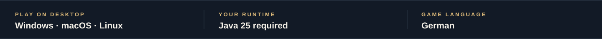
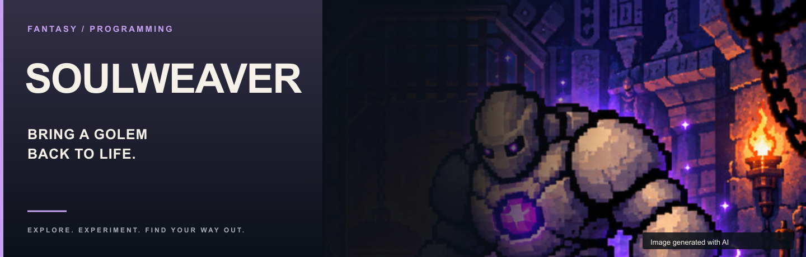
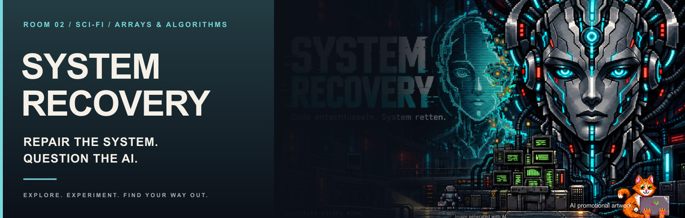
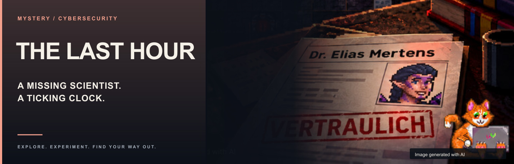
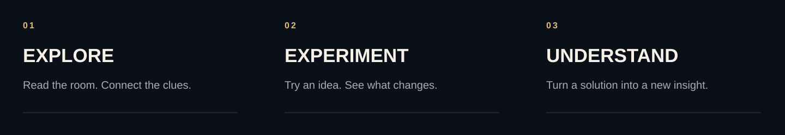
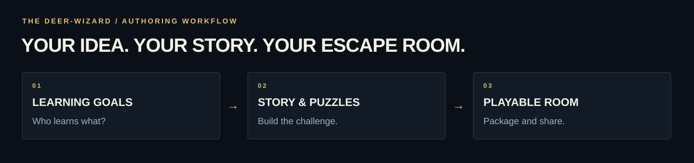

  <picture>
    <source media="(max-width: 600px)" srcset="doc/img/readme/dungeon-hero-mobile.jpg">
    
  </picture>

<h1 align="center">A way out. A reason to think.</h1>

  Story-driven escape rooms where the next breakthrough is yours. 
  <strong>Play a room. Bring it into your teaching. Build a world of your own.</strong>

  
  
  

  <a href="#what-is-a-deer-why-use-it">What is a DEER?</a> &nbsp; / &nbsp;
  <a href="#see-the-world-youll-play-in">Gameplay</a> &nbsp; / &nbsp;
  <a href="#start-playing">Quick start</a> &nbsp; / &nbsp;
  <a href="#build-with-dungeon">For developers</a>

## Choose your escape room

A forgotten forge. A failing facility. A scientist's empty office. Pick your setting, follow the clues and use what you know to move forward.

  <picture>
    <source media="(max-width: 600px)" srcset="doc/img/readme/platforms-mobile.svg">
    
  </picture>

[SoulWeaver](#soulweaver) &nbsp; / &nbsp; [System Recovery](#system-recovery) &nbsp; / &nbsp; [The Last Hour](#the-last-hour)

### SoulWeaver

**A missing master. A silent golem. Your code brings him back.**

Step into Valerius' abandoned forge and restore Nox's soul binding. Give him instructions, clear the machine cellar and find your way through the labyrinth of decisions. Your program runs; Nox shows you what it does.

**Your challenge:** variables, loops, methods and conditions. **Your starting point:** programming beginner.

  
  

### System Recovery

**The facility is failing. The AI has a plan. Do you trust it?**

AXIOM needs you to restore the damaged subsystems. A mysterious voice on the phone offers help as you work your way towards the system core. Repair arrays, sort data and program a search robot to unlock the next area.

**Your challenge:** arrays and algorithms. **Your starting point:** some Java experience.

  
  

### The Last Hour

**A scientist has vanished. You have 20 minutes to uncover what happened.**

Search the office, connect scattered clues and crack the codes before time runs out. Inspect objects, decode hidden messages and work through a web of connected cybersecurity puzzles.

**Your challenge:** cybersecurity and deduction. **The pressure:** a 20-minute countdown.

  
  

The header and room banners use AI-generated promotional artwork based on project assets. They are illustrations; actual gameplay is shown below.

## See the world you'll play in

**Pixel art. Real puzzles. Your next move.**

Actual gameplay from The Last Hour. The screenshot captures an earlier build; the current room description specifies a 20-minute time limit.

<strong>Watch a gameplay excerpt</strong>

### Start playing

1. **Get Java 25.** Install a [Java 25 runtime or JDK](https://jdk.java.net/25/) if needed.
2. **Choose your room.** Use its download button above, or [browse all releases](https://github.com/Dungeon-CampusMinden/Dungeon/releases).
3. **Launch the JAR.** Double-click the downloaded file. If it does not open, run `java -jar YourDownloadedGame.jar` in a terminal.

For room-specific setup and multiplayer instructions, follow **Explore the room** above.

---

## What is a DEER? Why use it?

### The puzzle is the learning activity.

A **Digital Educational Escape Room (DEER)** connects a game scenario with explicit learning goals. Players explore a setting, uncover information and solve linked puzzles to reach a shared objective. Subject knowledge becomes a tool they use to progress.

In Dungeon, a locked door can depend on understanding an array. A golem can make the effect of a loop visible. A hidden message can turn a cybersecurity concept into something players need to solve.

**Bring a room into your teaching**

| Before the game | During the game | After the game |
| --- | --- | --- |
| Choose a room that fits your learners and learning goals. Introduce the scenario. | Let learners investigate, test ideas and explain their reasoning. Provide support when needed. | Debrief the decisions, compare approaches and connect the puzzles to the subject. |

[Read the toolkit paper](https://doi.org/10.1145/3789624.3789628) · [Explore the research](#research)

## Create your own DEER: The DEER-Wizard

### Your subject deserves its own adventure.

The DEER-Wizard is being developed to guide educators from a teaching idea to a playable escape room, without implementing a new Java room module.

**Start with your learners.** Define prior knowledge and learning goals. **Make it your story.** Add images, puzzle content, hints and a connected game flow. **Bring it together.** Validate the project and package a playable `WizardRoom.jar`.

> **In development.** The current setup is intended for developers and technical support. It uses a browser-based authoring interface and a local Java host. Player JARs require Java 25 and support the host/join flow; a bundled educator installer is not yet part of this workflow.

**[Explore the DEER-Wizard →](wizard/doc/README.md)** &nbsp; · &nbsp; [Developer setup](wizard/spec-generator/README.md) &nbsp; · &nbsp; [Example room](wizard/examples/the-last-hour-v0.5/)

## Research

### Built to play. Designed to investigate.

Dungeon connects game development with research on educational escape rooms and game-based learning: puzzle mechanics, collaborative gameplay, authoring support and the transition from visual to textual programming.

**GamiFIN 2026 · Toolkit design**

**Designing a DEER-Toolkit: Enabling Educational Escape Rooms in a 2D Dungeon Crawler Game**

The toolkit design and a cybersecurity demonstrator. Evaluation of effectiveness in authentic teaching settings is identified as future work in this publication.

[Paper / DOI ↗](https://doi.org/10.1145/3789624.3789628) &nbsp; · &nbsp; [Read the PDF](doc/publication/2026-03-23_gamifin26_designing-a-deer-toolkit_paper.pdf) &nbsp; · &nbsp; [View the poster](doc/publication/2026-03-23_gamifin26_designing-a-deer-toolkit_poster.pdf)

**GamiFIN 2026 · Programming education**

**Designing Workshops to Bridge Visual and Textual Programming: A Narrative Game Approach**

A workshop concept connecting visual and textual programming through a narrative game.

[Paper / DOI ↗](https://doi.org/10.1145/3789624.3789625) &nbsp; · &nbsp; [Read the PDF](doc/publication/2026-03-23_gamifin26_designing-workshops-to-bridge-visual-and-textual-programming_paper.pdf)

[All publications](doc/publication/) &nbsp; · &nbsp; [Wizard research notes](wizard/doc/research/README.md) &nbsp; · &nbsp; [Cite this project](CITATION.cff)

---

## Build with Dungeon

**Help create the next room.** Dungeon provides the underlying Java game framework and a foundation for educational game content. Explore the source, improve a puzzle or contribute a new idea.

[Contribute →](CONTRIBUTING.md) &nbsp; · &nbsp; [Browse the game source](game/) &nbsp; · &nbsp; [Wizard documentation](wizard/doc/README.md) &nbsp; · &nbsp; [Report an issue](https://github.com/Dungeon-CampusMinden/Dungeon/issues)

<strong>Development requirements and limitations</strong>

Java 25 is required. The documented Wizard development workflow additionally requires Node.js 22. See the respective setup guides for current build instructions.

As noted in the original project documentation, paths to project files should not contain spaces, special characters or umlauts.

## Project background

<strong>Funding and project history</strong>

<!-- Existing funding acknowledgements and project history are retained below. -->

It is acknowledged that parts of the materials contained in this repository have been
developed as part of various publicly funded projects.

### Lehr-Escape-Rooms mit LowCode im Dungeon (L<ESC>ROD)

04/2025 - 03/2027, 3003-1271, [Freiraum 2025], [Stiftung Innovation in der Hochschullehre]

This project builds upon the goals and insights of the earlier *"Dungeon: Learning by
Questing"* initiative. It aims to combine **playful engagement with meaningful educational
experiences** by using the *Dungeon* framework to design and implement **didactic escape
rooms**.

In these digital escape rooms, students must **collaborate to solve subject-related puzzles**
in order to progress through the game. The approach fosters teamwork, critical thinking, and
applied understanding of academic content in an interactive game environment. To support this,
the *Dungeon* framework is being extended with **remote multiplayer capabilities**, allowing
multiple students to participate in a shared escape room experience from different locations.
Additionally, a **low-code approach** is being developed to enable educators - even those
without programming experience - to easily design and create their own escape rooms. This
makes the concept accessible and adaptable for a wide range of teaching contexts.

### Programming Dungeon Adventures at School (PRODUS)

12/2024 - 08/2026, EFRE-20300105, [Pakt für Informatik 2.0], [EFRE/JTF NRW 2021--27]

The documentation, project files, and results related to the Produs project have been moved to a dedicated [produs repository].

The project aims to promote interest in STEM subjects - especially computer science - among
school students in the surrounding region. The primary goal is to inspire young learners to
consider a future path in computer science by engaging them in hands-on, game-based learning
experiences.

To this end, a series of programming workshops were designed, all based on the *Dungeon*
framework and grounded in the principles of **game-based learning**. Each workshop is tailored
to different experience levels:

-   **Workshop 1: Blockly-Dungeon**

    This no-code workshop is designed for younger pupils with little to no prior programming
    experience. Using Google's Blockly language, pupils guide a hero through various levels of
    a dungeon. Along the way, they solve puzzles that gradually increase in complexity,
    introducing programming concepts such as loops and boolean expressions in an intuitive,
    visual format.

-   **Workshop 2: Java-Dungeon**

    This low-code workshop targets pupils who are already familiar with visual programming
    (like Blockly) but have not yet written actual code. Using a custom-built Visual Studio
    Code plugin, pupils control the dungeon hero by writing simple Java code. They combine
    basic programming constructs (like loops and variables) with game-specific commands (such
    as `move`, `use`, etc.), gaining their first experience with real syntax in a motivating,
    game-oriented environment.

-   **Workshop 3: Advanced Dungeon**

    This workshop is intended for pupils who already have some programming experience. Here,
    they solve complex in-game coding challenges and are introduced to selected topics in
    artificial intelligence. The workshop fosters analytical thinking and problem-solving at a
    more advanced level.

Each workshop is complemented by **career-oriented elements**: professional software
developers share insights into their daily work, and Bielefeld University of Applied Sciences
(HSBI) provides information about studying computer science and career paths in tech.

The project is a **collaborative effort** between local schools and companies in the OWL
(Ostwestfalen-Lippe) region, with HSBI providing both academic leadership and operational
coordination.

![][2]

### Spiele-Framework für Digital Game Based Learning

09/2022 - 11/2023, FRFMM-623/2022, [Freiraum 2022][Freiraum 2025], [Stiftung Innovation in der
Hochschullehre]

As part of the project, the principles of game-based learning were further explored and
applied to the existing Dungeon framework. In contrast to the previous PM-Dungeon project,
where students programmed their own games, the focus here was not on game development, but on
learning through gameplay.

Students were provided with a fully developed game in which they had to solve subject-specific
challenges directly within the game world. Real academic problems were seamlessly integrated
with game mechanics - such as crafting or puzzle-solving - to create an engaging and
meaningful learning experience. To evaluate student performance, the game included an
automated analysis system that detected whether solutions were correct or whether players
encountered difficulties during the task. The in-game challenges and puzzles were defined
using a custom domain-specific language (DSL). This DSL enables even non-programmers to create
and integrate educational tasks and puzzles into the game. It supports a variety of input
types, such as single-choice questions, matching tasks, and element combination exercises.
Depending on the level of detail provided, the DSL can either generate a specific gameplay
scenario or automatically create a diverse game environment in which players must solve tasks
to progress. Additionally, a Petri net-based system was implemented to define alternative
learning paths. This allows the game to dynamically adapt to the learner's needs - for
example, by revisiting topic areas where students previously struggled.

### PM-Dungeon

10/2021 - 11/2022, [Fellowships für Innovationen in der digitalen Hochschullehre
(digi-Fellows)], Ministerium für Kultur und Wissenschaft (MKW) in NRW im Einvernehmen mit der
Digitalen Hochschule NRW (DH.NRW)

The goal of the project was to motivate computer science students to engage deeply with
programming by providing exciting challenges and development environments. A particular focus
was placed on promoting self-directed learning, enabling students to explore programming
concepts at their own pace and based on their individual interests and progress.

As part of the project:

-   Open Educational Resources (OER) were created and published to support teaching
    programming with Java.
-   The Java-based framework Dungeon, built on libGDX, was conceptualized and developed. This
    framework has since been extended, revised, and optimized through additional projects.

The Dungeon framework was used in the "Programming Methods" course at Bielefeld University of
Applied Sciences (HSBI) to teach students advanced programming techniques in Java. Students
used the framework to develop their own 2D rogue-like games, applying key programming concepts
in a creative and practical way. To support this, the framework provides essential
functionalities to simplify complex development tasks. These include a built-in game loop,
graphical rendering of textures, an animation system, and tools for level generation and
loading. In addition, a submission process called "Deploy to Grading", based on GitHub
Actions, was developed. This allows students to submit their code solutions via GitHub pull
requests. The submitted code is automatically evaluated using a CI pipeline that includes
JUnit tests, Checkstyle, and similar tools - providing immediate, formative feedback and
reinforcing the idea of autonomous, feedback-driven learning.

<strong>Credits and licenses</strong>

## Credits

The assets in [`game/assets/`] are a mix from free and self
modified resources:

-   Textures and animations:
    -   https://0x72.itch.io/16x16-dungeon-tileset (CC0 1.0)
    -   https://0x72.itch.io/dungeontileset-ii (CC0 1.0)
-   Music and sound effects:
    -   https://alkakrab.itch.io/free-12-tracks-pixel-rpg-game-music-pack (CC0 1.0)
    -   https://opengameart.org/content/50-rpg-sound-effects (CC0 1.0)
    -   https://opengameart.org/content/hurt-death-sound-effect-for-character (CC0 1.0)
    -   https://opengameart.org/content/80-cc0-creture-sfx-2 (CC0 1.0)
    -   https://freesound.org/s/578488/ (CC0 1.0)
-   Adapted and modified by [\@Flamtky][]:
    -   Files (except [Health Potion]) in [`game/assets/items/potion/`] (originating from
        [\@dkirshner])
    -   Files in [`game/assets/dungeon/*/floor`][]: each `floor_damaged.png` (originating
        from [\@dkirshner])
    -   [`game/assets/dungeon/fire/floor/floor_1.png`] (originating from [\@dkirshner])

## Licenses

Unless otherwise noted, this [work] by [contributors] is licensed under [MIT].

All files in [`doc/publication/`] are licensed under [CC BY-SA 4.0].

  [PRODUS project]: #programming-dungeon-adventures-at-school-produs
  [project page]: https://www.hsbi.de/minden/produs/home
  [1]: game/doc/img/monster.gif
  [Java SE Development Kit 25 LTS]: https://jdk.java.net/25/
  [Freiraum 2025]: https://stiftung-hochschullehre.de/foerderung/freiraum/
  [Stiftung Innovation in der Hochschullehre]: https://stiftung-hochschullehre.de/
  [Pakt für Informatik 2.0]: https://www.efre.nrw/einfach-machen/foerderung-finden/pakt-fuer-informatik-20
  [EFRE/JTF NRW 2021--27]: https://www.efre.nrw/
  [produs repository]: https://github.com/Dungeon-CampusMinden/PRODUS
  [2]: doc/press_kit/blockly/blockly_gif.gif
  [Fellowships für Innovationen in der digitalen Hochschullehre (digi-Fellows)]: https://www.dh.nrw/kooperationen/Digi-Fellows-2
  [`game/assets/`]: game/assets/
  [\@Flamtky]: https://github.com/Flamtky
  [Health Potion]: game/assets/items/potion/health_potion.png
  [`game/assets/items/potion/`]: game/assets/items/potion/
  [\@dkirshner]: https://github.com/dkirshner
  [`game/assets/dungeon/*/floor`]: game/assets/dungeon/
  [`game/assets/dungeon/fire/floor/floor_1.png`]: game/assets/dungeon/fire/floor/floor_1.png
  [work]: https://github.com/Dungeon-CampusMinden/Dungeon
  [contributors]: https://github.com/Dungeon-CampusMinden/Dungeon/graphs/contributors
  [MIT]: LICENSE.md
  [`doc/publication/`]: doc/publication/
  [CC BY-SA 4.0]: LICENSE-PAPER.md

<strong>Press and further reading</strong>

- [HSBI project report, April 2024](https://www.hsbi.de/presse/pressemitteilungen/informatik-studierende-am-campus-minden-entwickeln-2d-rollenspiel-zum-lehren-und-lernen)
- [HSBI press release, December 2025](https://www.hsbi.de/presse/pressemitteilungen/hsbi-informatiker-entwickeln-ein-tool-mit-dem-die-erstellung-von-escape-rooms-fuer-die-lehre-auch-ohne-programmier-kenntnisse-gelingt)
- [PRODUS at Herder-Gymnasium, March 2026](https://www.herder-gymnasium-minden.de/allgemein/projekt-produs/)

