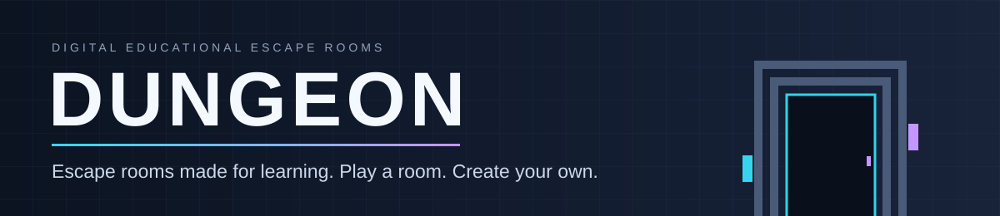
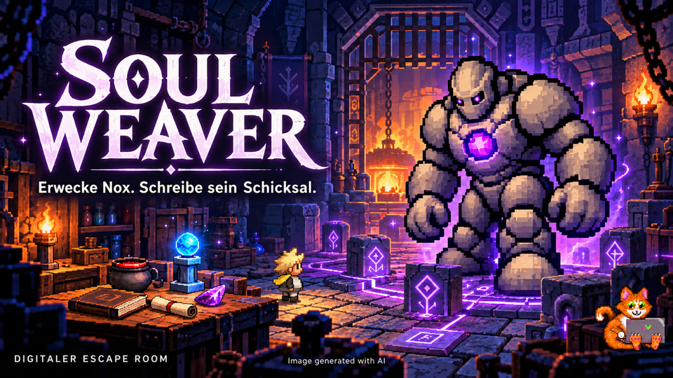
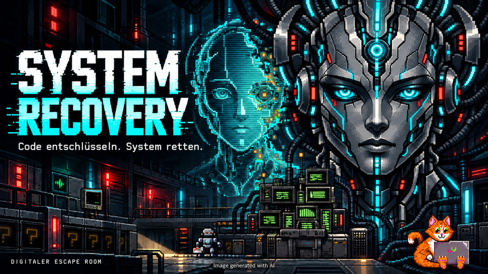
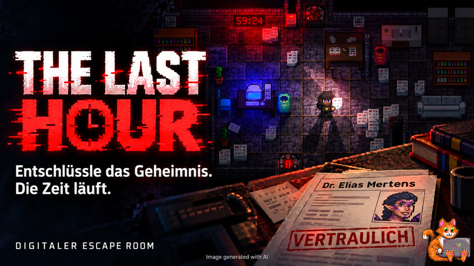
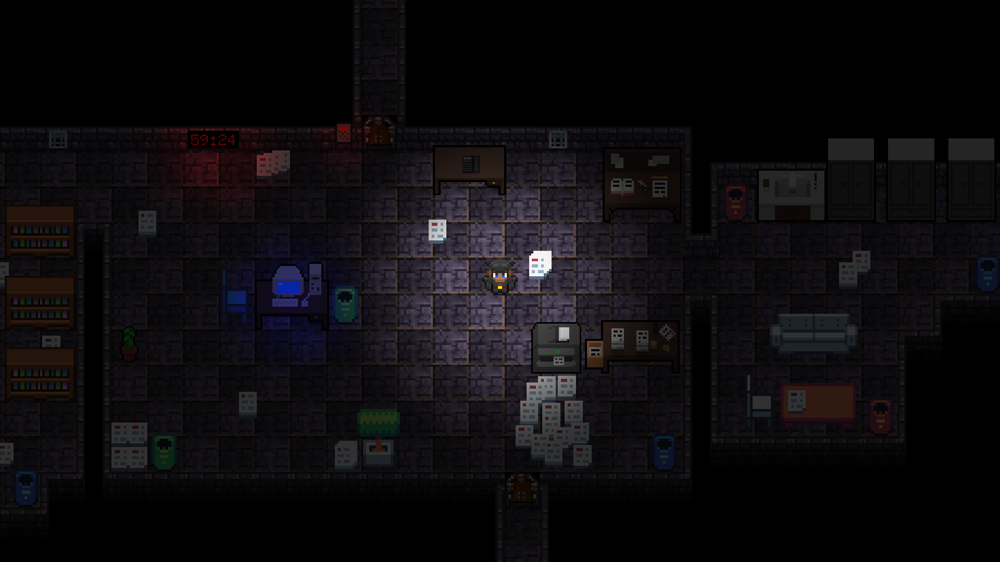
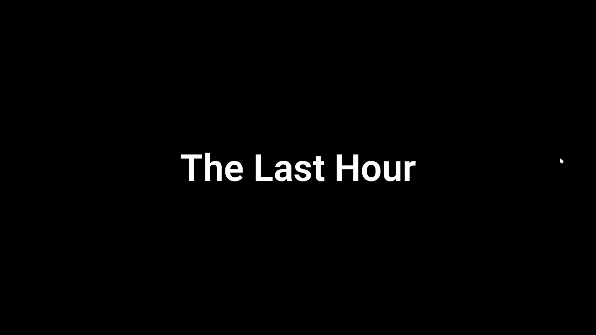

  

  <strong>Play an escape room. Bring it into your classroom. Create your own.</strong>

  <a href="#choose-your-escape-room">Play a DEER</a> &nbsp;·&nbsp;
  <a href="#what-is-a-deer-why-use-it">What is a DEER?</a> &nbsp;·&nbsp;
  <a href="#create-your-own-deer-the-deer-wizard">Create your own</a> &nbsp;·&nbsp;
  <a href="#research">Research</a>

Dungeon brings learning into a 2D game world. Explore a story, investigate clues and solve connected puzzles to find your way out. Play an existing Digital Educational Escape Room, use one in your teaching, or explore the tools for building your own.

## Choose your escape room

<strong>Windows / macOS / Linux</strong> &nbsp; Java 25 required &nbsp; Game content in German

<table>
<tr>
<td width="42%" valign="top">

</td>
<td width="58%" valign="top">
<h3>SoulWeaver</h3>

<strong>A missing master. A silent golem. Your code brings him back.</strong>

Step into Valerius' abandoned forge and restore Nox's soul binding. Give the golem instructions, clear the machine cellar and find your way through the labyrinth of decisions.

<strong>You play by:</strong> giving Nox values, loops, methods and conditions — then watching your program change the world.

Fantasy · Programming fundamentals · Beginner-friendly

<a href="doc/escape_room/room_concepts/soulweaver/soulweaver_concept.md"><strong>Explore SoulWeaver →</strong></a>

</td>
</tr>
<tr>
<td width="42%" valign="top">

</td>
<td width="58%" valign="top">
<h3>System Recovery</h3>

<strong>The facility is failing. The AI has a plan. Do you trust it?</strong>

AXIOM needs you to restore the damaged subsystems. A mysterious voice on the phone offers help as you work your way towards the system core.

<strong>You play by:</strong> repairing arrays, sorting data and programming a search robot to unlock the next area.

Sci-fi · Arrays &amp; algorithms · Java experience recommended

<a href="game/src/rooms/systemRecovery/README.md"><strong>Explore System Recovery →</strong></a>

</td>
</tr>
<tr>
<td width="42%" valign="top">

</td>
<td width="58%" valign="top">
<h3>The Last Hour</h3>

<strong>A scientist has vanished. The clock is ticking.</strong>

You have 20 minutes to uncover what happened. Search the office, connect scattered clues and crack the codes before time runs out.

<strong>You play by:</strong> investigating objects, decoding hidden messages and solving connected cybersecurity puzzles.

Mystery · Cybersecurity · 20-minute countdown

<a href="doc/lasthourReadme.md"><strong>Explore The Last Hour →</strong></a>

</td>
</tr>
</table>

Promotional artwork generated with AI using project assets. These illustrations are not gameplay screenshots.

<strong>See the game in action</strong>

An in-game view of The Last Hour. Explore the room, inspect objects and connect the clues.

### Start playing

1. Install [Java 25](https://jdk.java.net/25/) if it is not already available on your computer.
2. Download the room you want to play.
3. Launch the downloaded JAR. If double-clicking does not start it, run `java -jar YourDownloadedGame.jar` in a terminal.

[Browse all releases](https://github.com/Dungeon-CampusMinden/Dungeon/releases)

## What is a DEER? Why use it?

A **Digital Educational Escape Room (DEER)** connects a game scenario with explicit learning goals. Players explore a setting, uncover information and solve linked puzzles to reach a shared objective. The subject matter becomes part of what players do to progress.

In Dungeon, this happens inside a pixel-art game world: a locked door can depend on understanding an array; a golem's actions can make the effect of a loop visible.

| A learning activity | What it can look like in a DEER |
| --- | --- |
| Apply knowledge | Use a concept to solve a concrete problem in the room. |
| Explain your thinking | Discuss clues and agree on a next step with your team. |
| Try and revise | Observe what an attempt changes, then adjust your approach. |
| Reflect on the experience | Connect game decisions to the subject during a debrief. |

A DEER works best as a planned learning activity: introduce the task, give learners time to play, and discuss their approaches afterwards. The room's learning goals, puzzles and debrief should fit together.

[Explore the research behind the toolkit](#research)

## Create your own DEER: The DEER-Wizard

**Turn your teaching idea into an escape room.**

The DEER-Wizard is being developed to guide educators through authoring a room without implementing a new Java room module. The workflow starts with your learners and learning goals, then connects your story, puzzles and game flow.

1. **Define the learning context.** Set the audience, prior knowledge and learning goals.
2. **Shape the scenario.** Add a story, your own images and puzzle content.
3. **Connect the puzzles.** Specify the flow, hints and ending.
4. **Check and package.** Validate the project and create a playable `WizardRoom.jar`.

The current development version provides a browser-based authoring interface backed by a local Java host. Generated player JARs support the host/join flow and require Java 25.

> **Development status:** The Wizard is under active development. The documented setup currently targets developers and technical support; a bundled installer for educators is not yet part of this workflow.

[Explore the DEER-Wizard](wizard/doc/README.md) · [Developer setup](wizard/spec-generator/README.md) · [Example room](wizard/examples/the-last-hour-v0.5/)

## Research

Dungeon connects game development with research on educational escape rooms and game-based learning. Our work covers puzzle mechanics, collaborative gameplay, authoring support and the transition from visual to textual programming.

The DEER-Toolkit work presents the design and a demonstrator. Evaluation of its effectiveness in authentic teaching settings is identified as future work in that publication.

### Selected publications

| Publication | Links |
| --- | --- |
| **Designing a DEER-Toolkit: Enabling Educational Escape Rooms in a 2D Dungeon Crawler Game** — GamiFIN 2026 | [Paper / DOI](https://doi.org/10.1145/3789624.3789628) · [Repository PDF](doc/publication/2026-03-23_gamifin26_designing-a-deer-toolkit_paper.pdf) · [Poster](doc/publication/2026-03-23_gamifin26_designing-a-deer-toolkit_poster.pdf) |
| **Designing Workshops to Bridge Visual and Textual Programming: A Narrative Game Approach** — GamiFIN 2026 | [Paper / DOI](https://doi.org/10.1145/3789624.3789625) · [Repository PDF](doc/publication/2026-03-23_gamifin26_designing-workshops-to-bridge-visual-and-textual-programming_paper.pdf) |

[All publications](doc/publication/) · [Wizard research notes](wizard/doc/research/README.md) · [Citation metadata](CITATION.cff)

## Build with Dungeon

Dungeon also provides the underlying Java game framework and an example foundation for creating educational game content.

[Contribute](CONTRIBUTING.md) · [Browse the source](game/) · [Wizard documentation](wizard/doc/README.md)

## Project background

<strong>Funding and project history</strong>

<!-- Existing funding acknowledgements and project history are retained below. -->

It is acknowledged that parts of the materials contained in this repository have been
developed as part of various publicly funded projects.

### Lehr-Escape-Rooms mit LowCode im Dungeon (L<ESC>ROD)

04/2025 - 03/2027, 3003-1271, [Freiraum 2025], [Stiftung Innovation in der Hochschullehre]

This project builds upon the goals and insights of the earlier *"Dungeon: Learning by
Questing"* initiative. It aims to combine **playful engagement with meaningful educational
experiences** by using the *Dungeon* framework to design and implement **didactic escape
rooms**.

In these digital escape rooms, students must **collaborate to solve subject-related puzzles**
in order to progress through the game. The approach fosters teamwork, critical thinking, and
applied understanding of academic content in an interactive game environment. To support this,
the *Dungeon* framework is being extended with **remote multiplayer capabilities**, allowing
multiple students to participate in a shared escape room experience from different locations.
Additionally, a **low-code approach** is being developed to enable educators - even those
without programming experience - to easily design and create their own escape rooms. This
makes the concept accessible and adaptable for a wide range of teaching contexts.

### Programming Dungeon Adventures at School (PRODUS)

12/2024 - 08/2026, EFRE-20300105, [Pakt für Informatik 2.0], [EFRE/JTF NRW 2021--27]

The documentation, project files, and results related to the Produs project have been moved to a dedicated [produs repository].

The project aims to promote interest in STEM subjects - especially computer science - among
school students in the surrounding region. The primary goal is to inspire young learners to
consider a future path in computer science by engaging them in hands-on, game-based learning
experiences.

To this end, a series of programming workshops were designed, all based on the *Dungeon*
framework and grounded in the principles of **game-based learning**. Each workshop is tailored
to different experience levels:

-   **Workshop 1: Blockly-Dungeon**

    This no-code workshop is designed for younger pupils with little to no prior programming
    experience. Using Google's Blockly language, pupils guide a hero through various levels of
    a dungeon. Along the way, they solve puzzles that gradually increase in complexity,
    introducing programming concepts such as loops and boolean expressions in an intuitive,
    visual format.

-   **Workshop 2: Java-Dungeon**

    This low-code workshop targets pupils who are already familiar with visual programming
    (like Blockly) but have not yet written actual code. Using a custom-built Visual Studio
    Code plugin, pupils control the dungeon hero by writing simple Java code. They combine
    basic programming constructs (like loops and variables) with game-specific commands (such
    as `move`, `use`, etc.), gaining their first experience with real syntax in a motivating,
    game-oriented environment.

-   **Workshop 3: Advanced Dungeon**

    This workshop is intended for pupils who already have some programming experience. Here,
    they solve complex in-game coding challenges and are introduced to selected topics in
    artificial intelligence. The workshop fosters analytical thinking and problem-solving at a
    more advanced level.

Each workshop is complemented by **career-oriented elements**: professional software
developers share insights into their daily work, and Bielefeld University of Applied Sciences
(HSBI) provides information about studying computer science and career paths in tech.

The project is a **collaborative effort** between local schools and companies in the OWL
(Ostwestfalen-Lippe) region, with HSBI providing both academic leadership and operational
coordination.

![][2]

### Spiele-Framework für Digital Game Based Learning

09/2022 - 11/2023, FRFMM-623/2022, [Freiraum 2022][Freiraum 2025], [Stiftung Innovation in der
Hochschullehre]

As part of the project, the principles of game-based learning were further explored and
applied to the existing Dungeon framework. In contrast to the previous PM-Dungeon project,
where students programmed their own games, the focus here was not on game development, but on
learning through gameplay.

Students were provided with a fully developed game in which they had to solve subject-specific
challenges directly within the game world. Real academic problems were seamlessly integrated
with game mechanics - such as crafting or puzzle-solving - to create an engaging and
meaningful learning experience. To evaluate student performance, the game included an
automated analysis system that detected whether solutions were correct or whether players
encountered difficulties during the task. The in-game challenges and puzzles were defined
using a custom domain-specific language (DSL). This DSL enables even non-programmers to create
and integrate educational tasks and puzzles into the game. It supports a variety of input
types, such as single-choice questions, matching tasks, and element combination exercises.
Depending on the level of detail provided, the DSL can either generate a specific gameplay
scenario or automatically create a diverse game environment in which players must solve tasks
to progress. Additionally, a Petri net-based system was implemented to define alternative
learning paths. This allows the game to dynamically adapt to the learner's needs - for
example, by revisiting topic areas where students previously struggled.

### PM-Dungeon

10/2021 - 11/2022, [Fellowships für Innovationen in der digitalen Hochschullehre
(digi-Fellows)], Ministerium für Kultur und Wissenschaft (MKW) in NRW im Einvernehmen mit der
Digitalen Hochschule NRW (DH.NRW)

The goal of the project was to motivate computer science students to engage deeply with
programming by providing exciting challenges and development environments. A particular focus
was placed on promoting self-directed learning, enabling students to explore programming
concepts at their own pace and based on their individual interests and progress.

As part of the project:

-   Open Educational Resources (OER) were created and published to support teaching
    programming with Java.
-   The Java-based framework Dungeon, built on libGDX, was conceptualized and developed. This
    framework has since been extended, revised, and optimized through additional projects.

The Dungeon framework was used in the "Programming Methods" course at Bielefeld University of
Applied Sciences (HSBI) to teach students advanced programming techniques in Java. Students
used the framework to develop their own 2D rogue-like games, applying key programming concepts
in a creative and practical way. To support this, the framework provides essential
functionalities to simplify complex development tasks. These include a built-in game loop,
graphical rendering of textures, an animation system, and tools for level generation and
loading. In addition, a submission process called "Deploy to Grading", based on GitHub
Actions, was developed. This allows students to submit their code solutions via GitHub pull
requests. The submitted code is automatically evaluated using a CI pipeline that includes
JUnit tests, Checkstyle, and similar tools - providing immediate, formative feedback and
reinforcing the idea of autonomous, feedback-driven learning.

<strong>Credits and licenses</strong>

## Credits

The assets in [`game/assets/`] are a mix from free and self
modified resources:

-   Textures and animations:
    -   https://0x72.itch.io/16x16-dungeon-tileset (CC0 1.0)
    -   https://0x72.itch.io/dungeontileset-ii (CC0 1.0)
-   Music and sound effects:
    -   https://alkakrab.itch.io/free-12-tracks-pixel-rpg-game-music-pack (CC0 1.0)
    -   https://opengameart.org/content/50-rpg-sound-effects (CC0 1.0)
    -   https://opengameart.org/content/hurt-death-sound-effect-for-character (CC0 1.0)
    -   https://opengameart.org/content/80-cc0-creture-sfx-2 (CC0 1.0)
    -   https://freesound.org/s/578488/ (CC0 1.0)
-   Adapted and modified by [\@Flamtky][]:
    -   Files (except [Health Potion]) in [`game/assets/items/potion/`] (originating from
        [\@dkirshner])
    -   Files in [`game/assets/dungeon/*/floor`][]: each `floor_damaged.png` (originating
        from [\@dkirshner])
    -   [`game/assets/dungeon/fire/floor/floor_1.png`] (originating from [\@dkirshner])

## Licenses

Unless otherwise noted, this [work] by [contributors] is licensed under [MIT].

All files in [`doc/publication/`] are licensed under [CC BY-SA 4.0].

  [PRODUS project]: #programming-dungeon-adventures-at-school-produs
  [project page]: https://www.hsbi.de/minden/produs/home
  [1]: game/doc/img/monster.gif
  [Java SE Development Kit 25 LTS]: https://jdk.java.net/25/
  [Freiraum 2025]: https://stiftung-hochschullehre.de/foerderung/freiraum/
  [Stiftung Innovation in der Hochschullehre]: https://stiftung-hochschullehre.de/
  [Pakt für Informatik 2.0]: https://www.efre.nrw/einfach-machen/foerderung-finden/pakt-fuer-informatik-20
  [EFRE/JTF NRW 2021--27]: https://www.efre.nrw/
  [produs repository]: https://github.com/Dungeon-CampusMinden/PRODUS
  [2]: doc/press_kit/blockly/blockly_gif.gif
  [Fellowships für Innovationen in der digitalen Hochschullehre (digi-Fellows)]: https://www.dh.nrw/kooperationen/Digi-Fellows-2
  [`game/assets/`]: game/assets/
  [\@Flamtky]: https://github.com/Flamtky
  [Health Potion]: game/assets/items/potion/health_potion.png
  [`game/assets/items/potion/`]: game/assets/items/potion/
  [\@dkirshner]: https://github.com/dkirshner
  [`game/assets/dungeon/*/floor`]: game/assets/dungeon/
  [`game/assets/dungeon/fire/floor/floor_1.png`]: game/assets/dungeon/fire/floor/floor_1.png
  [work]: https://github.com/Dungeon-CampusMinden/Dungeon
  [contributors]: https://github.com/Dungeon-CampusMinden/Dungeon/graphs/contributors
  [MIT]: LICENSE.md
  [`doc/publication/`]: doc/publication/
  [CC BY-SA 4.0]: LICENSE-PAPER.md

<strong>Press and further reading</strong>

- [HSBI project report, April 2024](https://www.hsbi.de/presse/pressemitteilungen/informatik-studierende-am-campus-minden-entwickeln-2d-rollenspiel-zum-lehren-und-lernen)
- [HSBI press release, December 2025](https://www.hsbi.de/presse/pressemitteilungen/hsbi-informatiker-entwickeln-ein-tool-mit-dem-die-erstellung-von-escape-rooms-fuer-die-lehre-auch-ohne-programmier-kenntnisse-gelingt)
- [PRODUS at Herder-Gymnasium, March 2026](https://www.herder-gymnasium-minden.de/allgemein/projekt-produs/)

