# Morph & Co. KG: Walkthrough

Die Wörterfabrik der Morph & Co. KG steht still. Die Spielenden schalten den Alarm aus, lesen am
Computer die Fehlermeldungen, reparieren die Affix-Sortieranlage A-12 und die Flexionsstraße F-04
und starten danach die Produktion neu. Der Raum ist für ein bis zwei Personen gedacht (Fach:
Germanistische Linguistik, Morphologie).

Dieser Walkthrough beschreibt den kompletten Lösungsweg in der Reihenfolge, in der das Spiel ihn
freigibt, und danach alle optionalen Teile. F-04 und A-12 können in beliebiger Reihenfolge
repariert werden; nur die Flexionsmaschine in F-04 läuft erst, wenn A-12 wieder sortiert.

Start aus dem Repository: `./gradlew :game:runMorphCo`

## Übersichtskarte

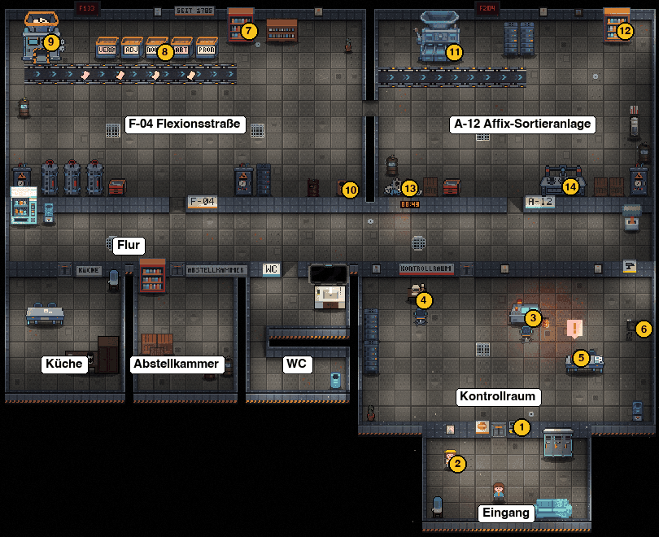

| Nr. | Ort | Station |
| --- | --- | --- |
| 1 | Eingang | Lesegerät an der Tür zum Kontrollraum |
| 2 | Eingang | Schichtleitung (Hinweise) |
| 3 | Kontrollraum | Konsole (Alarm) |
| 4 | Kontrollraum | Computer (Produktionsleitsystem) |
| 5 | Kontrollraum | Tisch mit Telefon, Schichtplan und Kaffeetasse |
| 6 | Kontrollraum | Sicherungsbox (optional) |
| 7 | F-04 | Bücherregale |
| 8 | F-04 | Kisten für die Wortarten |
| 9 | F-04 | Flexionsmaschine |
| 10 | F-04 | Papierkorb (optional) |
| 11 | A-12 | Affix-Sortieranlage mit Hebel, Wartungsklappe und Schloss |
| 12 | A-12 | Bücherregal |
| 13 | A-12 | Haufen mit Krimskrams (optional) |
| 14 | A-12 | Zirkumfixmontagestation (optional) |

Vom Eingang führt eine Tür in den Kontrollraum. Die Tür gegenüber vom Eingang führt vom Kontrollraum
in den Flur. Vom Flur aus erreicht man F-04 (links), A-12 (rechts) und die Sanitäranlagen. Küche und
Abstellkammer bleiben verschlossen. Zwischen F-04 und A-12 gibt es zusätzlich eine Verbindungstür.

## Bedienung

| Aktion | Taste |
| --- | --- |
| Bewegen | W, A, S, D |
| Interagieren | Mausklick auf das Objekt oder E |
| Inventar | Tab |
| Questlog | B |
| Dialog schließen | Esc oder „Schließen“ oben rechts |
| Einstellungen | Esc (wenn kein Dialog offen ist) |

- **Interagieren:** Fährt man mit der Maus über ein Objekt, mit dem man interagieren kann, bekommt
  es einen Umriss. Steht die Figur nah genug davor, wird der Umriss kräftiger und der Mauszeiger
  wechselt; dann reicht ein Klick.
- **Dialoge:** Texte bestätigt man mit „OK“. In Auswahldialogen (Konsole, Bücherregale) klickt man
  die gewünschte Option an.
- **Zuordnen:** In den Kisten, den Affix-Fächern, den Eingabeschächten, an der
  Zirkumfixmontagestation und in der Sicherungsbox zieht man ein Teil mit der Maus an sein Ziel.
  Alternativ klickt man erst das Teil und dann das Ziel an. In den Sortierdialogen legt
  „Zurücksetzen“ alles zurück, „Prüfen“ lässt die Lösung prüfen.
- **Tastaturwege der Minigames:**
  - Lesegerät: Leertaste oder Pfeil nach rechts gedrückt halten und am Ende loslassen.
  - Hebel von A-12: Leertaste oder Pfeil nach unten gedrückt halten und unten loslassen.
  - Ziffernblöcke (Schloss von A-12, Telefon): Ziffern tippen, Enter bestätigt, Rücktaste löscht
    die letzte Ziffer.
  - Sicherheitsfrage am Computer: Zahl ins Feld tippen und mit Enter oder „Bestätigen“ absenden.
- **Multiplayer:** Eine Person wählt im Hauptmenü „Schicht beginnen“, die zweite „Spiel
  beitreten“. Fortschritt, Hinweise und Questlog gelten für beide.

## Hilfesystem

Falsche Eingaben kosten nichts außer Zeit. Die Sortierdialoge zeigen nach „Prüfen“, wie viele
Teile noch falsch liegen. Zusätzlich gibt es drei Hilfen.

### Schichtleitung

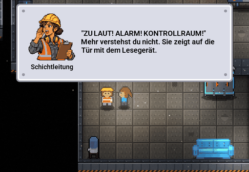

Die Schichtleitung steht am Eingang (2). Spricht man sie an, gibt sie einen Hinweis zum ersten
offenen Schritt. Hat man mit einer Halle begonnen, bezieht sich der Hinweis zuerst auf diese Halle.
Solange der Alarm läuft, versteht man sie kaum.

### Technik-Hotline

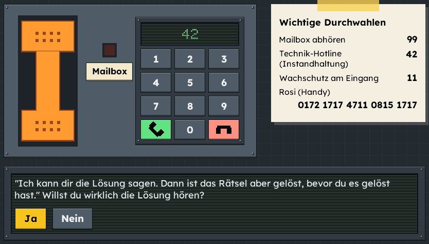

Am Telefon im Kontrollraum (5) erreicht man unter der Durchwahl **42** die Technik-Hotline. Sie hilft
bei demselben Schritt wie die Schichtleitung, in drei Stufen:

1. **Hinweis:** wohin man schauen muss.
2. **Tipp:** ein konkreter Ansatz.
3. **Lösung:** Vorher fragt die Hotline nach, ob man die Lösung wirklich hören will. „Nein“ kostet
   nichts. Danach wiederholt sie bei jedem Anruf die Lösung.

Jeder Anruf gibt die nächste Stufe. Ist der Schritt gelöst, beginnt der nächste wieder bei Stufe 1.
Die Stufen gelten für den ganzen Raum: Im Multiplayer macht die zweite Person dort weiter, wo die
erste aufgehört hat. Die Hotline hilft auch schon, solange der Alarm noch läuft. Auf sie weisen der
Steuerungsdialog zu Beginn, der Zettel am Telefon, die Bandansage unter den Fehlercodes 133 und 204
und die Schichtleitung hin.

### Questlog

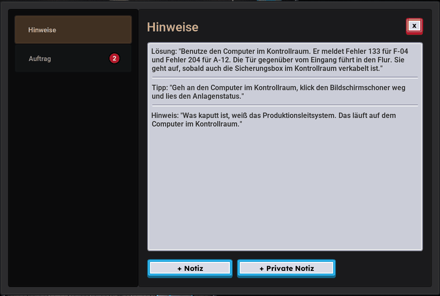

Das Questlog (B) hat die Tabs „Auftrag“, „F-04 Flexionsstraße“, „A-12 Affix-Sortieranlage“,
„Indizien“ und „Hinweise“. Erledigte Aufgaben werden als „(erledigt)“ markiert. Unter „Indizien“
stehen gefundene Hinweise, etwa das Handbuch, beide Teile des Handouts und die Frage am Schloss.
Unter „Hinweise“ steht jede gehörte Stufe der Technik-Hotline, die neueste oben.

## Walkthrough

### 1. Eingang: Lesegerät

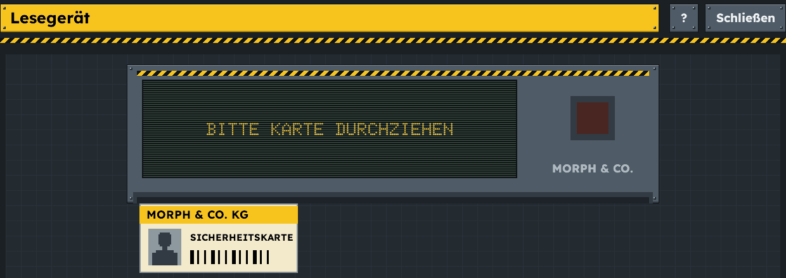

Nach dem Intro brüllt die Schichtleitung gegen die Sirene an und zeigt auf die Tür mit dem
Lesegerät (1). Ein Klick auf das Lesegerät öffnet es. Die Sicherheitskarte wird von links nach
rechts durch den Schlitz gezogen.

**Lösung:** Die Karte in einem Zug ganz durchziehen und dafür **zwischen 0,3 und 1,2 Sekunden**
brauchen. Zu schnell, zu langsam oder nicht ganz durchgezogen heißt: noch einmal. Danach öffnet sich
die Tür zum Kontrollraum. Drinnen ist die Sirene nur noch halb so laut.

### 2. Kontrollraum: Alarm ausschalten

Die Konsole (3) steht in der Mitte des Kontrollraums. Sie hat fünf beschriftete Knöpfe.

**Lösung:** Knopf **„Nerviger Alarmton“**. Die Sirene verstummt, und das Achievement „Wuuuuuuh-o,
wuuuuuh-o“ wird freigeschaltet. Die anderen Knöpfe („Förderband-Turbo“, „Kaffeemaschine
Personalküche“, „Hintergrundmusik Flur“, „Notbeleuchtung“) geben nur eine witzige Rückmeldung.

Solange der Alarm läuft, meldet der Computer nur: „Erst muss der Alarm aus.“

### 3. Kontrollraum: Computer

Am Computer (4) ist ein Bildschirmschoner aktiv; ein Klick beendet ihn. Der Tab „[ANLAGENSTATUS]“
meldet:

- **F-04 Flexionsstraße - Fehler 133:** Flexionsparadigma inkonsistent.
- **A-12 Affix-Sortieranlage - Fehler 204:** Unzulässiger Morphemtyp im Materialmagazin.

Sobald der Computer benutzt wurde, öffnet sich die Tür zum Flur. Im Questlog stehen jetzt die
Aufgaben „A-12 reparieren“ und „F-04 reparieren“. Im Tab „[NEUSTART]“ steht noch „Nicht verfügbar.“
Die Produktionsfreigabe für den Neustart wird erst erteilt, wenn alle Anlagen repariert sind.

Ebenfalls im Kontrollraum: das Telefon (5) mit der Mailbox (99) und der Technik-Hotline (42) und
die optionale Sicherungsbox (6), siehe [Optionales](#optionales).

### 4. Flur

Im Flur hängen Türschilder. Links geht es nach F-04, rechts nach A-12. Personalküche und
Abstellkammer sind abgeschlossen. In den Sanitäranlagen gibt es nur Waschbecken und Spiegel. Die
Reihenfolge der beiden Hallen ist frei; dieser Walkthrough beginnt mit F-04, weil dort auch der
Hinweis für das Schloss in A-12 steht.

### 5. F-04: Handbuch und Handout Teil 1

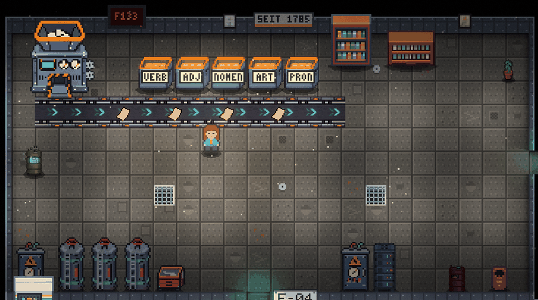

In F-04 stehen oben die Flexionsmaschine (9), die fünf Kisten (8), das Förderband mit vier
fehlerhaften Wortformen und zwei Bücherregale (7). Beide Regale öffnen dieselbe Bücherauswahl.

**Lösung:** Im Regal das Buch **„Handbuch: Flexionsmaschine FL3-10-9001“** lesen. Es sagt, dass nur
flektierbare Wortarten in die Maschine dürfen: **Nomen, Adjektive, Verben, Artikel und Pronomina**.
Adverbien, Partikeln, Konjunktionen und Präpositionen gehören nicht dazu. Erst danach lassen sich die
Kisten öffnen.

Im selben Regal steht **„Morphemtypen und wo sie zu finden sind: Teil 1“** mit den freien
Morphemen. Dieses Buch braucht man für das Schloss in A-12 (Schritt 8).

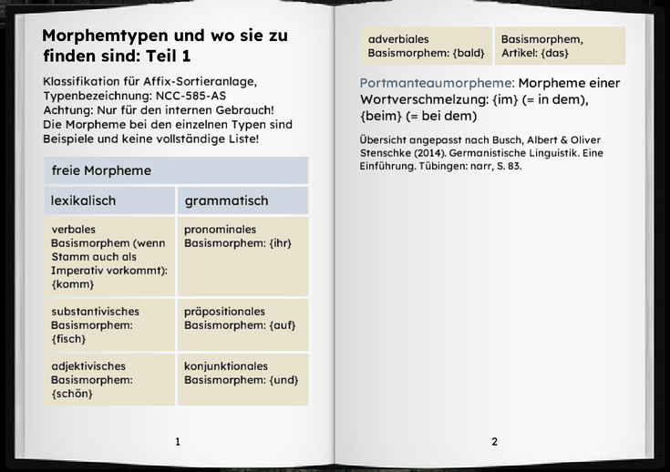

### 6. F-04: Wortarten-Kisten

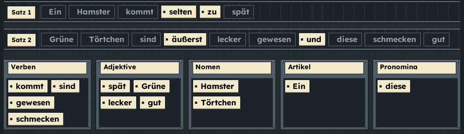

Ein Klick auf eine der Kisten (8) öffnet den Sortierdialog. Jedes flektierbare Wort kommt in die
Kiste seiner Wortart. Wörter ohne passende Kiste bleiben liegen.

| Satz | Wort | Kiste |
| --- | --- | --- |
| 1 | Ein | Artikel |
| 1 | Hamster | Nomen |
| 1 | kommt | Verben |
| 1 | selten | bleibt liegen |
| 1 | zu | bleibt liegen |
| 1 | spät | Adjektive |
| 2 | Grüne | Adjektive |
| 2 | Törtchen | Nomen |
| 2 | sind | Verben |
| 2 | äußerst | bleibt liegen |
| 2 | lecker | Adjektive |
| 2 | gewesen | Verben |
| 2 | und | bleibt liegen |
| 2 | diese | Pronomina |
| 2 | schmecken | Verben |
| 2 | gut | Adjektive |

Nach „Prüfen“ meldet der Dialog, wie viele Wörter in einer falschen Kiste liegen und wie viele
flektierbare Wörter noch fehlen. Ist alles richtig, gibt es das Achievement „Kistenweise Wortarten“.

Benutzt man jetzt die Flexionsmaschine (9), meldet sie, dass die Wortarten stimmen, aber noch
falsche Affixe aus A-12 ankommen. Weiter geht es in A-12.

### 7. A-12: Nahansicht der Anlage

Die Affix-Sortieranlage (11) steht oben in A-12. Jede ihrer Klickflächen (Anlage, Hebel,
Wartungsklappe, Schloss, Display) öffnet dieselbe Nahansicht. Darin sieht man das Display, den
Hebel, die Wartungsklappe, das elektronische Schloss mit seiner Frage und einen Ziffernblock.

Das Display zeigt immer den nächsten Schritt:

| Display | Nächster Schritt |
| --- | --- |
| FEHLER 204: Sortierfehler. Manuelle Inspektion erforderlich. Wartungsklappe öffnen. | Schloss öffnen |
| FEHLER 204: Sortierung blockiert. Affixe manuell sortieren. | Wartungsklappe anklicken |
| FEHLER 204: Affixe sortiert. Eingabeschächte befüllen. | Wartungsklappe anklicken |
| NEUSTART ERFORDERLICH | Hebel ziehen |
| STATUS: OK | erledigt |

### 8. A-12: Schloss der Wartungsklappe

Die Frage am Schloss lautet: „Wie viele unterschiedliche Typen von freien Morphemen (ohne das
Portmanteaumorphem) unterscheidet man?“

**Lösung: 8.** Im Handout „Morphemtypen und wo sie zu finden sind: Teil 1“ (Regal in F-04) stehen
acht Typen freier Morpheme:

| Lexikalisch | Grammatisch |
| --- | --- |
| verbales Basismorphem {komm} | pronominales Basismorphem {ihr} |
| substantivisches Basismorphem {Fisch} | präpositionales Basismorphem {auf} |
| adjektivisches Basismorphem {schön} | konjunktionales Basismorphem {und} |
| adverbiales Basismorphem {bald} | Basismorphem, Artikel {das} |

Die Portmanteaumorpheme ({im}, {beim}) zählen nicht mit. Wer 9 eingibt, sieht „FAST“ und den
Hinweis, dass das Portmanteaumorphem nicht zählt. Die 8 wird über den Ziffernblock eingegeben und
mit „OK“ bestätigt. Danach zeigt das Display „OFFEN“.

### 9. A-12: Affixe zerschneiden und sortieren

Ein Klick auf die Wartungsklappe öffnet den Wartungsmodus. Links stehen sieben Wörter. Ein Klick
zwischen zwei Buchstaben schneidet das Wort dort; ein zweiter Klick fügt es wieder zusammen. Die
abgeschnittenen Affixe kommen in die Fächer „Präfixe“, „Suffixe“ oder „Zirkumfixe“. Stämme bleiben
liegen. Wörter ohne Affix kommen ungeteilt ins Fach „Kein Affix“. Bei einem Zirkumfix kommen beide
Teile zu den Zirkumfixen.

| Wort | Schnitte | Fächer |
| --- | --- | --- |
| unbezahlbar | un · be · zahl · bar | un → Präfixe, be → Präfixe, bar → Suffixe |
| auf | keine | ganzes Wort → Kein Affix |
| geregnet | ge · regn · et | ge → Zirkumfixe, et → Zirkumfixe |
| Störung | Stör · ung | ung → Suffixe |
| sagten | sag · ten | ten → Suffixe |
| Schornstein | keine | ganzes Wort → Kein Affix |
| Hamster | keine | ganzes Wort → Kein Affix |

Auch die feineren Segmentierungen *ge · regne · t* (ge und t zu den Zirkumfixen) und
*sag · te · n* (te und n zu den Suffixen) werden akzeptiert.

Nach „Prüfen“ zeigt der Dialog, wie viele der sieben Wörter schon richtig bearbeitet sind, und
markiert sie. Stimmt alles beim ersten Prüfen, gibt es das versteckte Achievement „Schnitt sitzt“.

### 10. A-12: Eingabeschächte

Direkt danach öffnen sich die Eingabeschächte. Die freigelegten Affixe kommen in den Schacht
„Wortbildung“ (ein neues Wort entsteht) oder „Flexion“ (eine neue Wortform entsteht). Die
Unterscheidung steht in „Morphemtypen und wo sie zu finden sind: Teil 2“ im Regal von A-12 (12).

| Affix | Schacht |
| --- | --- |
| {un-} | Wortbildung |
| {be-} | Wortbildung |
| {-bar} | Wortbildung |
| {-ung} | Wortbildung |
| {-ten} | Flexion |
| {ge- ... -et} | Flexion |

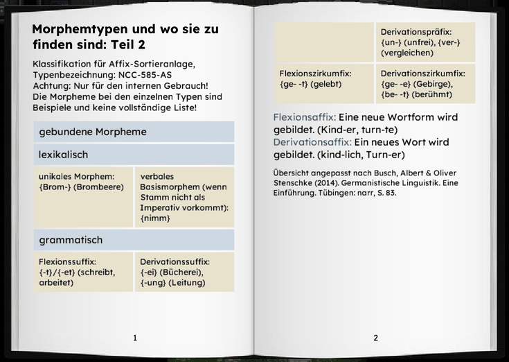

Wer die Eingabeschächte später erneut öffnen muss, klickt in der Nahansicht wieder auf die
Wartungsklappe.

### 11. A-12: Hebel

Nach den Eingabeschächten öffnet sich die Nahansicht mit dem Display „NEUSTART ERFORDERLICH“.

**Lösung:** Den Hebel mit der Maus gleichmäßig ganz nach unten ziehen und erst unten loslassen.
Der Zug muss **zwischen 0,6 und 2 Sekunden** dauern, etwa eine Sekunde passt. Zu schnell, zu
langsam oder zu früh losgelassen heißt: noch einmal. Ohne Maus hält man die Leertaste oder den Pfeil
nach unten gedrückt.

Danach zeigt das Display „STATUS: OK“, A-12 ist repariert, und es gibt das Achievement „Marie Kondo
wäre stolz auf dich“. Vor den Eingabeschächten klemmt der Hebel nur („Hnnnnnnnnnng!“).

### 12. F-04: Flexionsmaschine

Zurück in F-04 benutzt man die Flexionsmaschine (9). Stimmen die Kisten und ist A-12 repariert,
springt sie an. Der Bildschirm über der Maschine zeigt „BEREIT“, und es gibt das Achievement „In Form
gebracht“.

Ohne Handbuch rührt man die Maschine nicht an. Fehlt noch etwas, sagt die Maschine, ob die Kisten
oder A-12 noch nicht stimmen.

### 13. Kontrollraum: Neustart und Sicherheitsfrage

Im Kontrollraum zeigt der Computer jetzt „ALLE ANLAGEN BEREIT - NEUSTART MÖGLICH“. Im Tab
„[NEUSTART]“ steht „Produktionsfreigabe erteilt. Neustart möglich.“, und der Knopf „NEUSTART“ öffnet
die Sicherheitsfrage: „Aus wie vielen Morphemen besteht das Wort Überlegungen?“

**Lösung: 4.** *Überlegungen* = {über} + {leg} + {ung} + {en}: Präfix, Stamm, Wortbildungssuffix und
Flexionssuffix. Nach zwei falschen Antworten blendet der Computer genau diesen Tipp ein.

Nach der richtigen Antwort laufen die Abschlusstexte, und es gibt das Achievement „All systems
nominal“.

## Optionales

### Sicherungsbox

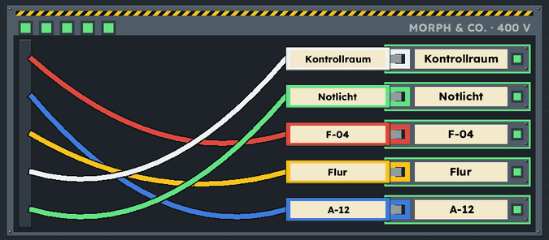

Rechts im Kontrollraum hängt die Sicherungsbox (6). Jemand hat alle Kabel herausgezogen. Jedes
Kabelende kommt in die Buchse mit derselben Beschriftung (Ziehen oder erst Kabel, dann Buchse
anklicken). Ein falsches Kabel springt zurück.

| Kabel (Farbe) | Buchse |
| --- | --- |
| F-04 (rot) | F-04 |
| A-12 (blau) | A-12 |
| Flur (gelb) | Flur |
| Kontrollraum (weiß) | Kontrollraum |
| Notlicht (grün) | Notlicht |

Stecken alle Kabel, geht über den Türen die grüne Notbeleuchtung an, und alle Spielenden bekommen das
versteckte Achievement „Unter Strom“. Der Knopf „Notbeleuchtung“ an der Konsole meldet danach, dass
die Notbeleuchtung an ist.

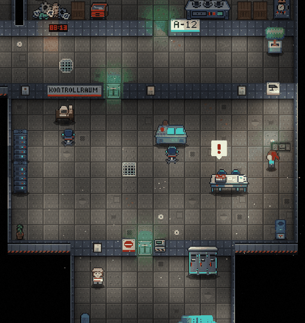

### Papierkorb

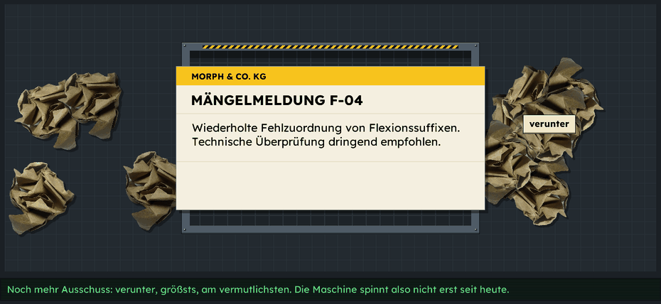

Unten rechts in F-04 steht der Papierkorb (10). Die zerknüllten Zettel zieht man aus dem Korb oder
wirft sie mit einem Klick hinaus. Drei Zettel zeigen weitere Ausschusswörter (*verunter*, *größsts*,
*am vermutlichsten*). Darunter liegt ein gefaltetes Blatt; ein Klick entfaltet die „Mängelmeldung
F-04“. Sie landet als Indiz im Questlog.

### Zirkumfixmontagestation

Im Haufen mit Krimskrams (13) unten links in A-12 liegen zerbrochene Zirkumfix-Teile. Auf die Frage,
ob man welche mitnehmen möchte, antwortet man „Ja“. Ins Inventar kommen sechs Teile: {ge}, {be},
{ig}, {ge}, {e}, {en}.

An der Zirkumfixmontagestation (14) legt man ein Teil ins linke und eins ins rechte Schälchen und
klickt „Montieren“:

| Links | Rechts | Zirkumfix | Beispiel |
| --- | --- | --- | --- |
| {ge} | {e} | {ge- ... -e} | Gebirge |
| {be} | {ig} | {be- ... -ig} | begierig |
| {ge} | {en} | {ge- ... -en} | gelesen |

Andere Paare passen nicht zusammen. Sind alle drei Zirkumfixe montiert, gibt es das Achievement
„Kombinatorisch 1A!“. Inventare werden nicht gespeichert; nach dem Laden eines Spielstands gibt der
Krimskrams die noch fehlenden Teile erneut heraus.

### Bücher und Hamsterwitze

| Regal | Buch | Inhalt |
| --- | --- | --- |
| F-04 | Das grüne Buch | Satzlehre, nicht relevant |
| F-04 | Die drei Nullmorpheme und die verlorene Form | Krimi mit leeren Seiten |
| F-04 | Handbuch: Flexionsmaschine FL3-10-9001 | Pflicht, Schritt 5 |
| F-04 | Evidentia erzählt | Geschichten aus der Fabrik |
| F-04 | Morphemtypen und wo sie zu finden sind: Teil 1 | freie Morpheme, Schritt 8 |
| A-12 | Syntagma - Ein Grammatik-Abenteuer | Abenteuerroman über Satzglieder |
| A-12 | Morphemtypen und wo sie zu finden sind: Teil 2 | gebundene Morpheme, Schritt 10 |
| A-12 | 100 anspruchsvolle Hamsterwitze für den täglichen Gebrauch | Hamsterbuch |

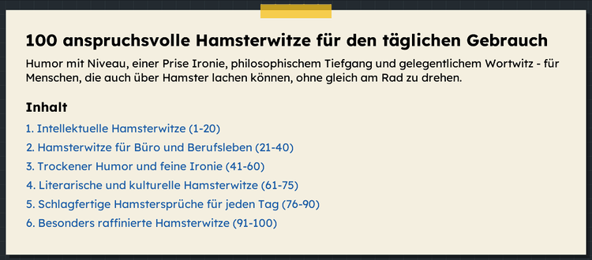

Das Hamsterbuch schlägt bei jedem Öffnen einen zufälligen Witz auf. Ein Witz wiederholt sich erst,
wenn alle 100 gezeigt wurden. Mit „Weiterblättern“ kommt man zum Inhaltsverzeichnis mit sechs
Kapiteln; ein Klick auf ein Kapitel springt dorthin. Die letzte Seite ist die Hamsterweisheit des
Tages. Wer alle acht Bücher aufschlägt, bekommt das versteckte Achievement „Leseratte“.

### Telefonnummern

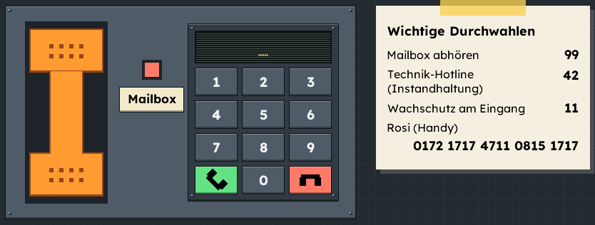

Das Telefon steht auf dem Tisch im Kontrollraum (5). Man wählt über den Ziffernblock und drückt „OK“.

| Nummer | Fundort | Ergebnis |
| --- | --- | --- |
| 99 | Zettel am Telefon | Mailbox mit der Nachricht vom Morgen (nur Sirenengeheul); das Ausrufezeichen über dem Telefon verschwindet |
| 42 | Zettel am Telefon | Technik-Hotline mit gestuften Hinweisen |
| 11 | Zettel am Telefon | Wachschutz am Eingang: niemand nimmt ab |
| 17 | Schichtplan auf dem Tisch | Rosi: nimmt nicht ab |
| 133, 204 | Fehlercodes am Computer | Bandansage mit Verweis auf die Technik-Hotline |
| jede andere | nirgends | „Kein Anschluss unter dieser Nummer.“ |

Wer 11 und 17 anruft, bekommt das versteckte Achievement „Niemand zu Hause“.

### Weitere Kleinigkeiten

- **Plakate:** vier im Kontrollraum, zwei in F-04, eines in A-12. Ein Klick zeigt das Plakat groß.
  Das linke Plakat in F-04 hängt über den Kisten. Man erreicht es durch den Durchgang zwischen der
  Flexionsmaschine und der Kiste „VERB“; er führt hinter die Kisten.
- **Topfpflanzen:** je eine im Kontrollraum, im Flur und in F-04.
- **Förderband in F-04:** Die vier Wortformen *du schreiben*, *Gemäuse*, *undes* und *zerkleinst*
  lassen sich einzeln ansehen und kommen als Indiz ins Questlog.
- Warnschild am Eingang, Kaffeetasse, Hinweisschild zur Videoüberwachung, Schichtuhr im Flur,
  Waschbecken und Spiegel im WC, Murmeltier-Bild und leere Kisten in A-12.

## Achievements

Die Achievements sind im Hauptmenü unter „Achievements“ zu sehen. Bei versteckten Achievements
stehen Name und Beschreibung dort erst, wenn sie freigeschaltet sind.

| Achievement | Bedingung | Versteckt |
| --- | --- | --- |
| Wuuuuuuh-o, wuuuuuh-o | Alarm an der Konsole ausschalten | nein |
| Kistenweise Wortarten | Wortarten-Kisten in F-04 richtig sortieren | nein |
| Marie Kondo wäre stolz auf dich | A-12 reparieren (Hebel nach den Eingabeschächten) | nein |
| Kombinatorisch 1A! | alle drei Zirkumfixe montieren | nein |
| In Form gebracht | Flexionsmaschine in F-04 reparieren | nein |
| All systems nominal | Produktion am Computer neu starten | nein |
| Schnitt sitzt | Affixe in A-12 beim ersten Prüfen richtig zerschneiden und sortieren | ja |
| Was hast du erwartet? | alle drei Topfpflanzen untersuchen | ja |
| Hnnnnnnnnnng | fünfmal am klemmenden Hebel ziehen, bevor die Eingabeschächte befüllt sind | ja |
| Niemand zu Hause | Wachschutz (11) und Rosi (17) anrufen | ja |
| Unter Strom | alle Kabel der Sicherungsbox einstecken | ja |
| Aushangkundig | alle sieben Plakate ansehen (Weg zum Plakat über den Kisten in F-04: siehe „Weitere Kleinigkeiten“) | ja |
| Leseratte | alle acht Bücher in den Regalen aufschlagen | ja |
| Mitarbeitende des Monats | alle anderen Achievements freischalten | nein |
