# Morph & Co. KG: Walkthrough

Die Wörterfabrik der Morph & Co. KG steht still. Die Spielenden holen ihre Sicherheitskarte aus dem
Spind, schalten den Alarm aus, lesen am Computer die Fehlermeldungen, verkabeln die Sicherungsbox,
reparieren die Affix-Sortieranlage A-12 und die Flexionsstraße F-04 und starten danach die
Produktion neu. Der Raum ist für ein bis zwei Personen gedacht (Fach: Germanistische Linguistik,
Morphologie).

Dieser Walkthrough beschreibt den kompletten Lösungsweg in der Reihenfolge, in der das Spiel ihn
freigibt, und danach alle optionalen Teile. F-04 und A-12 können in beliebiger Reihenfolge
repariert werden; nur die Flexionsmaschine in F-04 läuft erst, wenn A-12 wieder sortiert.

Start aus dem Repository: `./gradlew :game:runMorphCo`

## Übersichtskarte

| Nr. | Ort | Station |
| --- | --- | --- |
| 1 | Eingang | Spind und Lesegerät an der Tür zum Kontrollraum |
| 2 | Eingang | Schichtleitung (Hinweise) |
| 3 | Kontrollraum | Konsole (Alarm) |
| 4 | Kontrollraum | Computer (Produktionsleitsystem) |
| 5 | Kontrollraum | Tisch mit Telefon, Schichtplan und Kaffeetasse |
| 6 | Kontrollraum | Sicherungsbox |
| 7 | F-04 | Bücherregal |
| 8 | F-04 | Kisten für die Wortarten |
| 9 | F-04 | Flexionsmaschine |
| 10 | F-04 | Papierkorb (optional) |
| 11 | A-12 | Affix-Sortieranlage mit Hebel, Wartungsklappe und Schloss |
| 12 | A-12 | Bücherregal |
| 13 | A-12 | Haufen mit Krimskrams |
| 14 | A-12 | Zirkumfixmontagestation |

Vom Eingang führt eine Tür in den Kontrollraum. Die Tür gegenüber vom Eingang führt vom Kontrollraum
in den Flur. Vom Flur aus erreicht man F-04 (links), A-12 (rechts) und die Sanitäranlagen. Küche und
Lager sind verschlossen; sie gehören zur optionalen Nebenquest „Schokoriegel“. Zwischen F-04 und
A-12 gibt es zusätzlich eine Verbindungstür.

## Bedienung

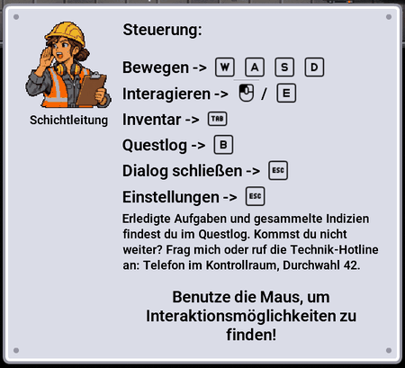

| Aktion | Taste |
| --- | --- |
| Bewegen | W, A, S, D |
| Interagieren | Mausklick auf das Objekt oder E |
| Inventar | Tab |
| Questlog | B |
| Dialog schließen | Esc oder „Schließen“ oben rechts |
| Einstellungen | Esc (wenn kein Dialog offen ist) |

- **Rätsel-Erklärungen:** Nach dem Intro fragt das Spiel, ob man mit oder ohne Erklärungen spielen
  will. Mit Erklärungen steht in jedem Rätsel unter der Aufgabe, wie man es bedient; ohne
  Erklärungen steht dort nur die Aufgabe. Die Zirkumfixmontagestation zeigt ohne Erklärungen auch
  keine Aufgabe und keine Schilder an der Teileleiste und am mittleren Schälchen. Im Multiplayer
  wählt jede Person für sich; ein fortgesetztes Spiel behält die Wahl.
- **Interagieren:** Fährt man mit der Maus über ein Objekt, mit dem man interagieren kann, bekommt
  es einen Umriss. Steht die Figur nah genug davor, wird der Umriss kräftiger und der Mauszeiger
  wechselt; dann reicht ein Klick.
- **Dialoge:** Texte bestätigt man mit „OK“. In Auswahldialogen (Bücherregale) klickt man die
  gewünschte Option an. An der Konsole klickt man direkt auf einen Knopf.
- **Zuordnen:** In den Kisten, den Affix-Fächern, den Eingabeschächten, an der
  Zirkumfixmontagestation und in der Sicherungsbox zieht man ein Teil mit der Maus an sein Ziel.
  Alternativ klickt man erst das Teil und dann das Ziel an. In den Sortierdialogen legt
  „Zurücksetzen“ alles zurück, „Prüfen“ lässt die Lösung prüfen.
- **Tastaturwege der Minigames:**
  - Lesegerät: Leertaste oder Pfeil nach rechts gedrückt halten und am Ende loslassen.
  - Hebel von A-12: Leertaste oder Pfeil nach unten gedrückt halten und unten loslassen.
  - Ziffernblöcke (Schloss von A-12, Telefon): Ziffern tippen, Enter bestätigt, Rücktaste löscht
    die letzte Ziffer.
  - Sicherheitsfrage am Computer: Zahl ins Feld tippen und mit Enter oder „Bestätigen“ absenden.
- **Multiplayer:** Eine Person wählt im Hauptmenü „Schicht beginnen“, die zweite „Spiel
  beitreten“. Fortschritt, Hinweise und Questlog gelten für beide.

## Hilfesystem

Falsche Eingaben kosten nichts außer Zeit. Die Sortierdialoge zeigen nach „Prüfen“, wie viele
Teile noch falsch liegen. Zusätzlich gibt es drei Hilfen.

### Schichtleitung

Die Schichtleitung steht am Eingang (2). Spricht man sie an, gibt sie einen Hinweis zum ersten
offenen Schritt. Hat man mit einer Halle begonnen, bezieht sich der Hinweis zuerst auf diese Halle.
Solange der Alarm läuft, versteht man sie kaum.

### Technik-Hotline

Am Telefon im Kontrollraum (5) erreicht man unter der Durchwahl **42** die Technik-Hotline. Sie hilft
bei demselben Schritt wie die Schichtleitung, in drei Stufen:

1. **Hinweis:** wohin man schauen muss.
2. **Tipp:** ein konkreter Ansatz.
3. **Lösung:** Vorher fragt die Hotline nach, ob man die Lösung wirklich hören will. „Nein“ kostet
   nichts. Danach wiederholt sie bei jedem Anruf die Lösung.

Was die Hotline sagt, erscheint im Telefon auf dem Bildschirm unter dem Apparat. Bei der Rückfrage
stehen dort die Knöpfe „Ja“ und „Nein“.

Jeder Anruf gibt die nächste Stufe. Ist der Schritt gelöst, beginnt der nächste wieder bei Stufe 1.
Die Stufen gelten für den ganzen Raum: Im Multiplayer macht die zweite Person dort weiter, wo die
erste aufgehört hat. Die Hotline hilft auch schon, solange der Alarm noch läuft. Auf sie weisen der
Steuerungsdialog zu Beginn, der Zettel am Telefon, die Bandansage unter den Fehlercodes 133 und 204
und die Schichtleitung hin.

### Questlog

Das Questlog (B) hat die Tabs „Auftrag“, „F-04 Flexionsstraße“, „A-12 Affix-Sortieranlage“,
„Indizien“ und „Hinweise“. Jede Aufgabe hat ein Kästchen, das abgehakt wird, sobald sie erledigt
ist. In den Tabs von F-04 und A-12 stehen die Schritte der Reparatur eingerückt unter „F-04
reparieren“ bzw. „A-12 reparieren“. Unter
„Indizien“ stehen gefundene Hinweise, etwa das Handbuch, ein Verweis auf die Morphemtypen-Bände im
Inventar und die Frage am Schloss.
Unter „Hinweise“ steht jede gehörte Stufe der Technik-Hotline, die neueste oben.

## Walkthrough

### 1. Eingang: Spind und Lesegerät

Nach dem Intro und der Frage nach den Erklärungen zeigt die Schichtleitung auf die Tür mit dem
Lesegerät. Die Sicherheitskarte liegt aber noch im Spind; fragt man die Schichtleitung, ruft sie
„KARTE! SPIND!“. Die Spinde stehen rechts neben der Tür mit dem Lesegerät (1); ein Klick auf die
Spinde gibt die Karte. Ohne Karte meldet das Lesegerät nur, dass die Karte fehlt. Es gibt eine Karte
für alle: Nach dem ersten Durchziehen bleibt die Tür offen, auch für die zweite Person.

Mit der Karte öffnet ein Klick auf das Lesegerät die Nahansicht. Die Karte wird von links nach
rechts durch den Schlitz gezogen.

**Lösung:** Die Karte in einem Zug ganz durchziehen und dafür **zwischen 0,3 und 1,2 Sekunden**
brauchen. Zu schnell, zu langsam oder nicht ganz durchgezogen heißt: noch einmal. Danach öffnet sich
die Tür zum Kontrollraum. Drinnen ist die Sirene nur noch halb so laut.

### 2. Kontrollraum: Alarm ausschalten

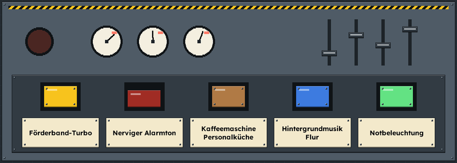

Die Konsole (3) steht oben im Kontrollraum, links neben dem Computer; der Tisch mit dem Telefon
steht darunter in der rechten Raumhälfte. Ein Klick öffnet ihre Nahansicht mit fünf beschrifteten
Knöpfen, Anzeigen, Reglern und der blinkenden Alarmlampe. Der Knopf „Nerviger Alarmton“ ist
eingedrückt und zittert. Ohne Maus wählen die Pfeiltasten oder Tab einen Knopf, Leertaste oder Enter
drückt ihn; mit dem Controller Steuerkreuz und A.

**Lösung:** Knopf **„Nerviger Alarmton“**. Die Sirene verstummt, und das Achievement „Wuuuuuuh-o,
wuuuuuh-o“ wird freigeschaltet. Die anderen Knöpfe („Förderband-Turbo“, „Kaffeemaschine
Personalküche“, „Hintergrundmusik Flur“, „Notbeleuchtung“) geben nur eine witzige Rückmeldung. Alle
Antworten erscheinen unten im Display der Konsole; sie bleibt offen, bis man sie schließt.

Solange der Alarm läuft, meldet der Computer nur: „Erst muss der Alarm aus.“

### 3. Kontrollraum: Computer

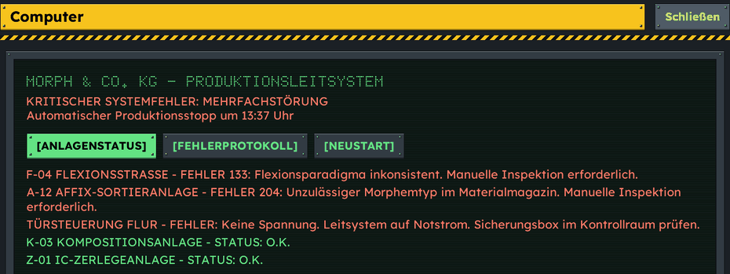

Am Computer (4) ist ein Bildschirmschoner aktiv; ein Klick beendet ihn. Der Tab „[ANLAGENSTATUS]“
meldet:

- **F-04 Flexionsstraße - Fehler 133:** Flexionsparadigma inkonsistent.
- **A-12 Affix-Sortieranlage - Fehler 204:** Unzulässiger Morphemtyp im Materialmagazin.
- **Türsteuerung Flur - Fehler:** Keine Spannung. Leitsystem auf Notstrom. Sicherungsbox im
  Kontrollraum prüfen.

Konsole, Computer und Telefon laufen auf der Notstrombatterie, die Tür zum Flur nicht. Sie bleibt
zu, bis die Sicherungsbox verkabelt ist (Schritt 4). Im Questlog stehen jetzt die Aufgabe zur
Sicherungsbox, „A-12 reparieren“ und „F-04 reparieren“. Im Tab „[NEUSTART]“ steht noch „Nicht
verfügbar.“ Die Produktionsfreigabe für den Neustart wird erst erteilt, wenn alle Anlagen repariert
sind.

Ebenfalls im Kontrollraum: das Telefon (5) mit der Mailbox (99) und der Technik-Hotline (42).

### 4. Kontrollraum: Sicherungsbox

Rechts im Kontrollraum hängt die Sicherungsbox (6). Jemand hat alle Kabel herausgezogen. Jedes
Kabelende kommt in die Buchse mit derselben Beschriftung (Ziehen oder erst Kabel, dann Buchse
anklicken; mit dem Controller Steuerkreuz und A). Ein falsches Kabel springt zurück.

| Kabel (Farbe) | Buchse |
| --- | --- |
| F-04 (rot) | F-04 |
| A-12 (blau) | A-12 |
| Flur (gelb) | Flur |
| Kontrollraum (weiß) | Kontrollraum |
| Notlicht (grün) | Notlicht |

Stecken alle Kabel, öffnet sich mit einem Türgeräusch die Tür zum Flur, an der Sicherungsbox geht
ein kleines grünes Notlicht an, und alle Spielenden bekommen das Achievement „Unter Strom“. Der
Computer meldet jetzt „Türsteuerung Flur - Status: O.K.“, und der Knopf „Notbeleuchtung“ an der
Konsole meldet, dass die Notbeleuchtung an ist. Die Box lässt sich auch schon vor dem Computer
verkabeln; die Tür geht trotzdem sofort auf.

### 5. Flur

Im Flur hängen Türschilder. Links geht es nach F-04, rechts nach A-12. Personalküche und
Lager sind abgeschlossen (Nebenquest, siehe „Optionales“). In den Sanitäranlagen gibt es nur ein
Waschbecken, einen Spiegel und eine blaue Tonne, die als Toilette dient. Die Reihenfolge der beiden
Hallen ist frei; dieser Walkthrough beginnt mit F-04, weil dort auch der Hinweis für das Schloss in
A-12 steht.

### 6. F-04: Handbuch und Morphemtypen Teil 1

In F-04 steht links die Flexionsmaschine (9), daneben die fünf Kisten (8). Von rechts läuft das Band
aus A-12 in die Maschine; unter ihr führt das Förderband mit vier fehlerhaften Wortformen in den
Papierkorb (10). Oben an der Wand steht das Bücherregal (7).

**Lösung:** Im Regal das Buch **„Handbuch: Flexionsmaschine FL3-10-9001“** lesen. Es sagt, dass nur
flektierbare Wortarten in die Maschine dürfen: **Nomen, Adjektive, Verben, Artikel und Pronomina**.
Adverbien, Partikeln, Konjunktionen und Präpositionen gehören nicht dazu. Erst danach lassen sich die
Kisten öffnen.

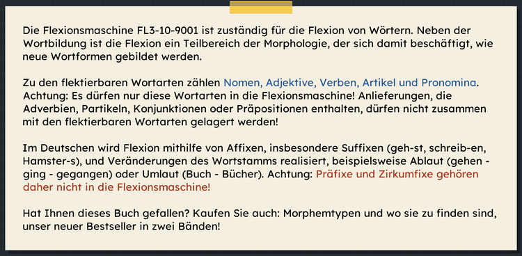

Im selben Regal steht **„Morphemtypen und wo sie zu finden sind: Teil 1“** mit den freien
Morphemen. Dieses Buch braucht man für das Schloss in A-12 (Schritt 9). Wer es anklickt, nimmt es
ins Inventar mit und kann es dort jederzeit mit E lesen. Teil 2 steht im Regal von A-12. Zieht man
im Inventar einen Band auf den anderen, werden beide zum Buch „Morphemtypen und wo sie zu finden
sind: Sammelband“ mit allen Morphemtypen auf einen Blick. Alle Spielenden nehmen ihr eigenes Exemplar mit.

### 7. F-04: Wortarten-Kisten

Ein Klick auf eine der Kisten (8) öffnet den Sortierdialog. Jedes flektierbare Wort kommt in die
Kiste seiner Wortart. Wörter ohne passende Kiste bleiben liegen.

| Satz | Wort | Kiste |
| --- | --- | --- |
| 1 | Ein | Artikel |
| 1 | Hamster | Nomen |
| 1 | kommt | Verben |
| 1 | immer | bleibt liegen |
| 1 | zu | bleibt liegen |
| 1 | spät | Adjektive |
| 2 | Grüne | Adjektive |
| 2 | Törtchen | Nomen |
| 2 | sind | Verben |
| 2 | äußerst | bleibt liegen |
| 2 | lecker | Adjektive |
| 2 | gewesen | Verben |
| 2 | und | bleibt liegen |
| 2 | diese | Pronomina |
| 2 | schmecken | Verben |
| 2 | gut | Adjektive |

Nach „Prüfen“ meldet der Dialog, wie viele Wörter in einer falschen Kiste liegen und wie viele
flektierbare Wörter noch fehlen. Ist alles richtig, gibt es das Achievement „Kistenweise Wortarten“.

Benutzt man jetzt die Flexionsmaschine (9), meldet sie, dass die Wortarten stimmen, aber noch
falsche Affixe aus A-12 ankommen. Weiter geht es in A-12.

### 8. A-12: Nahansicht der Anlage

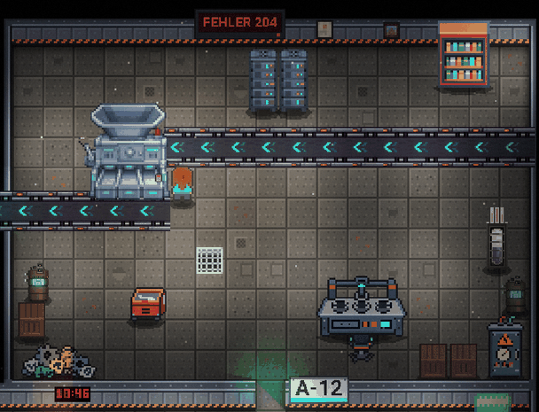

Die Affix-Sortieranlage (11) steht oben links in A-12. Jede ihrer Klickflächen (Anlage, Hebel,
Wartungsklappe) öffnet dieselbe Nahansicht. Darin sieht man das Display, den Hebel, die
Wartungsklappe, das elektronische Schloss mit seiner Frage und einen Ziffernblock. Der Bildschirm
mit „FEHLER 204“ an der Hallenwand zeigt dieselbe Statuszeile wie der Computer im Kontrollraum.

Das Display zeigt immer den nächsten Schritt:

| Display | Nächster Schritt |
| --- | --- |
| FEHLER 204: Sortierfehler. Manuelle Inspektion erforderlich. Wartungsklappe öffnen. | Schloss öffnen |
| FEHLER 204: Sortierung blockiert. Affixe manuell sortieren. | Wartungsklappe anklicken |
| FEHLER 204: Affixe sortiert. Eingabeschächte befüllen. | Wartungsklappe anklicken |
| FEHLER 204: Zirkumfix-Magazin leer. Zirkumfixe montieren. | Zirkumfixe montieren (Schritt 12) |
| NEUSTART ERFORDERLICH | Hebel ziehen |
| STATUS: OK | erledigt |

### 9. A-12: Schloss der Wartungsklappe

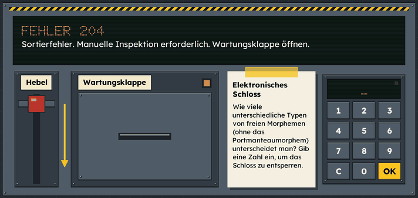

Die Frage am Schloss lautet: „Wie viele unterschiedliche Typen von freien Morphemen (ohne das
Portmanteaumorphem) unterscheidet man? Wenn du dir nicht sicher bist, findest du das passende
Buch irgendwo in der Fabrik.“

**Lösung: 8.** Im Band „Morphemtypen und wo sie zu finden sind: Teil 1“ (Regal in F-04) stehen
acht Typen freier Morpheme:

| Lexikalisch | Grammatisch |
| --- | --- |
| verbales Basismorphem {komm} | pronominales Basismorphem {ihr} |
| substantivisches Basismorphem {Fisch} | präpositionales Basismorphem {auf} |
| adjektivisches Basismorphem {schön} | konjunktionales Basismorphem {und} |
| adverbiales Basismorphem {bald} | Basismorphem, Artikel {das} |

Die Portmanteaumorpheme ({im}, {beim}) zählen nicht mit. Wer 9 eingibt, sieht „FAST“ und den
Hinweis, dass das Portmanteaumorphem nicht zählt. Die 8 wird über den Ziffernblock eingegeben und
mit „OK“ bestätigt. Danach zeigt das Display „OFFEN“.

### 10. A-12: Affixe zerschneiden und sortieren

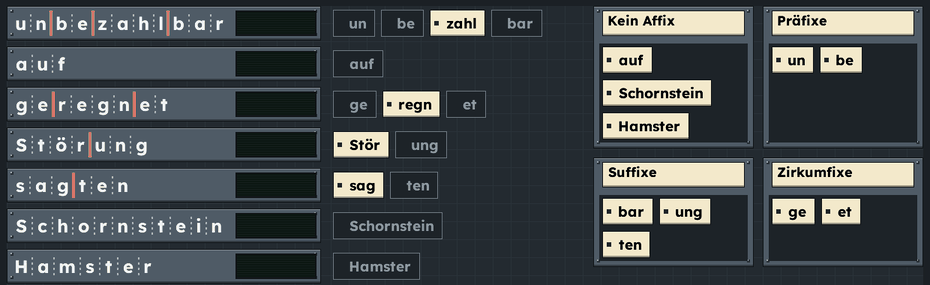

Ein Klick auf die Wartungsklappe öffnet den Wartungsmodus. Links stehen sieben Wörter. Ein Klick
zwischen zwei Buchstaben schneidet das Wort dort; ein zweiter Klick fügt es wieder zusammen. Ein
neuer Schnitt teilt nur das Stück, in dem er liegt; schon einsortierte Teile bleiben in ihren
Fächern. Die abgeschnittenen Affixe kommen in die Fächer „Präfixe“, „Suffixe“ oder „Zirkumfixe“.
Stämme bleiben liegen. Wörter ohne Affix kommen ungeteilt ins Fach „Kein Affix“. Bei einem Zirkumfix
kommen beide Teile zu den Zirkumfixen.

| Wort | Schnitte | Fächer |
| --- | --- | --- |
| unbezahlbar | un · be · zahl · bar | un → Präfixe, be → Präfixe, bar → Suffixe |
| auf | keine | ganzes Wort → Kein Affix |
| geregnet | ge · regn · et | ge → Zirkumfixe, et → Zirkumfixe |
| Störung | Stör · ung | ung → Suffixe |
| sagten | sag · ten | ten → Suffixe |
| Schornstein | keine | ganzes Wort → Kein Affix |
| Hamster | keine | ganzes Wort → Kein Affix |

Auch die feineren Segmentierungen *ge · regne · t* (ge und t zu den Zirkumfixen) und
*sag · te · n* (te und n zu den Suffixen) werden akzeptiert.

Nach „Prüfen“ zeigt der Dialog, wie viele der sieben Wörter schon richtig bearbeitet sind, und
markiert sie. Stimmt alles beim ersten Prüfen, gibt es das versteckte Achievement „Schnitt sitzt“.
Schließt man die Wartungsklappe, bleiben Schnitte und Fächer erhalten und sind beim nächsten Öffnen
wieder da.

### 11. A-12: Eingabeschächte

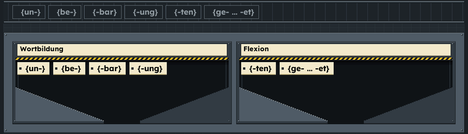

Direkt danach öffnen sich die Eingabeschächte. Die freigelegten Affixe kommen in den Schacht
„Wortbildung“ (ein neues Wort entsteht) oder „Flexion“ (eine neue Wortform entsteht). Die
Unterscheidung steht in „Morphemtypen und wo sie zu finden sind: Teil 2“ im Regal von A-12 (12).

| Affix | Schacht |
| --- | --- |
| {un-} | Wortbildung |
| {be-} | Wortbildung |
| {-bar} | Wortbildung |
| {-ung} | Wortbildung |
| {-ten} | Flexion |
| {ge- ... -et} | Flexion |

Wer die Eingabeschächte später erneut öffnen muss, klickt in der Nahansicht wieder auf die
Wartungsklappe.

### 12. A-12: Zirkumfixe montieren

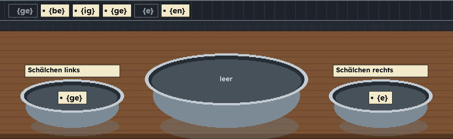

Fehler 204 hat die Zirkumfixe von A-12 zerlegt. Fehlen sie, zeigt das Display nach den
Eingabeschächten „FEHLER 204: Zirkumfix-Magazin leer. Zirkumfixe montieren.“, und der Hebel klemmt.
Die Teile liegen im Haufen mit Krimskrams (13) unten links in A-12. Ein Klick auf den Haufen öffnet
eine Nahansicht wie beim Papierkorb: Obenauf liegen Werkzeug, Handschuhe, Kaffeebecher und anderer
Kram. Ein Klick wirft ein Stück beiseite, man kann es auch wegziehen. Darunter kommen die
Zirkumfix-Teile zum Vorschein; ein Klick auf ein Teil steckt es ein. Ohne Maus wählen Tab oder die
Pfeiltasten links und rechts ein Stück, die Leertaste wirft es weg oder steckt das Teil ein; am
Controller wählt das Steuerkreuz, A wirft weg oder steckt ein. Insgesamt sind es sechs Teile: {ge},
{be}, {ig}, {ge}, {e}, {en}. Ist das Inventar voll, bleibt das Teil im Haufen. Zu zweit darf jede
Person wühlen, jedes Teil bekommt aber nur eine. Ist der Haufen leer, meldet ein Popup, dass dort
nur noch Krimskrams liegt.

An der Zirkumfixmontagestation (14) stehen drei Schälchen auf einer Werkbank. Man legt ein Teil ins
linke und eins ins rechte Schälchen und klickt „Montieren“:

| Links | Rechts | Zirkumfix | Beispiel |
| --- | --- | --- | --- |
| {ge} | {e} | {ge- ... -e} | Gebirge |
| {be} | {ig} | {be- ... -ig} | begierig |
| {ge} | {en} | {ge- ... -en} | gelesen |

Die Station bleibt dabei offen: Das montierte Zirkumfix erscheint im mittleren Schälchen, die
Meldung steht unten im Fenster, und man kann gleich das nächste Paar montieren. Andere Paare passen
nicht zusammen. Nach dem dritten Zirkumfix meldet die Station, dass sie die Zirkumfixe gleich ins
Zirkumfix-Magazin von A-12 schiebt, und es gibt das Achievement „Kombinatorisch 1A!“. Sind die
Eingabeschächte schon befüllt, zeigt das Display jetzt „NEUSTART ERFORDERLICH“. Die Zirkumfixe
lassen sich auch vor den Eingabeschächten montieren; dann folgt auf die Eingabeschächte direkt der
Neustart.

Die Zirkumfix-Teile werden nicht gespeichert; nach dem Laden eines Spielstands gibt der Krimskrams
die noch fehlenden Teile erneut heraus, im Multiplayer auch die Teile einer Person, die das Spiel
verlassen hat. Die Morphemtypen-Bände und den Sammelband bekommen dagegen alle Spielenden nach dem
Laden zurück.

### 13. A-12: Hebel

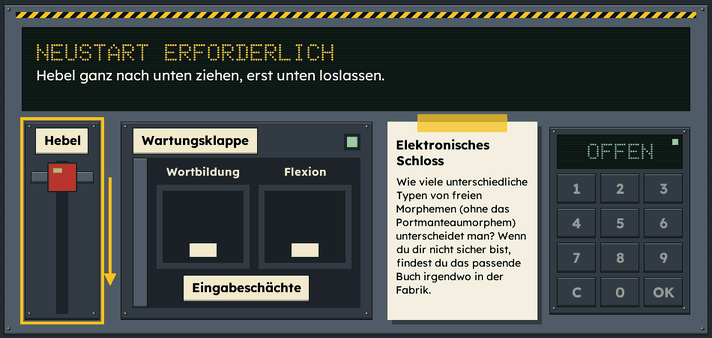

Sind die Eingabeschächte befüllt und die Zirkumfixe montiert, zeigt das Display der Nahansicht
„NEUSTART ERFORDERLICH“.

**Lösung:** Den Hebel mit der Maus ganz nach unten ziehen und erst unten loslassen. Das Tempo spielt
keine Rolle. Wer zu früh loslässt, muss noch einmal ziehen. Ohne Maus hält man die Leertaste oder
den Pfeil nach unten gedrückt.

Danach zeigt das Display „STATUS: OK“, A-12 ist repariert, und es gibt das Achievement „Marie Kondo
wäre stolz auf dich“. Solange Eingabeschächte oder Zirkumfix-Magazin leer sind, klemmt der Hebel
und gibt nur ein Stück nach.

### 14. F-04: Flexionsmaschine

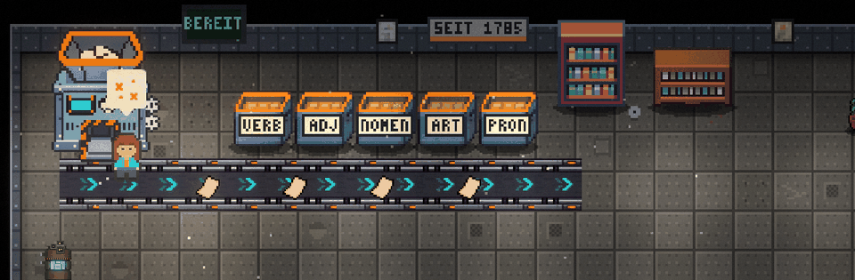

Zurück in F-04 benutzt man die Flexionsmaschine (9). Stimmen die Kisten und ist A-12 repariert,
springt sie an. Der Bildschirm über der Maschine zeigt „BEREIT“, und es gibt das Achievement „In Form
gebracht“.

Ohne Handbuch rührt man die Maschine nicht an. Fehlt noch etwas, sagt die Maschine, ob die Kisten
oder A-12 noch nicht stimmen.

### 15. Kontrollraum: Neustart und Sicherheitsfrage

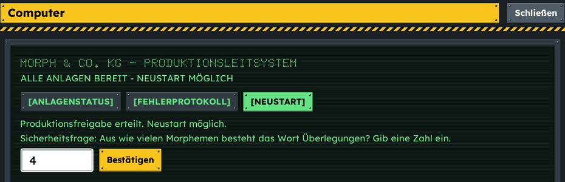

Im Kontrollraum zeigt der Computer jetzt „ALLE ANLAGEN BEREIT - NEUSTART MÖGLICH“. Im Tab
„[NEUSTART]“ steht „Produktionsfreigabe erteilt. Neustart möglich“, und der Knopf „NEUSTART“
öffnet die Sicherheitsfrage: „Aus wie vielen Morphemen besteht das Wort Überlegungen?“

**Lösung: 4.** *Überlegungen* = {über} + {leg} + {ung} + {en}: Präfix, Stamm, Wortbildungssuffix und
Flexionssuffix. Nach zwei falschen Antworten blendet der Computer genau diesen Tipp ein.

Nach der richtigen Antwort wird der Bildschirm schwarz. In grüner Terminalschrift tippt der Computer
nacheinander „Korrekt! Initiiere Neustart ...“, „A-12: online“, „Sensoren: online“, „F-04: online“
und „All systems nominal“, dahinter blinkt der Cursor. Danach laufen die Abschlusstexte. Sie zeigen
die Statuszeilen noch einmal, auch für Mitspieler*innen, die nicht am Computer stehen. Dazu gibt es
das Achievement „All systems nominal“.

## Optionales

### Papierkorb

Am Ende des Förderbands unter der Flexionsmaschine steht der Papierkorb (10). Fährt man mit der Maus
über einen zerknüllten Zettel, zeigt er eines der Ausschusswörter *verunter*, *größsts* oder *am
vermutlichsten*. Mit einem Klick wirft man ihn aus dem Korb, oder man zieht ihn beiseite. Unter den
obersten drei Zetteln liegt ein gefaltetes Blatt; ein Klick entfaltet die „Mängelmeldung F-04“. Sie
landet als Indiz im Questlog. Ohne Maus wählen Tab oder die Pfeiltasten links und rechts einen Zettel
oder das Blatt, die Leertaste wirft den Zettel hinaus oder entfaltet das Blatt.

### Bücher und Hamsterwitze

| Regal | Buch | Inhalt |
| --- | --- | --- |
| F-04 | Das grüne Buch | Satzlehre, nicht relevant |
| F-04 | Die drei Nullmorpheme und die verlorene Form | Krimi mit leeren Seiten |
| F-04 | Handbuch: Flexionsmaschine FL3-10-9001 | Pflicht, Schritt 6 |
| F-04 | Evidentia erzählt | Geschichten aus der Fabrik |
| F-04 | Morphemtypen und wo sie zu finden sind: Teil 1 | freie Morpheme, Schritt 9 |
| A-12 | Syntagma - Ein Grammatik-Abenteuer | Abenteuerroman über Satzglieder |
| A-12 | Morphemtypen und wo sie zu finden sind: Teil 2 | gebundene Morpheme, Schritt 11 |
| A-12 | 100 anspruchsvolle Hamsterwitze für den täglichen Gebrauch | Hamsterbuch |

Das Hamsterbuch schlägt bei jedem Öffnen einen zufälligen Witz auf. Ein Witz wiederholt sich erst,
wenn alle 100 gezeigt wurden. Mit dem Pfeil „>“ blättert man zum Inhaltsverzeichnis mit sechs
Kapiteln; ein Klick auf ein Kapitel springt dorthin. Die letzte Seite ist die Hamsterweisheit des
Tages. Wer alle acht Bücher aufschlägt, bekommt das versteckte Achievement „Leseratte“.

### Schokoriegel

Am Westende des Flurs steht ein Snackautomat. Die kleine Nebenquest ist versteckt und für den
Hauptweg nicht nötig. Sie erscheint erst im Questlog (Reiter „Schokoriegel“), wenn man den Automaten
zum ersten Mal benutzt.

1. **Automat:** In Fach B4 steckt der Lieblingsschokoriegel, aber man hat kein Geld.
2. **Schichtleitung (2):** Im Gespräch gibt es jetzt neben „Wie komme ich weiter?“ die Frage nach
   Geld. Ihr Portemonnaie liegt im Spind, und der Schlüssel ist vermutlich im Lager.
3. **Lager:** Die verschlossene Tür im Flur nennt die Durchwahl des Hausmeisters: 66. Am
   Telefon im Kontrollraum (5) wählt man 66, und der Hausmeister schließt aus der Ferne auf. Ruft
   man ihn an, bevor man die Schichtleitung um Geld gebeten hat, fragt er nur, wer einen schickt,
   und die Tür bleibt zu.
4. **Spindschlüssel:** liegt im Lager zwischen den Kisten.
5. **Schichtleitung:** Man gibt ihr den Schlüssel zurück („Ich habe deinen Spindschlüssel
   gefunden.“). Das Portemonnaie ist leer, aber sie schließt die Personalküche auf.
6. **Geldschein:** liegt in der Küche unter dem Tisch neben der Kaffeekasse.
7. **Automat:** Er frisst den Schein, und der Riegel bleibt schräg an der Scheibe hängen. Die
   Nebenquest ist damit erledigt, und es gibt das versteckte Achievement „Klemmt“.

Schlüssel und Geldschein gehören dem ganzen Team: Wer sie zuerst aufhebt, nimmt sie für alle aus
dem Level. Alle Schritte werden gespeichert.

### Telefonnummern

Das Telefon steht auf dem Tisch im Kontrollraum (5). Man wählt über den Ziffernblock und drückt den
grünen Hörer; der rote Hörer legt auf und löscht die Ziffern. Die Ansage erscheint auf dem
Bildschirm unter dem Telefon, danach kann man gleich die nächste Nummer wählen; ein weiterer Druck
auf den grünen Hörer wählt dieselbe Nummer noch einmal.

| Nummer | Fundort | Ergebnis |
| --- | --- | --- |
| 99 | Zettel am Telefon | Mailbox mit der Nachricht vom Morgen (nur Sirenengeheul); das Ausrufezeichen über dem Telefon verschwindet |
| 42 | Zettel am Telefon | Technik-Hotline mit gestuften Hinweisen |
| 11 | Zettel am Telefon | Wachschutz am Eingang: niemand nimmt ab |
| 17 | Schichtplan auf dem Tisch | Rosi: nimmt nicht ab |
| 0172 1717 4711 0815 1717 | Zettel am Telefon | Rosis Handy: nimmt auch nicht ab |
| 133, 204 | Fehlercodes am Computer | Bandansage mit Verweis auf die Technik-Hotline |
| 66 | Tür des Lagers | Hausmeister: schließt das Lager auf, sobald man die Schichtleitung um Geld gebeten hat (Nebenquest Schokoriegel) |
| jede andere | nirgends | „Kein Anschluss unter dieser Nummer.“ |

Wer den Wachschutz (11) und Rosi (17 oder Handy) anruft, bekommt das versteckte Achievement
„Niemand zu Hause“.

### Weitere Kleinigkeiten

- **Plakate:** vier im Kontrollraum, zwei in F-04, eines in A-12. Ein Klick zeigt das Plakat groß.
  Das linke Plakat in F-04 hängt an der Rückwand links neben dem Schild „Seit 1785“, über der Lücke
  zwischen den Kisten „ADJ“ und „NOMEN“.
- **Topfpflanzen:** je eine im Kontrollraum, im Flur und in F-04.
- **Ausgangstür:** im kleinen Vorraum unter dem Eingang; dahinter ist draußen etwas Grün zu sehen.
  Die Tür geht nie auf. Ein Klick zeigt nur den Gedanken, dass man die Fabrik nicht im Stich lassen
  kann und der Bus ohnehin erst später fährt.
- **Förderband in F-04:** Die vier Wortformen *du schreiben*, *Gemäuse*, *undes* und *zerkleinst*
  lassen sich einzeln ansehen und kommen als Indiz ins Questlog.
- Warnschild am Eingang, Kaffeetasse, Hinweisschild zur Videoüberwachung, Schichtuhr im Flur,
  Kaffeemaschine in der Küche (nennt die Uhrzeit), Waschbecken, Spiegel und die blaue Tonne als
  Toilette im WC, Murmeltier-Bild und leere Kisten in A-12.

## Achievements

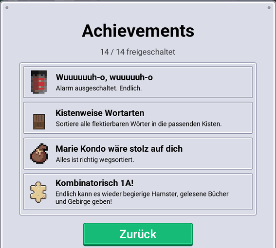

Die Achievements sind im Hauptmenü unter „Achievements“ zu sehen. Bei versteckten Achievements
stehen Name und Beschreibung dort erst, wenn sie freigeschaltet sind.

| Achievement | Bedingung | Versteckt |
| --- | --- | --- |
| Wuuuuuuh-o, wuuuuuh-o | Alarm an der Konsole ausschalten | nein |
| Unter Strom | Sicherungsbox verkabeln | nein |
| Kistenweise Wortarten | Wortarten-Kisten in F-04 richtig sortieren | nein |
| Marie Kondo wäre stolz auf dich | A-12 reparieren (Hebel nach Eingabeschächten und Zirkumfixen) | nein |
| Kombinatorisch 1A! | alle drei Zirkumfixe montieren | nein |
| In Form gebracht | Flexionsmaschine in F-04 reparieren | nein |
| All systems nominal | Produktion am Computer neu starten | nein |
| Schnitt sitzt | Affixe in A-12 beim ersten Prüfen richtig zerschneiden und sortieren | ja |
| Was hast du erwartet? | alle drei Topfpflanzen untersuchen | ja |
| Hnnnnnnnnnng | fünfmal am klemmenden Hebel ziehen, solange Eingabeschächte oder Zirkumfix-Magazin leer sind | ja |
| Niemand zu Hause | Wachschutz (11) und Rosi (17 oder Handy) anrufen | ja |
| Aushangkundig | alle sieben Plakate ansehen | ja |
| Leseratte | alle acht Bücher in den Regalen aufschlagen | ja |
| Klemmt | den Schokoriegel im Snackautomaten bezahlen (Nebenquest) | ja |
| Mitarbeitende des Monats | alle anderen Achievements freischalten | nein |
