# System Recovery – Schritt-für-Schritt-Anleitung

## Das Terminal

Im Terminal gibst du Befehle und Code ein – ähnlich wie in einem Code-Editor. Dabei kannst du Text, Zahlen und verschiedene Zeichen verwenden und miteinander kombinieren.

- **Löschen:** Über die Schaltfläche „Löschen“ entfernst du die gesamte Eingabe im Terminal.

- **Senden:** Über die Schaltfläche „Senden“ lässt du deine Eingabe überprüfen.

- **Rückmeldung:** Unten links siehst du, ob deine Eingabe akzeptiert oder abgelehnt wurde.

- **Verlauf:** Jede akzeptierte Eingabe wird rechts im Bereich „Akzeptierte Eingaben“ gespeichert und ist dort später wieder einsehbar.

- **Terminal schließen:** Mit der Esc-Taste oder über das X oben rechts kannst du das Terminal jederzeit schließen.

## Das Hilfesystem

Das Hilfesystem passt seine Hinweise automatisch an den Rätselschritt an, an dem du gerade arbeitest. Sobald das Telefon klingelt, steht ein Hinweis zu diesem Schritt bereit. Die Hinweise werden mit jeder Stufe konkreter:

1. **Orientierung**
   - Ein allgemeiner Hinweis, der erklärt, worum es in diesem Rätselschritt geht.

2. **Ansatz**
   - Ein konkreterer Hinweis, der einen möglichen Lösungsansatz aufzeigt.

3. **Beinahe Lösung**
   - Ein sehr konkreter Hinweis, der dich unmittelbar an die Lösung heranführt.

4. **Lösung**
   - Die vollständige Lösung oder die genaue Eingabe beziehungsweise Aktion, die erforderlich ist.

Ein Hinweis gilt nicht bereits dann als verwendet, wenn du ihn dir anzeigen lässt. Erst wenn du ihn bestätigst, wird er eingesetzt und im entsprechenden Tab des Questlogs gespeichert. Im Questlog findest du Dialoge, Hinweise und eingegebene Lösungen. Einen Hinweis lediglich zu öffnen oder zu lesen, verändert deinen Rätsel-Fortschritt nicht.

Das Hilfesystem löst keine Aufgaben automatisch und greift nicht direkt in den Rätsel-Fortschritt ein. Es unterstützt dich lediglich mit Hinweisen zum aktuellen Schritt. Wenn du keine Hilfe benötigst, kannst du das Rätsel ohne Hinweis fortsetzen.

### Übersichtskarte

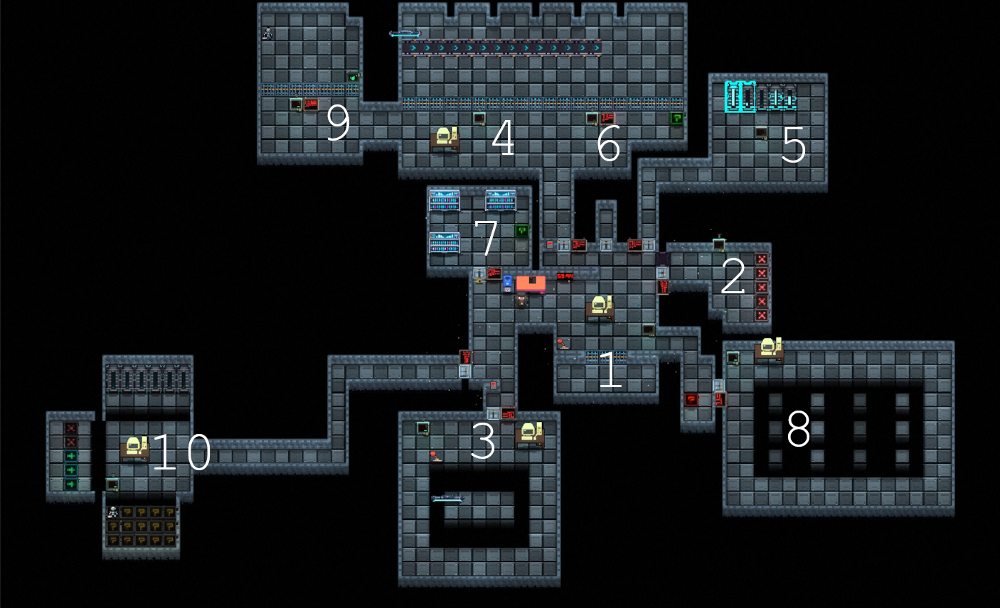

Die Zahlen auf der Karte kennzeichnen die Räume, in denen sich die jeweiligen Rätsel befinden. Sobald ein Raum abgeschlossen ist, färbt sich die Tafel vor diesem Raum grün.

## Walkthrough

### 1. Energieversorgung

Lege zunächst im Terminal ein Array mit Platz für fünf Energieeinträge an:

```
int[] energie = new int[5];
```

Wichtig: Das Array muss zuerst ohne Werte angelegt und anschließend separat befüllt werden. Du darfst die fünf Werte also nicht direkt bei der Erstellung des Arrays angeben.

```
energie[0] = 40;
energie[1] = 10;
energie[2] = 80;
energie[3] = 30;
energie[4] = 60;
```

Betätige anschließend den Hebel, um die Batterie zu materialisieren. Du benötigst sie, um Raum 2 („Modulspeicher“) freizuschalten. Lege die Batterie dazu in die Batteriebox oberhalb der Tür zu Raum 2.

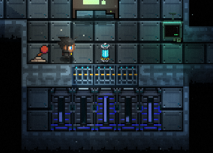

*Abbildung: Die Batterie nach dem Betätigen des Hebels.*

### 2. Modulspeicher

Lege im Terminal ein String-Array an, das fünf Module aufnehmen kann. Den Namen kannst du frei wählen. Wichtig ist, dass du bei allen folgenden Befehlen denselben Namen verwendest. Beide folgenden Varianten sind beispielsweise zulässig:

```
String[] module = new String[5];
```

oder auch:

```
String[] abc = new String[5];
```

Befülle das Array anschließend im Terminal mit den folgenden Werten:

```
module[0] = "CPU";
module[1] = "RAM";
module[2] = "GPU";
module[3] = "SSD";
module[4] = "NETWORK"
```

Offenbar ist eines der Module defekt. Untersuche die Sockel, indem du mit jedem einzelnen interagierst. Dabei stellst du fest, dass der GPU-Sockel defekt ist. Setze den entsprechenden Eintrag deshalb im Terminal auf `null`:

```
module[2] = null;
```

Gib nun mithilfe von `display.show()` die Länge des Arrays aus. Verwende dazu die Eigenschaft `.length`. Alle folgenden Varianten sind zulässig:

```
display.show(module.length);
```

oder

```
int size = 0;
size = module.length;
display.show(size);
```

oder

```
int size = module.length;
display.show(size);
```

Lies anschließend am Display des Modulspeichers in Raum 2 den Code für Raum 3 ab: **0502**. Er besteht aus der Arraykapazität **5** und dem Index **2** des ausgefallenen GPU-Moduls.

### 3. Inventarscanner

Zähle nun, wie viele Module tatsächlich vorhanden sind. Lege dazu einen Zähler an und durchlaufe das Array:

```
int count = 0;
for (String entry : module) {
   if (entry != null) {
      count++;
   }
}
display.show(count);
```

Die Variablennamen `entry` und `count` kannst du frei wählen. Achte darauf, den korrekten Namen des Modul-Arrays zu verwenden und den Zähler erst nach der Schleife auszugeben.

Sobald du den Code korrekt im Terminal eingegeben hast, betätige den Hebel im Raum, um die Schleife auszuführen. Interagiere danach mit dem Display auf der linken Raumseite. Es zeigt eine Kapazität von **5** und **4 belegte Module** an. Daraus ergibt sich der Code **0504**, mit dem du Raum 4 öffnen kannst.

### 4. Transportlager

In Raum 4/6 findest du auf dem Display über dem Terminal die Reihenfolge der Pakete und ihre Gewichte. Lege diese Werte im Terminal in einem Array ab. Das geht beispielsweise so:

```
int[] pakete = {15, 40, 20, 60, 30};
```

oder

```
int[] pakete = new int[]{15, 40, 20, 60, 30};
```

Lass den Roboter die Pakete anschließend mithilfe einer `for`-Schleife einsammeln. Der Befehl `collect()` benötigt dabei keinen Parameter:

```
for (int i = 0; i < pakete.length; i++) {
   roboter.collect();
}
```

Auch die Länge kann vorher gespeichert werden:

```
int paketAnzahl = pakete.length;
for (int i = 0; i < paketAnzahl; i++) {
   roboter.collect();
}
```

### 5. Datenspeicher

Die nächste Aufgabe findet in Raum 5 statt und wird ohne Terminal gelöst. Sortiere die Sicherheitswerte des Datenspeichers, indem du mit dem Display in der Raummitte interagierst. Vergleiche die angezeigten Werte und tausche sie bei Bedarf, bis sie von links nach rechts aufsteigend angeordnet sind. Die Werte werden hinter dem Display dargestellt.

Die Ausgangsreihenfolge lautet: **90, 30, 10, 70, 50**

Dir werden jeweils zwei Werte zum Vergleichen angezeigt. Entscheide, ob sie vertauscht werden müssen: Ist der linke Wert größer als der rechte, tausche die beiden Werte. Ist der linke Wert kleiner oder gleich dem rechten, lasse sie unverändert. Eine falsche Entscheidung setzt den Ablauf zurück.

Das Ziel ist die Reihenfolge **10, 30, 50, 70, 90**. Sobald die Werte korrekt sortiert sind, erscheint neben der Sortierstation ein USB-Stick.

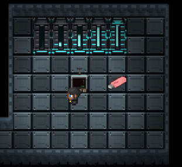

### 6. Bubble-Sort-Maschine

Der USB-Stick enthält den Programmcode, den du für das nächste Rätsel benötigst. Kehre zum Computer in Raum 4/6 zurück und lege den Sortierchip ein.


Wähle anschließend oben den Tab „Sortierchip“ anstelle des Terminals aus.

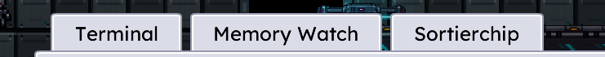

Trage im Bubble-Sort-Programm nur noch die folgende Bedingung ein:

```
array[j] > array[j + 1]
```

Lade den Chip anschließend über das abgebildete Display hoch, damit er für die Ausführung bereitsteht.

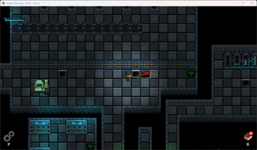

Setze den Chip an diesem Display ein und starte die Sortierung. Sobald der Algorithmus abgeschlossen ist, gehe zum Archiv in Raum 7.

### 7. Datenarchiv

Um Raum 7 zu betreten, musst du die Tür mit dem silbernen Schlüssel aufschließen. Deine Aufgabe im Datenarchiv ist es, drei Arrays mit den vorgegebenen Werten anzulegen.

Die Knoten befinden sich an den folgenden Stellen und enthalten die jeweils dargestellten Informationen:

| Ort des Knoten                                 | Inhalt des Knotens                       |
| ---------------------------------------------- | ---------------------------------------- |
| 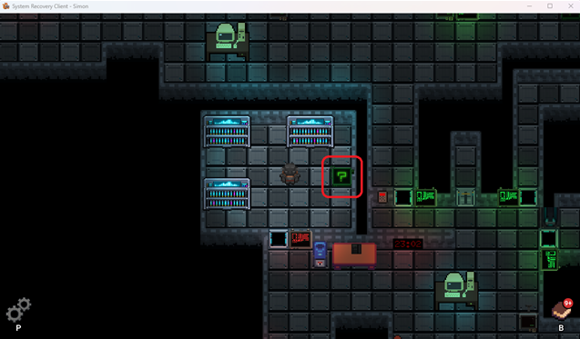 | 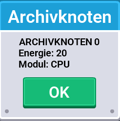 |
| 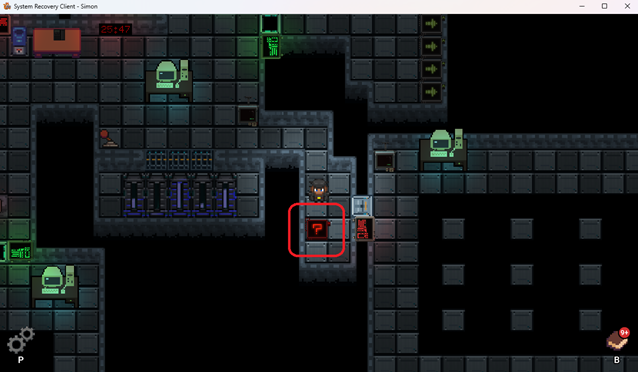 | 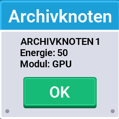 |
| 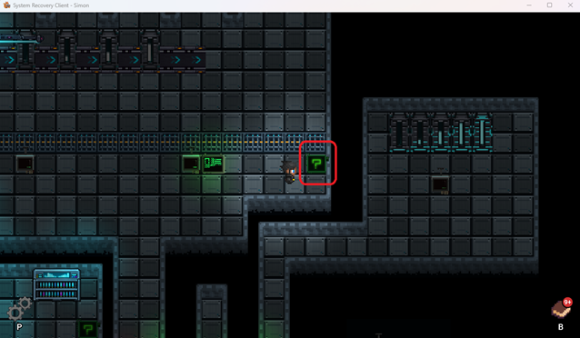 | 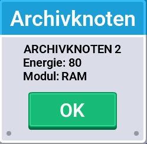 |

Die Farbe zeigt an, ob ein Knoten aktiv ist. Daraus ergeben sich die folgenden Arrays:

```
int[] energie = {20, 50, 80};
String[] module = {"CPU", "GPU", "RAM"};
boolean[] aktiv = {true, false, true};
```

Erstelle diese Arrays anschließend im Terminal des Computers. Die Reihenfolge der drei Deklarationen sowie die Reihenfolge der Werte innerhalb der jeweiligen Arrays kann variieren. Auch die explizite Java-Schreibweise mit `new ...[]{...}` wird akzeptiert.

Danach öffnet sich die Tür zu Raum 8.

### 8. Zweidimensionaler Speicher

Lege in Raum 8 zunächst ein zweidimensionales Array an. Die erforderlichen Dimensionen kannst du dem Display neben dem Computer entnehmen:

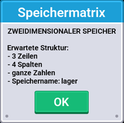

Daraus leitet sich folgendes Array ab:

```
int[][] lager = new int[3][4];
```

Sobald du die Arraystruktur im Terminal angelegt hast, färben sich die Felder in der Raummitte. Weise dem Array anschließend die passenden Werte zu. Auf dem Display neben dem Terminal siehst du, welcher Feldfarbe welcher Wert entspricht:

- **Cyanfarbenes Feld:** Wert 1
- **Oranges Feld:** Wert 2
- **Magentafarbenes Feld:** Wert 3

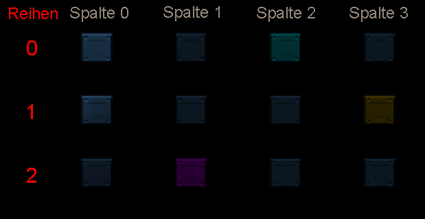

Daraus ergeben sich die folgenden Codezeilen:

```
lager[0][2] = 1;
lager[1][3] = 2;
lager[2][1] = 3;
```

Die Reihenfolge der drei Zuweisungen ist beliebig. Du kannst auch einen anderen Arraynamen verwenden, musst diesen dann aber in allen Befehlen einheitlich beibehalten. Sobald das Array vollständig befüllt ist, erscheinen die Datenobjekte und der Ortungschip automatisch.

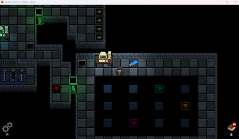

Mit diesem Ortungschip kannst du nun am Computer in Raum 4/6 programmieren.

### 9. Suchroboter

Ergänze im Ortungschip den folgenden Teil der Bedingung:

```
map[row].length
```

Der Code sollte danach wie folgt aussehen:

```
for (int row = 0; row < map.length; row++) {
   for (int column = 0; column < map[row].length; column ++) {
      if (map[row][column] == 1) {
         roboter.collect();
      }
   }
}

```

Die äußere Schleife durchläuft die Zeilen der Matrix, während die innere Schleife die Spalten der jeweils aktuellen Zeile durchläuft. Übertrage das Programm anschließend auf den Ortungschip und setze ihn in das Display in Raum 9 ein. Der Roboter fährt daraufhin die Matrix ab und bringt das Systemkern-Zugriffsmodul zurück.

### 10. Systemkern

Sammle den Systemkern ein und verbinde ihn mit einem Computer. Daraufhin erscheint dort ein neuer Tab namens „Systemkern“.

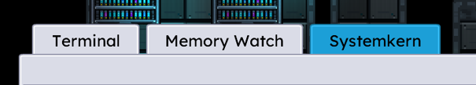

Öffne den Tab „Systemkern“ und klicke auf „Freigeben“, um die letzte Spielphase zu starten. Nimm anschließend den Anruf von ECHO entgegen und gehe in Raum 10. Dort warten drei weitere Rätsel auf dich. Die jeweiligen Aufgabeninformationen findest du auf dem Display im Raum.

#### 10.1 Zahlenfeld

Sortiere die Zahlen mithilfe des Bubble-Sort-Algorithmus in aufsteigender Reihenfolge. Auf dem Display siehst du, dass das Array `array` heißt und folgende Werte enthält: **42, 8, 23, 4, 16, 15**.

Daraus lässt sich dann folgende Lösung zusammensetzen:

```
for (int i = 0; i < array.length - 1; i++) {
   for (int j = 0; j < array.length - 1 - i; j++) {
      if (array[j] > array[j + 1]) {
         int temp = array[j];
         array[j] = array[j + 1];
         array[j + 1] = temp;
      }
   }
}
```

Das Ergebnis der Sortierung lautet: **4, 8, 15, 16, 23, 42**

Alternativ kannst du die Länge des Arrays vorab in einer Variablen speichern.

#### 10.2 Modulstatus

Zähle nun, wie viele Module belegt sind. Auf dem Display findest du dazu die folgenden Informationen: Das Array heißt `modules` und enthält die Werte **CPU, GPU, RAM, leer, leer**.

Daraus lässt sich dann folgende Lösung zusammensetzen:

```
int count = 0;
for (String module : modules) {
   if (module != null) {
      count++;
   }
}
```

Das Ergebnis: **3 Module** sind belegt.

#### 10.3 Modulraster

In diesem Rätsel soll der Suchroboter für jede Zelle den Befehl `roboter.collect()` ausführen. Das Display zeigt ein Array namens `map` mit **3 Zeilen und 5 Spalten**. Farbe und Wert der einzelnen Zellen spielen keine Rolle – jede Zelle muss erfasst werden.

Hier genügt es, das Array `map` mit zwei verschachtelten Schleifen zu durchlaufen:

```
for (int row = 0; row < map.length; row++) {
   for (int column = 0; column < map[row].length; column++) {
      roboter.collect();
   }
}
```

Alternativ kannst du die Dimensionen in Variablen zwischenspeichern:
int rows = map.length;

```
for (int row = 0; row < rows; row++) {
   int columns = map[row].length;
   for (int column = 0; column < columns; column++) {
      roboter.collect();
   }
}
```

Wichtig: Ermittle die Spaltenanzahl für jede Zeile anhand von `map[row].length`.

### 11. Letzte Aufgabe

Wenn du alle Rätsel gelöst hast, interagiere erneut mit dem Computer. Dort findest du nun einen neuen Tab namens „Systemzustand“.

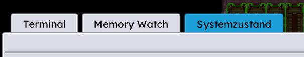

Trage dort die Werte ein, die auf dem Display angezeigt werden:

Energiewerte: **4, 8, 15, 16, 23, 42**

Belegte Module: **3**

Erfasste Rastermodule: **15**

In der Abschlussmaske ist kein weiterer Java-Code erforderlich. Beantworte anschließend den letzten Anruf von ECHO. Danach öffnet sich der Aufzug. Sobald du einsteigst, ist das Spiel abgeschlossen.

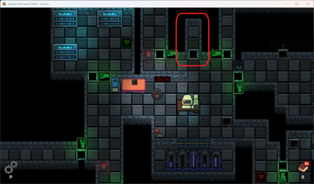
