# Soulweaver – Walkthrough

Der Soulweaver Escaperoom, besteht aus vier Akten. Dieser Walkthrough ist in vier Abschnitten aufgeteilt, jeder Teil für den entsprechenden Akt. In jeden Abschnitt wird erst die Akt Mechanik beschrieben, dann das Rätsel und die Lösung.

## Akt 1

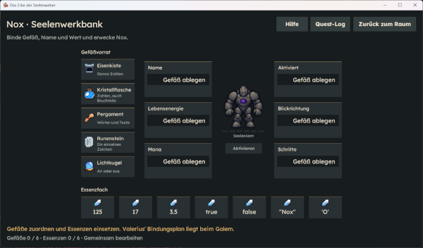

### Mechanik

Im ersten Akt muss der Spieler den Golem aktivieren. Hierzu muss der Spieler die passenden Gefäße und Essenzen finden und dann im Golem UI, welches man mit einer Interaktion öffnet, in die passenden Felder ziehen. Wie der Spieler die Bindungen zu binden hat, findet der Spieler in einem Buch auf der rechten Seite im Raum.

### Walkthrough

Zunächst muss der Spieler die beiden Kisten öffnen, in denen sich die Gefäße und Essenzen befinden. Die Essenzenkiste befindet sich im oberen linken Bereich des Raumes, während die Gefäßekiste oben rechts steht.
Anschließend muss der Spieler mit dem Golem interagieren, um das Rätsel zu starten. Zuerst zieht er die richtigen Gefäße in die dafür vorgesehenen Felder. Danach müssen die passenden Essenzen den jeweiligen Gefäßen zugeordnet werden.
Hier ist eine Gesamtlösung, welches Gefäß und Essenz in welches Feld müssen:

| Name des Feldes | Gefäß           | Essenz |
| --------------- | --------------- | ------ |
| Name            | Pergament       | "Nox"  |
| Lebensenergie   | Eisenkiste      | 125    |
| Mana            | Kristallflasche | 3.5    |
| Aktiviert       | Lichtkugel      | True   |
| Blickrichtung   | Runenstein      | ‘O‘    |
| Schritte        | Eisenkiste      | 17     |

Danach kann der Spieler den Golem aktivieren. Akt 1 ist nun abgeschlossen.

## Akt 2

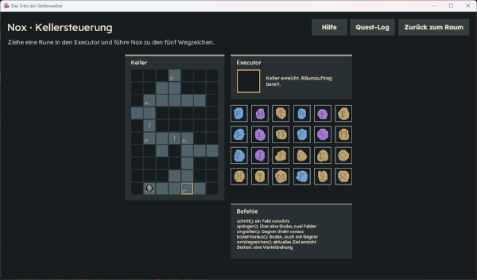
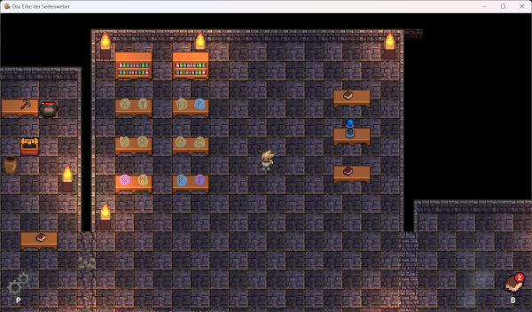
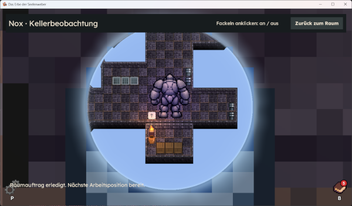

### Mechanik

Der Spieler muss alle 24 Runen einsammeln und anschließend dem Golem Nox helfen, den Keller zu durchqueren, damit dieser den Schutt an der Torwinde beseitigen kann. Dazu muss der Spieler die korrekten Runen in der richtigen Reihenfolge in den Executor ziehen. Nox führt ausschließlich die Befehle der Rune aus, die sich gerade im Executor befindet.
Interagiert der Spieler mit dem Buch "Nox Kellersteuerung", öffnet sich eine Übersichtskarte des Kellers, auf der Nox aktuelle Position angezeigt wird.

Zusätzlich gibt es den Bereich "Befehle", in dem die Funktionen der einzelnen Runen erklärt werden. Auch alle bisher eingesammelten Runen werden dort aufgelistet. Das Ziel dieses Rätsels ist es, Nox mithilfe der richtigen Runen zur Torwinde zu führen. Bei einer falschen Eingabe kehrt Nox zum letzten Checkpoint zurück.Dieser entspricht seiner Position unmittelbar vor der Ausführung des fehlerhaften Befehls.

Um Nox bei seiner Bewegung zu beobachten, kann der Spieler mit der Kellerbeobachtung interagieren. Dort erhält er Einblick in Noxs aktuelle Umgebung im Keller und kann seinen Fortschritt verfolgen.

### Walkthrough

Zunächst sollten alle Runensteine eingesammelt werden. Dies ist zwar nicht zwingend erforderlich, erleichtert den weiteren Ablauf jedoch, da der Spieler nach dem Ausprobieren einer Rune nicht erneut nach einem passenden Runenstein suchen muss. Insgesamt gibt es 24 Runensteine, von denen sich zwei im ersten Raum und die übrigen im zweiten Raum befinden. Sobald alle Runensteine eingesammelt wurden, muss der Spieler die Runen in der vorgegebenen Reihenfolge in den Executor einsetzen. Bereits verwendete Runen können anschließend direkt im selben UI zur Seite gelegt werden, um Platz für die nächste Rune zu schaffen.

Die richtige Reihenfolge der Runen:

| Reihenfolge | Icon                                | Bildausschnitt des Codes            |
| ----------- | ----------------------------------- | ----------------------------------- |
| 1           |  | 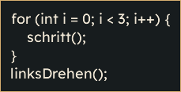 |
| 2           |  | 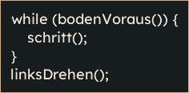 |
| 3           |  | 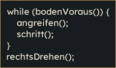 |
| 4           |  | 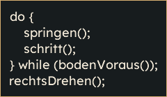 |
| 5           |  | 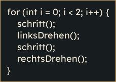 |

Wenn die Befehle in der richtigen Reihenfolge ausgeführt wurden, räumt der Golem die Torwinde frei, diese wird dabei leider beschädigt. Nun wird der Pfad für Akt 3 freigeschalten.

## Akt 3

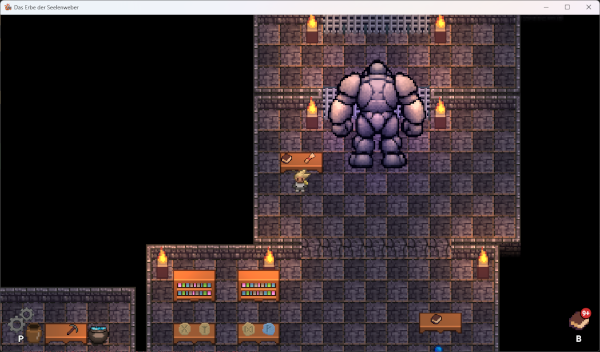
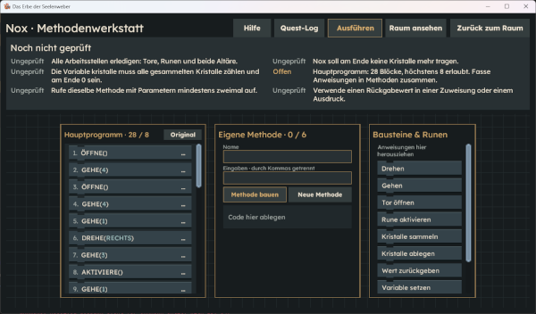

### Mechanik

In diesem Akt muss der Spieler mehrere Befehle zu Methoden zusammenfassen. Dafür nutzt er das Buch im neu zugänglichen Raum, der sich durch die Beschädigung der Torwinde geöffnet hat.
Nach dem Öffnen des Buches erscheint ein UI mit drei Fenstern. Links befindet sich das Fenster "Hauptprogramm", in dem die vorhandenen Befehle aufgelistet sind, die zu Methoden zusammengefasst werden müssen. In der Mitte liegt das Fenster "Eigene Methoden", in dem der Spieler die Befehle zu eigenen Methoden kombiniert. Rechts befindet sich das Fenster "Bausteine & Runen", in dem die erstellten Methoden und weitere Bausteine verfügbar sind.

Um eine Methode zu erstellen, zieht der Spieler die gewünschten Befehle aus dem Fenster "Hauptprogramm" in das mittlere Fenster "Eigene Methoden". Sobald eine Methode erstellt wurde, erscheint sie im Fenster "Bausteine & Runen" und kann dort weiterverwendet werden.

### Walkthrough

Hier werden die Befehle aufgelistet, die zu einer Methode zusammengebaut werden müssen.

| Schritt 1                                 |                                                                                                                                                                                                                     |
| ----------------------------------------- | ------------------------------------------------------------------------------------------------------------------------------------------------------------------------------------------------------------------- |
| 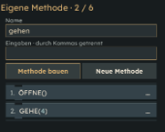 | Die ersten zwei Befehle sind im Hauptprogramm mehrmals vorhanden. Diese kann man in einer Methode zusammenfassen.  Der Name dieser Methode ist nicht wichtig. Danach kann die Methode zweimal eingesetzt werden. |

| Schritt 2                                 |                                                                                                                                                                                                                                                                                                                                                                                           |
| ----------------------------------------- | ----------------------------------------------------------------------------------------------------------------------------------------------------------------------------------------------------------------------------------------------------------------------------------------------------------------------------------------------------------------------------------------- |
| 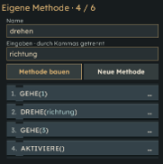 | Die nächsten vier Befehle sind wieder identisch, bis auf dem Parameter im "drehe" Befehl. Trotzdem können diese zusammengefasst werden.  Wichtig dabei ist, die Richtung bei "drehe" als Parameter zu übergeben. Der Name des Parameters ist nicht wichtig.  Danach kann die Methode zweimal eingesetzt werden, den ersten Aufruf mit RECHTS und den zweiten mit LINKS als Eingabe. |

| Schritt 3                                     |                                                                                                                                                                                                                                                                                                                                                                                                                                                                                        |
| --------------------------------------------- | -------------------------------------------------------------------------------------------------------------------------------------------------------------------------------------------------------------------------------------------------------------------------------------------------------------------------------------------------------------------------------------------------------------------------------------------------------------------------------------- |
| 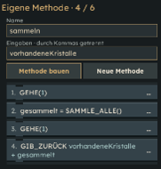     | Die nächsten vier Befehle sind identisch, nur wird die Variable "kristalle" immer wieder überschrieben.  Hier können diese Befehle in eine Methode gepackt werden und anstatt einer Zuweisung kann die Methode den Wert der Addierung zurückgeben.   Nun muss nur noch im Hauptprogramm der zurückgegeben Wert in einer Variable gespeichert werden.  Dies kann eingestellt werden, indem der Baustein ins Hauptprogramm geschoben wird und dann auf die "..." gedrückt wird. |
| 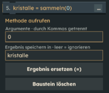  | Dies wird dann so aussehen und muss so eingestellt werden.   Der erste Aufruf wird mit 0 als Parameter aufgerufen, da hier noch keine Kristalle gesammelt wurden und das Ergebnis wird in kristalle gespeichert.                                                                                                                                                                                                                                                                    |
| 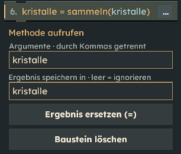 | Der zweite Aufruf findet mit den bisher gesammelten Kristallen statt und speichert diese in der gleichen Variable.   <b>Hier ist es wichtig das die Kristall Variable ab nun immer den gleichen Namen hat.</b>                                                                                                                                                                                                                                                                      |

| Schritt 4                                 |                                                                                                                                                                                                                                                                                                                                                                                                                                                                                                                                                                                                                          |
| ----------------------------------------- | ------------------------------------------------------------------------------------------------------------------------------------------------------------------------------------------------------------------------------------------------------------------------------------------------------------------------------------------------------------------------------------------------------------------------------------------------------------------------------------------------------------------------------------------------------------------------------------------------------------------------ |
| 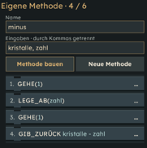 | Die letzten acht Befehle sollten nun aus zwei identischen Gruppen mit jeweils vier Befehlen bestehen. Lediglich der Wert X unterscheidet sich bei den Befehlen "lege_ab(X)" und "kristalle = kristalle - X".   Die Methode erhält nun zwei Parameter: die aktuell vorhandene Anzahl an Kristallen und die Anzahl der Kristalle, die abgelegt werden sollen.   Der Befehl "kristalle = kristalle - X" wird durch "GIB_ZURÜCK kristalle - zahl" ersetzt. Anschließend kann die Methode zweimal aufgerufen werden.  Beim ersten Aufruf werden "kristalle, 3" als Parameter übergeben, beim zweiten "kristalle, 5". |

| Schritt 5                                 |                                                                                                                                           |
| ----------------------------------------- | ----------------------------------------------------------------------------------------------------------------------------------------- |
| 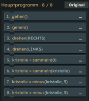 | Dies ist nun das Hauptprogramm, nach dem alle Schritte befolgt wurden. Nun kann der Code ausgeführt werden und der Akt ist abgeschlossen. |

## Akt 4

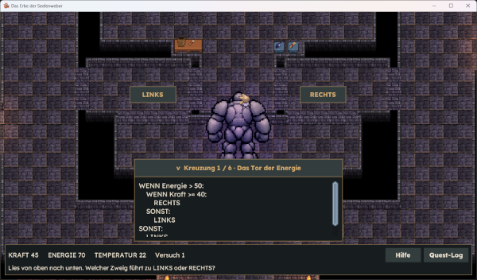

### Mechanik

Der Spieler muss anhand der vorhandenen Daten im UI den Code Schritt für Schritt nachvollziehen und entscheiden, ob der Golem nach links oder rechts gehen soll. Bei einer falschen Eingabe kehrt der Golem zum Startpunkt zurück und die Variante des Rätsels ändert sich.

### Walkthrough

Es gibt 4 Varianten des Rätsels, die Lösung hängt von den Werten im ersten Raum ab:

| Variante | Kraft | Energie | Temperatur |
| -------- | ----- | ------- | ---------- |
| 1        | 45    | 70      | 22         |
| 2        | 50    | 90      | 21         |
| 3        | 35    | 70      | 16         |
| 4        | 40    | 75      | 27         |

| Lösungen zu den jeweiligen Varianten |        |        |        |        |        |        |
| ------------------------------------ | ------ | ------ | ------ | ------ | ------ | ------ |
| **Variante 1**                       | Rechts | Rechts | Links  | Links  | Rechts | Links  |
| **Variante 2**                       | Rechts | Links  | Rechts | Rechts | Links  | Links  |
| **Variante 3**                       | Links  | Links  | Rechts | Rechts | Rechts | Links  |
| **Variante 4**                       | Rechts | Rechts | Links  | Links  | Links  | Rechts |
