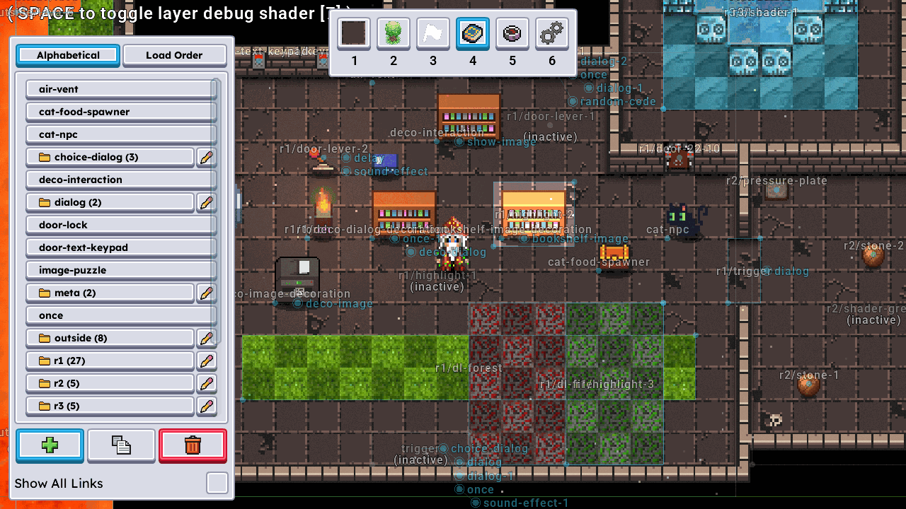

The DEER-Editor (DEER = Digital Educational Escape Room) is Dungeon's built-in level editor. It
runs inside the game: you paint the map, place decorations and named points, and connect
ready-made building blocks (prefabs) such as doors, levers, keypads, card readers, pressure
plates, dialogs, sorting boards and item spawners into puzzles. In the code it is still called
the level editor (`LevelEditorSystem`, `feature.leveleditor`).

<p align="center"></p>

## Start

Each escape room has its own task:

``` bash
./gradlew :game:runTheLastHourLevelEditor
./gradlew :game:runSystemRecoveryLevelEditor
./gradlew :game:runSoulweaverLevelEditor
./gradlew :game:runGameOfGamesLevelEditor
```

The task starts the room with the `--leveleditor` flag. Server and client then run in a single
process and the editor opens with the level. In the main menu of these rooms, `F4` also shows a
hidden *Level Editor* button.

## Editing and playing

-   `F4` switches between the editor and normal play. While the editor is active, the hero does
    not move; switch back with `F4` to try out what you built.
-   `W`, `A`, `S`, `D` move the camera (hold `Shift` to move faster), the mouse wheel zooms.
-   `Space` toggles a debug shader that shows the drawing layers.
-   The panel on the left lists the controls of the current mode.

## Modes

The number keys `1` to `6` select the mode:

| Key | Mode | What it does |
| --- | --- | --- |
| `1` | Tiles | Place and remove level tiles (floor, wall, pit, door and more) |
| `2` | Decos | Place, pick up and delete decorations |
| `3` | Points | Place, move and delete named points that the room code refers to |
| `4` | Prefabs | Place prefab instances, edit their settings and link them to each other |
| `5` | Start Tiles | Set the tiles where players spawn |
| `6` | Settings | Resize and shift the level, choose the save path, switch auto-save |

## Saving

Auto-save is on by default: every change is written to `levels/<room>/` in the repository root.
Git ignores this folder, so the room itself does not change yet. To take your changes into the
room, copy the saved file to `game/assets/levels/<room>/` and replace the level file there.

In the *Settings* mode you can change the save path or turn auto-save off; then a *Save Level*
button appears, which also copies the level to the clipboard.
