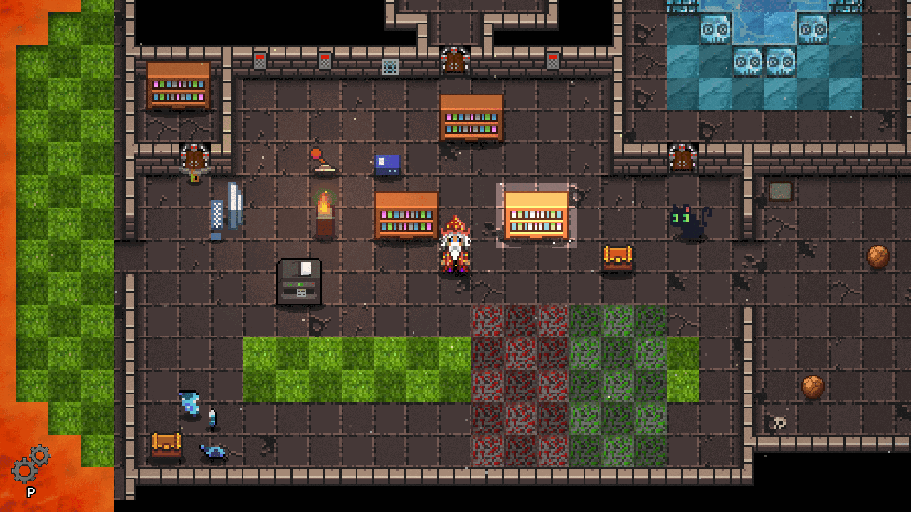

# Game of Games

A room in progress for 1–2 players. There is no release yet. From the repository:
`./gradlew :game:runGameOfGames`

## For players

Between unfinished board-game manuals and dusty rulebooks, one note stands out: "Every game has
rules. The interesting part is finding out who wrote them." Explore rooms full of levers,
keypads, pressure plates and stones to push, study the rule board, and watch out when the water
starts to rise. Play as the wizard or the hunter, alone or with a partner.

## For educators

Game of Games does not have a subject or learning objectives yet. The room serves as a test bed
for the building blocks of future escape rooms: the level editor prefabs (doors, levers,
keypads, pressure plates, pushable stones, water) and the node canvas behind the rule board.

## Technical notes

-   **Play from source:** `./gradlew :game:runGameOfGames`
-   **Multiplayer:** one player chooses *Host Game*, the other *Join Game*.
-   **Level editor:** `./gradlew :game:runGameOfGamesLevelEditor`. Debug systems and the level
    editor are switched on while `GameOfGames.DEBUG_MODE` is `true`.
-   Level: `game/assets/levels/gameOfGames/`
