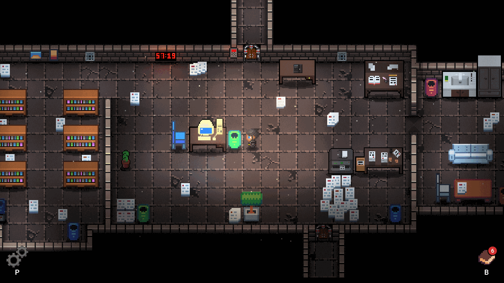

# The Last Hour

A cybersecurity escape room for 1–2 players. From the repository:
`./gradlew :game:runTheLastHour`

## For players

Dr. Elias Mertens, lead security researcher at Ciphera Labs, has been missing for 72 hours. His
office is dark, his computer is locked, and somewhere between the bookshelves, the scattered
papers and a handful of USB sticks lies the trail of his last project. Step into his office,
get his PC running and follow his messages. Then the phone rings. Not every voice on the line
and not every message on the screen can be trusted. A clock on the wall counts down 60 minutes:
solve the case alone or with a partner, and get out before the time runs out.

## For educators

**Subject:** cybersecurity. The room is a Digital Educational Escape Room (DEER) for one or two
players; the in-game countdown is 60 minutes. There is no separate concept document yet, so the
following summary is based on the room's content.

The puzzles build on each other and bring everyday security topics into play:

-   **Manipulation and social engineering:** e-mails and phone calls press for urgent action or
    claim authority. Players have to judge which sources they can trust.
-   **Access control:** a locked computer, a login screen and an electronic door lock.
-   **Encoding and decryption:** credentials and door codes are hidden in encoded form and have
    to be decoded with the right manual.
-   **Removable media:** several USB sticks lie around the office, and not every one of them is
    harmless.

The room works as a self-contained session in class or as a self-study task. With the players'
consent, the game records attempts and progress in a tracking file on the computer hosting the
game; without consent, it runs without tracking.

## Technical notes

-   **Play a release:** download `TheLastHour.jar` (or the Windows or Linux package) from the
    [releases]. Start the JAR with a double-click or with `java -jar TheLastHour.jar`. It needs
    the [Java SE Development Kit 25 LTS]; check your installation with `java --version`.
-   **Play from source:** `./gradlew :game:runTheLastHour`
-   **Multiplayer:** one player chooses *Host Game*, the other *Join Game* and enters the
    host's IP address. A dedicated server starts with `./gradlew :game:runTheLastHourServer`.
    Both devices must be on the same local network; play over the internet and local co-op on
    one device are not supported yet.
-   **Level editor:** `./gradlew :game:runTheLastHourLevelEditor`
-   **Tests:** `./gradlew :game:test --tests 'rooms.lasthour.*'`
-   Texts: `game/assets/language/theLastHour/` (English and German)

  [releases]: https://github.com/Dungeon-CampusMinden/Dungeon/releases?q=The+Last+Hour
  [Java SE Development Kit 25 LTS]: https://jdk.java.net/25/
