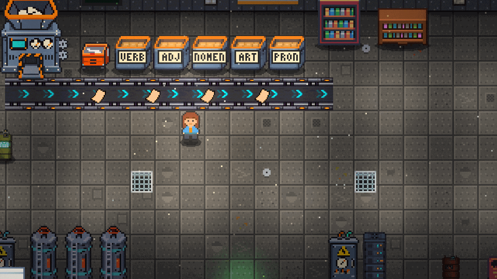
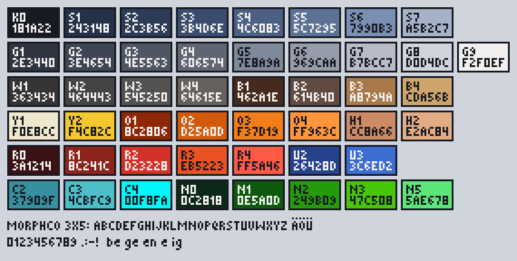

# Morph & Co. KG: Die Wörterfabrik

A morphology escape room for 1 or 2 players. There is no release yet. From the repository:
`./gradlew :game:runMorphCo`

## For players

For centuries, the word factory of Morph & Co. KG has produced every German word. This morning
the machines went haywire: prefixes end up on the wrong words, inflections get mixed up, and
quality control has stopped the production. When you arrive, the alarm is so loud that the shift
supervisor can only shout "ZU LAUT. ALARM!" at you. Silence the alarm, find out what is broken,
repair the affix sorting unit and the inflection line and restart the production before
communication collapses. Play alone or with a partner.

## For educators

| | |
| --- | --- |
| Subject | German linguistics (Germanistische Linguistik), morphology |
| Contents | inflectable word classes, prefixes, suffixes and circumfixes, word formation vs. inflection, free morphemes, morpheme analysis |
| Players | 1 or 2, alone or in multiplayer |
| Duration | Planned for 30 to 45 minutes; not yet confirmed in playtests |

Players take their security card from the locker, switch off the alarm in the control room, learn
from the production control system that two machines are broken and plug the cables of the fuse box
back in so the door to the corridor has power. In any order, they sort the words of two sentences
into crates for the inflectable word classes, cut words into morphemes, sort the affixes, tell word
formation from inflection and put broken circumfixes back together for the affix sorting unit, and
finally answer a question about the morphemes of *Überlegungen* to restart the production. The
handout "Morphemtypen und wo sie zu finden sind" is split into two books, one in each hall, so both
halls depend on each other. Optional extras: a wastepaper basket, phone numbers to try, a book with
100 hamster jokes and a hidden side quest around a chocolate bar in the snack machine.

**Controls and help:** move with W, A, S, D and interact by clicking an object or pressing E; B
opens the quest log, Esc closes dialogs. Every puzzle works with the mouse (drag and drop, or click
a piece and then its target), and the timing puzzles also work with the keyboard. Wrong answers cost
nothing. The shift supervisor at the entrance gives a hint for the current step. The technical
hotline (phone in the control room, extension **42**) helps with the same step in three stages: a
direction, a tip and finally the solution, which it reveals only after asking. The quest log keeps
tasks, clues and every hint heard.
Before the intro, each player chooses whether to play with puzzle explanations: with them, every
puzzle explains its controls below the task; without them, it shows only the task, and the circumfix
assembly station shows neither its task nor the labels of the parts tray and the middle bowl. A
continued game keeps the choice.

**Evaluation:** with the players' consent, the room records puzzle starts, solutions, attempts
and the hints used.

-   [Walkthrough] with screenshots (German, full spoilers, also as [PDF][Walkthrough PDF])
-   [Concept] (German)
-   [Handout "Morphemtypen und wo sie zu finden sind"][Handout] (German)

## Technical notes

-   **Play from source:** `./gradlew :game:runMorphCo`
-   **Multiplayer:** one player chooses *Schicht beginnen* (start shift), the other
    *Spiel beitreten* (join game). A dedicated server starts with
    `./gradlew :game:runMorphCoServer`.
-   **[DEER-Editor] (level editor):** `./gradlew :game:runMorphCoLevelEditor`
-   **Autoplay:** `./gradlew :game:runMorphCoAutoplay` plays the room once from start to end.
-   **Tests:** `./gradlew :game:test --tests 'rooms.morphco.*'`
-   Texts: `game/assets/language/morphCo/` (German and English)

  [Walkthrough]: ../../../../doc/escape_room/room_concepts/morph_co/Morph%20&%20Co%20Walkthrough/MorphCo.md
  [Walkthrough PDF]: ../../../../doc/escape_room/room_concepts/morph_co/Morph%20&%20Co%20Walkthrough/MorphCo.pdf
  [Concept]: ../../../../doc/escape_room/room_concepts/morph_co/morph_co_concept.md
  [Handout]: ../../../../doc/escape_room/room_concepts/morph_co/Handout_Morphemtypen.pdf
  [DEER-Editor]: ../../../../game/doc/deer_editor.md

## Developer notes (German)

### Aufbau

| Paket | Inhalt |
| --- | --- |
| `MorphCo` | Starter, Server-/Client-Setup, Speicherpunkte, Tracking-Einwilligung |
| `level` | `MorphCoLevel` (Server), `MorphCoClientLevel`, ein Controller pro Bereich: `ControlRoom`, `Corridor`, `FlexionLine`, `AffixSorter`, `CircumfixStation`, `ShiftLead`, die versteckte Nebenquest `SnackQuest` (Snackautomat, Lager und Küche); die Technik-Hotline `HintHotline` am Telefon (gestufte Hinweise zum Schritt der Schichtleitung); Zustand und Questlog |
| `puzzles` | reine Rätselmodelle (Hebel von A-12 mit dem Tempo-Modell `Pace` aus `feature.interaction.cardreader`, Wortarten, Affixe, Zirkumfixe, Zahlenfragen) |
| `petrinet` | `MorphCoMilestone`, `MorphCoProgressNet` |
| `ui` | eigene Dialoge: Aussehen des Engine-Kartenlesers (`feature.interaction.cardreader`, für dessen Dialogtyp `CARD_READER` registriert), Sicherungsbox (Aussehen des Engine-Kabeldialogs `feature.interaction.cables`, die Kabel legt `ControlRoom` fest), Aussehen des Engine-Telefons (`feature.interaction.phone`, für dessen Dialogtyp `PHONE` registriert; Ansagen auf einem Bildschirm unter dem Apparat), Nahansicht der Konsole im Kontrollraum (`AlarmConsoleUI`; die Antworten des Servers stehen im Display, die Konsole bleibt offen), Papierkorb, Krimskrams-Haufen in A-12 (`PileUI`, Wühlen wie im Papierkorb), Telefon und Nahansicht der Affix-Sortieranlage mit dem Ziffernblock `KeypadNode` (Zifferneingabe `DigitEntry` aus `feature.interaction.phone`; Aussehen `KEYPAD` mit C und OK für das Schloss, `PHONE` mit grünem und rotem Hörer fürs Telefon), Wortarten-Kisten, Affix-Zerschneiden, Eingabeschächte, Zirkumfixstation (drei Schälchen auf einer Werkbank), PC mit Neustart als Terminal; alle auf dem Canvas-Framework (`feature.canvas`) mit `MorphCoConsoleUI` als Rahmen und `MorphCoUI` als gemeinsamem Stil; die Bücher (Handbuch, Morphemtypen, Hamsterbuch) ohne Rahmen als aufgeschlagenes Buch `BookUI` (`images/open-book.png`) über dem abgedunkelten Spiel, das ihren Inhalt nach gemessener Höhe auf die Seiten verteilt und mit Pfeilen, Pfeiltasten oder Controller umblättert; Wortarten-Kisten, Affix-Fächer, Eingabeschächte und Zirkumfixstation sortieren auf dem Zuordnungs-Board `SortBoard` aus `feature.interaction.sorting` im Aussehen `MorphCoSortBoard` (Kisten, Fächer, Maschinenschächte oder Schälchen; ein abgelegtes Teil fällt sichtbar hinein) |
| `items` | Zirkumfix-Teile und die Bände „Morphemtypen“ im Inventar |
| `save`, `network`, `util` | Speicherstand, Snapshot-Erweiterung, Texte, Übersetzer, Achievements, Tracking, Sounds der Dialoge |

Kartenleser, Zuordnungs-Board, Kabel-Stecken und Telefon sind Engine-Features mit Prefabs im
DEER-Editor (`feature.interaction.cardreader`, `feature.interaction.sorting`,
`feature.interaction.cables`, `feature.interaction.phone`). Messung, Zuordnen, Stecken und Wählen
kommen aus der Engine. Morph & Co. liefert nur das Aussehen (`CardReaderUI`, `MorphCoSortBoard`,
`FuseBoxUI`, `PhoneUI`) und die Rätseldaten: Wörter, Fächer und Prüfungen in `puzzles`, die Kabel
der Sicherungsbox und die Leitungen des Telefons in `ControlRoom`.

Neue Rätsellogik gehört in den Controller ihres Bereichs; Meilensteine werden nur über
`MorphCoLevel.complete(...)` abgeschlossen, damit Questlog und Speicherstand mitlaufen.

Gefühle und Reaktionen zeigt der Raum als Emote über der Figur statt im Text:
`MorphCoProps.popupReaction(...)` setzt das Emote über den Spieler, sobald das Popup geschlossen ist
(Dialoge verdecken die Figuren). Die Schichtleitung zeigt nach einem Gespräch, wie es ihr gerade
geht; während der Reparaturen wartet sie nur.

### Objekte platzieren

Alle Objekte des Raums sind Prefab-Instanzen vom Typ `morphco-object` in der Level-Datei und werden
im Level-Editor im Prefab-Modus (4) gesetzt und verschoben. Eine Instanz hat Position, Objektart
(`MorphCoObjects.kinds()`, z. B. `console`, `crate`, `picture-summer`, `server`) und eine Zahl
(Kistenindex, Bandlänge, Größe einer Klickfläche in Zehntelkacheln). Förderbänder gibt es als `belt`
(Pfeile nach rechts) und `belt-left` (Pfeile nach links). Im Level beginnen und enden sie an einer
Maschine, einer Wand, einer Tür oder am Papierkorb. An beiden Enden sitzt eine Umlenktrommel
(`belt_end.png`, eigene Entität `<Name>-end`); das Band dazwischen ist um die beiden Trommeln
kürzer, sodass ein Band mit der Zahl n insgesamt n Kacheln lang ist. Bis zur Reparatur der Halle
steht das Band und springt ruckartig weiter, danach laufen die Pfeile gleichmäßig (`belt.png`,
Zustände `off`/`on`). Das Band in F-04 (`conveyor`) läuft nach der Reparatur von F-04, die Bänder
`a12-supply`, `a12-conveyor` und `f04-feed` nach der von A-12. `Conveyors` schiebt auf dem Server
jeden Spieler, dessen Füße auf einem Band stehen, in jedem Tick in Pfeilrichtung. Ein kaputtes Band
schiebt genauso stark wie ein laufendes, nur sein Bild ruckt. Der Schub ist schwächer als das Gehen,
gegen das Band kommt man also langsamer voran. Wände, Maschinen und geschlossene Türen halten einen
geschobenen Spieler wie einen gehenden auf.

`belt-left-no-drum-left` und `belt-left-no-drum-right` haben links bzw. rechts keine Trommel, dort
geht das Band in das nächste über; so laufen `f04-feed` und `a12-conveyor` als ein Band durch die
Wand zwischen F-04 und A-12. Ist das vordere Ende eines Bandes offen, verschiebt es sein Bild, damit
die Pfeile am Übergang weiterlaufen. Wo ein Band rechts aus der Wand kommt wie `a12-supply`, setzt
`belt-left-tunnel-right` statt der Trommel eine Öffnung mit Gummilamellen wie an der Gepäckausgabe
(`belt_tunnel.png`, Entität `<Name>-tunnel`).

Die Nebenquest nutzt `snack-machine`, `locker-key` und `banknote`; Schlüssel und Geldschein
verschwinden für alle, sobald jemand sie aufhebt.

Der Instanzname ist der Entitätsname, an den die Controller ihr Verhalten hängen
(`MorphCoObjects.on("console", ...)`); das greift auch, wenn der Editor ein verschobenes Objekt neu
erzeugt. Im Code stehen keine Positionen. Benannte Punkte gibt es für Türen und Auslöseflächen.
Reine Möbel ohne Verhalten brauchen keinen Code: eine Instanz mit beliebigem Namen genügt.
Wandbilder sind kleine Rahmen (`wall_*.png`); bei Interaktion zeigt der Raum das große Bild
(`*_large.png`). Die Tür- und Hallenschilder sind gleich hoch, nur ihre Breite folgt dem Text.

Schilder (`sign-*`, `cctv`) und Wandbilder (`picture-*`) rasten an der Wand ein: Beim Erzeugen
setzt `MorphCoObjects` ihre Unterkante auf den Warnstreifen der Wandkachel an ihrer Position oder
direkt darunter. Im Editor genügt es deshalb, sie ungefähr auf die Wand zu ziehen; frei ist nur
die x-Position. Abseits einer Wand bleibt die Position, wie sie ist.

Die Fehleranzeige von F-04 blinkt, solange die Anlage kaputt ist, die Lampe der Sicherungsbox,
solange sie ohne Kabel ist (beides `MorphCoProps.buildBlinking`: zwei Bilder nebeneinander).
F-04 und A-12 wippen (`MorphCoProps.buildMachine`: acht Bilder nebeneinander, in denen die Maschine
um einen Pixel gestaucht und gestreckt wird): kaputt ruckartig und mit blinkender roter Lampe,
repariert gleichmäßig mit grüner Lampe. Der Collider bewegt sich nicht mit. Solange die Hallen
kaputt sind, leuchten ihre Fehleranzeigen außerdem rot; nach dem Verkabeln der Sicherungsbox brennt
an ihr ein kleines grünes Notlicht (beides `MorphCoLighting`). Die Infobildschirme an der Wand
(`wall-screen-arrow`, `wall-screen-cross`, `wall-screen-question`) leuchten wie die Bildschirme der
Engine, deren Kopien sie sind; dafür meldet `MorphCoLighting` ihre Bilder bei `EmissiveSprites` an.

### Grafikstil

Alle Grafiken des Raums folgen denselben Regeln. Vorbild ist die Affix-Sortieranlage
(`affix_sorter.png`): dunkler Umriss, stahlblaue Flächen, Akzente in Orange und Türkis.

| Regel | Festlegung |
| --- | --- |
| Pixeldichte | 16 Pixel pro Kachel für alles in der Welt: Möbel, Maschinen, Schilder, Displays, Wandbilder, Boden, Wände, Türen, Figuren, Gegenstände. Die kürzere Bildseite (bei blinkenden und wippenden Objekten die eines Einzelbilds) ist die Größe in Kacheln aus `MorphCoObjects` × 16, gerundet. |
| Palette | die 48 Farben „Morph & Co. 48“ aus dem Farbfeld und der Tabelle unten, keine anderen |
| Umriss | 1 Pixel `K0` (`#181a22`) um die Silhouette jedes Objekts und jedes Einzelbilds; Boden, Wände und Türen haben keinen, das Förderband nur oben, unten und an den Außenseiten der Trommeln, der Bandtunnel nur um die Haube und nicht auf der Wand; Linien, Beine und Kabel unter 3 Pixel Dicke behalten ihre Farbe |
| Licht | von oben links; je Fläche 3 bis 4 Stufen aus einer Farbreihe (Stahl `S`, Grau `G`, Warmgrau `W`, Holz `B`); verschiedene Flächen eines Objekts dürfen dieselbe Reihe nutzen |
| Sättigung | große Flächen von Maschinen, Möbeln, Böden und Wänden aus `K0`, `S`, `G`, `W`, `B` sowie Papier `Y1`; Orange `O`, Rot `R`, Türkis `C`, Blau `U`, Grün `N`, Gelb `Y2` für Lampen, Bildschirme, Griffe, Markierungen und für Dinge, die selbst farbig sind (Pflanzen, Fässer, Papierkörbe, Polster, Werkzeugwagen, Geldschein); Haut `H` nur für Figuren und Porträts |
| Schatten | kein Bodenschatten; jedes Pixel ist ganz deckend oder ganz durchsichtig |
| Perspektive | schräg von oben; Schilder, Bildschirme und Bilder an der Wand von vorn |
| Schrift | nur die Pixelschrift „MorphCo 3x5“: Großbuchstaben und Ziffern 5 Pixel hoch, M und W 5 Pixel breit, N 4 Pixel breit, 1 Pixel Abstand, ohne Kantenglättung; Kleinbuchstaben nur auf den Zirkumfix-Teilen; auf den großen Plakaten doppelt so groß |
| Bilder außerhalb der Welt | Dialogporträts 16 × 16 Pixel sechsfach, Plakate 96 × 120 Pixel vierfach, das Murmeltierbild 36 × 36 Pixel achtfach vergrößert, immer ganzzahlig und ohne Glättung |

| Reihe | Kürzel und Hex-Werte |
| --- | --- |
| `K0` Umriss | K0 `#181a22` |
| `S` Stahl | S1 `#243148`, S2 `#2c3b56`, S3 `#3b4d6e`, S4 `#4c6083`, S5 `#5c7295`, S6 `#7990b3`, S7 `#a5b2c7` |
| `G` Grau | G1 `#2e3440`, G2 `#3e4654`, G3 `#4e5563`, G4 `#606574`, G5 `#7e8a9a`, G6 `#969caa`, G7 `#b7bcc7`, G8 `#d0d4dc`, G9 `#f2f0ef` |
| `W` Warmgrau | W1 `#363434`, W2 `#464443`, W3 `#545250`, W4 `#64615e` |
| `B` Holz | B1 `#462a1e`, B2 `#614b40`, B3 `#a8794a`, B4 `#cda56b` |
| `Y` Papier/Gelb | Y1 `#f0e8cc`, Y2 `#f4c82c` |
| `O` Orange | O1 `#8c2806`, O2 `#d25a0d`, O3 `#f37d19`, O4 `#ff963c` |
| `R` Rot | R0 `#3a1214`, R1 `#8c241c`, R2 `#d23228`, R3 `#eb5223`, R4 `#ff5a46` |
| `C` Türkis | C2 `#37909f`, C3 `#4cbfc9`, C4 `#00f8fa` |
| `U` Blau | U2 `#26428d`, U3 `#3c6ed2` |
| `N` Grün | N0 `#0c2818`, N1 `#0e5a0d`, N2 `#249b09`, N3 `#47c508`, N5 `#5ae678` |
| `H` Haut | H1 `#cc8a66`, H2 `#e2ac84` |

Ausnahmen: die Questlog-Symbole `task_open.png` und `task_done.png` (schwarz wie alle Dialogsymbole),
die unsichtbare Klickfläche `hotspot.png`, das Startbild `menu_background.png` und die
Grafiken, die der Raum unverändert aus der Engine zeigt (unten).

Geteilte Grafiken der Engine ändert der Raum nicht: Für Objekte in der Welt hat er Kopien in `art/`
mit derselben Größe und demselben Collider. Unverändert aus der Engine kommen nur:

- der Waldboden hinter der Ausgangstür (Design `FOREST`; die Büsche und Bäumchen darauf sind
  Raumkopien),
- die drei Spielfiguren zur Auswahl (32 × 32 Pixel je Einzelbild; ihre Dialogporträts sind
  raumeigen),
- die Zeitanzeige der Schichtuhr (`WorldTimerComponent`, Schrift der Engine),
- die Inventarsymbole der beiden Bände und des Handouts „Morphemtypen“,
- das aufgeschlagene Buch, das zerknüllte Papier im Papierkorb und der Kram auf dem Haufen in A-12
  (`PileUI`).

### Geräusche und Musik

Der Server entscheidet, was zu hören ist, spielt aber selbst nichts ab: Er schickt die Geräusche an
die Clients, die sie abspielen. Wie die Sirene bekommt jeder Spieler bei der Begrüßung eigene
Schleifen (`targets`), denn ein Geräusch, das vor dem Verbindungsaufbau startet, erreicht den
Client nicht.

Jeder Spieler hat genau eine Sirene (`system_recovery_alarm_siren`, global, 0.35), die läuft, bis
der Alarm aus ist. Geht der Spieler durch die Tür in den Kontrollraum, wird seine Sirene leiser
(0.12) und beim Zurückgehen wieder lauter (`Game.audio().changeVolume(...)`); sie startet dabei
nicht neu.

| Auslöser | Datei (`game/assets/sounds/`) | Quelle des Geräuschs | Lautstärke, Reichweite |
| --- | --- | --- | --- |
| Alarm aus | `morphco_printer_dying` (einmal: Drucker im Lüftungsschacht) | global | 0.3 |
| F-04 kaputt / repariert | `morphco_f04_squeak` / `morphco_f04_hum` | `flexion-machine` | 0.35 / 0.3, 10 Kacheln |
| Band in F-04 kaputt / repariert | `morphco_conveyor_jerky` / `morphco_conveyor_run` | linkes Ende von `conveyor` | 0.2 / 0.2, 8 Kacheln |
| A-12 kaputt / repariert | `morphco_a12_clatter` / `morphco_a12_plop` | `affix-sorter` | 0.25 / 0.4, 8 Kacheln |
| Band in A-12 kaputt / repariert | `morphco_conveyor_jerky` / `morphco_conveyor_run` | linkes Ende von `a12-conveyor` | 0.15 / 0.2, 6 Kacheln |

`MorphCoAmbience` startet die Maschinenschleifen und tauscht sie, sobald `MorphCoLevel.complete(...)`
eine Reparatur meldet. Jeder Client verrechnet die Lautstärken noch mit Gesamt- und
Effektlautstärke aus den Einstellungen. Ein Geräusch mit Reichweite wird mit dem Abstand zum
eigenen Helden gleichmäßig leiser und ist am Rand der Reichweite verklungen. Ein Geräusch links vom
Helden hört man links, eines rechts von ihm rechts. Die Reichweiten sind so gewählt, dass man
vor allem die Maschinen der eigenen Halle hört.

Die Hintergrundmusik (`game/assets/rooms/morphCo/factory_music.ogg`) spielt jeder Client selbst in
Schleife (`MorphCo.playMusic`). Sie folgt der Musik- und Gesamtlautstärke und ist bei den
Standardeinstellungen etwa so laut wie die Maschinengeräusche.
