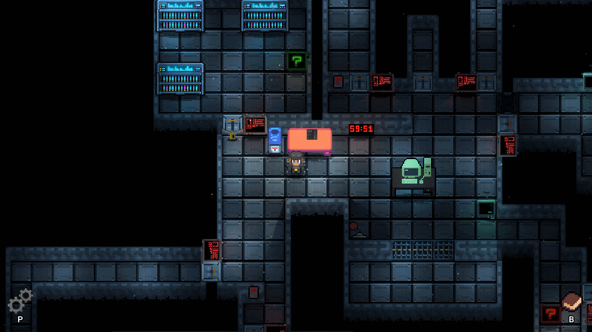

# System Recovery

<p align="center"></p>

<p align="center"><a href="https://github.com/Dungeon-CampusMinden/Dungeon/releases?q=System+Recovery"></a></p>

A cooperative programming escape room about arrays in Java, for 1–2 players. From the
repository: `./gradlew :game:runSystemRecovery`

## For players

You wake up as an AI agent in a damaged facility. AXIOM, the intelligence in charge, gives you
a clear order: bring the failed systems back online. Whatever you program at the terminal
changes the world around you: arrays turn into energy fields and storage modules, loops move
packages and search robots, and sorted data opens new paths through the facility. But a second
process called ECHO keeps calling on an old telephone, asking questions AXIOM would rather leave
unanswered. You have one hour before the system wipe begins, and the clock is already running.

## For educators

**Subject:** Programming 1, arrays in Java. Players write real Java code into in-game
terminals, and accepted inputs change the facility. Knowing the Java basics helps; the
actual challenge is to work out which step is needed right now. The room is meant for one or
two players and has a shared 60-minute limit.

| Puzzle | Concept |
| --- | --- |
| 1 Energy | declare an array and assign values |
| 2 Modules | fill an array, take out an element, read its length |
| 3 Inventory scanner | count occupied entries with a for-each loop |
| 4 Transport storage | process an array index by index in a loop |
| 5 Manual sorting | order neighboring values by hand |
| 6 Bubble sort | complete the condition of a bubble sort |
| 7 Data archive | reconstruct three array declarations |
| 8 2D storage | work with a 3x4 matrix |
| 9 Search robot | nested search through a two-dimensional array |
| 10 System core | three final checks that combine sorting, counting and searching |

**Help and feedback:** the telephone offers four hints per step, from orientation to the full
solution. After four minutes without progress, the next hint appears automatically. The shared
quest log keeps every accepted solution, and the *Memory Watch* tab on the PC shows the arrays
from the accepted inputs.

**Use in teaching:** the game saves automatically at checkpoints, and *Continue* resumes with
the remaining time. With the players' consent, attempts, hints and solutions are recorded in a
tracking file on the host computer. The texts are German by default; an English translation
exists.

-   [Concept and documentation] (German)
-   [Story flow] (German, contains spoilers)
-   [Sample solutions] for supervision (German, full spoilers)

## Technical notes

-   **Play a release:** download `SystemRecovery.jar` (or the Windows or Linux package) from
    the [releases] and start it with `java -jar SystemRecovery.jar`. It needs the
    [Java SE Development Kit 25 LTS].
-   **Play from source:** `./gradlew :game:runSystemRecovery`
-   **Multiplayer:** the *Join* button is hidden by default and can be enabled with
    `SystemRecovery.SHOW_JOIN_IN_MENU`. A dedicated server starts with
    `./gradlew :game:runSystemRecoveryServer`.
-   **Level editor:** `./gradlew :game:runSystemRecoveryLevelEditor`
-   **Tests:** `./gradlew :game:test --tests 'rooms.systemRecovery.*'`

  [Concept and documentation]: ../../../../doc/escape_room/room_concepts/prog1_arrays/README.md
  [Story flow]: ../../../../doc/escape_room/room_concepts/prog1_arrays/system_recovery_story_flow.md
  [Sample solutions]: ../../../../doc/escape_room/room_concepts/prog1_arrays/terminalSolution.md
  [releases]: https://github.com/Dungeon-CampusMinden/Dungeon/releases?q=System+Recovery
  [Java SE Development Kit 25 LTS]: https://jdk.java.net/25/

## Developer notes (German)

### Aufbau

`SystemRecoveryLevel` besitzt je eine Controller-Instanz pro Rätsel. Aufbau, Zustand und
Interaktionen eines Raums liegen in `riddles`; wiederverwendbare Entity-Konstruktion liegt in
`entities`. Terminalerfolge werden in `SystemRecoveryRiddleRegistry` dem zuständigen Controller
zugeordnet. Neue Rätsellogik gehört nicht in statische Level-Weiterleitungen.

| Nr. | Controller | Kernaufgabe |
| --- | --- | --- |
| 1 | `EnergyRiddle` | Energie-Array, Werte, Batterie |
| 2 | `ModuleStorageRiddle` | Modul-Array, GPU-Ausfall, Länge, Türcode |
| 3 | `InventoryScannerRiddle` | belegte Module zählen, Türcode |
| 4 | `TransportStorageRiddle` | Paketarray und indexbasierte Verarbeitung |
| 5 | `ManualSortingRiddle` | benachbarte Werte manuell ordnen |
| 6 | `BubbleSortRiddle` | Sortierchip ausführen und Archivschlüssel vergeben |
| 7 | `DataArchiveRiddle` | drei Array-Deklarationen rekonstruieren |
| 8 | `TwoDimensionalStorageRiddle` | 3x4-Matrix und markierte Zellen |
| 9 | `SearchRobotRiddle` | Ortungschip und zweidimensionale Suche |
| 10 | `SystemCoreRiddle` | drei Kernprüfungen mit eigenem Suchroboter und Abschlussmaske |

Pflichtpunkte werden beim Levelstart durch `SystemRecoveryPointRegistry` gesammelt geprüft.
Historische Tippfehler werden dort nur als explizite Aliase unterstützt. Rätsel 8 nutzt die festen
`storage_cell_*`-Punkte; Rätsel 9 erzeugt seinen Laufweg aus `roboter_start` und `roboter_end`.
Rätsel 10 setzt einen zweiten, controllerlosen Roboter am `map00`-Eingang ein.

### Fortschritt und Hinweise

`SystemRecoveryProgressNet` ist die einzige Quelle für den aktiven Lernschritt. Auf dem Server
liegt genau ein Token auf einem Place aus `SystemRecoveryLearningStep`. Erfolgreiche
Terminaleingaben werden über `SystemRecoveryPuzzleEvents.terminalAttempt(...)` zugeordnet;
physische Aktionen schließen ihren erwarteten Schritt ausdrücklich ab. Story-Trigger verändern
das Netz nicht.

Jeder aktive Place besitzt vier spezifische Hinweise. `SystemRecoveryHintPhone` zeigt sie nach
Bestätigung, schreibt sie ins Questlog und trackt ihre Verwendung. Versuche, Lösungen und
Rätselstarts laufen ebenfalls zentral über `SystemRecoveryPuzzleEvents` und die Dungeon-Tracking-
API.

Jede serverseitig akzeptierte Code- oder Ergebnis-Eingabe wird zusätzlich als originale
Spielerlösung im passenden Rätsel-Tab des gemeinsamen Questlogs gespeichert. Der PC enthält den
Tab `Memory Watch`; er zeigt die Array-Namen aus diesen akzeptierten Eingaben und aktualisiert sich
nach einer bestätigten Terminaleingabe direkt im geöffneten PC.

Die ausführliche, aktuelle Beschreibung steht in:

- `doc/escape_room/room_concepts/prog1_arrays/petri_net_system_recovery_concept.md`
- `doc/escape_room/room_concepts/prog1_arrays/system_recovery_story_flow.md`
- `doc/escape_room/room_concepts/prog1_arrays/system_recovery_save_load.md`

### Zeitlimit

`SystemRecoveryTimerFactory` erzeugt am Custom Point `timer` die Timer-Entity. Ihre Restzeit
rechnet `SystemRecoveryTimeLimit` aus der gemeinsamen Spieluhr; `SystemRecoveryTimerSystem`
friert sie bei `COMPLETE` ein und erkennt den Ablauf. `SystemRecoveryTimerSync` überträgt Start,
Dauer und Einfrierzeitpunkt, und `WorldTimerSystem` zeichnet die Restzeit mit der synchronisierten
Spieluhr auf den Clients. Läuft die Zeit vor `COMPLETE` ab, zeigt `SystemRecoveryTimeoutEnding`
das Fehler-Outro. Unabhängig davon löst `SystemRecoveryTimedHintSystem` die zeitgesteuerte Hilfe
aus (`SystemRecovery.FORCE_HINTS`, `SystemRecovery.HINT_DELAY_MINUTES`).

Das Verhalten beschreibt der
[Storyablauf](../../../../doc/escape_room/room_concepts/prog1_arrays/system_recovery_story_flow.md#zeitlimit-und-hilfe).

### Story und Lokalisierung

Nach Lore und Steuerungsdialog werden die Terminals freigegeben. Die erste falsche Eingabe lässt
ECHOs Telefon klingeln. Ist bereits die erste Eingabe korrekt, meldet sich zunächst AXIOM; danach
klingelt ECHO mit einem anderen Einstiegsgespräch. ECHO liefert später Übergangsgespräche und
Hinweise. Das Öffnen des Systemkerns aktiviert Alarm und Wendepunkt.
Nach dem letzten Kernschritt klingelt ECHO erneut; erst nach diesem Gespräch öffnet sich der
Aufzug.

### Save und Load

Der Server speichert automatisch am Anfang jedes Haupträtsels. Beim Laden werden die aktiven
Petri-Place, abgeschlossene Räume, akzeptierte Terminaleingaben, Questlog und
Achievement-Fortschritt sowie die Tracking-Einwilligung wiederhergestellt; Dialoge werden nicht
erneut abgespielt. Erfolgreiche USB-Uploads und die Teilschritte im Systemkern besitzen ebenfalls
Checkpoints. Die verbleibende Zeit ergibt sich aus der mitgespeicherten Spielzeit; vor dem
Einsetzen der Batterie entsteht weiterhin kein Savegame. Offline-Zeit wird nicht
abgezogen. Details und Grenzen stehen in der
[Save/Load-Dokumentation](../../../../doc/escape_room/room_concepts/prog1_arrays/system_recovery_save_load.md).

Alle sichtbaren Texte liegen in `game/assets/language/systemRecovery/de.json` und `en.json`.
Serverseitig erzeugte Dialoge transportieren Schlüssel, damit jeder Client in seiner eigenen
Sprache rendert. `SystemRecoveryStoryDialogs` schreibt angezeigte Storyschritte zugleich ins
gemeinsame Questlog und verzögert sie, solange der betroffene Spieler einen Computer geöffnet hat.

### Multiplayer

Der Server entscheidet über Fortschritt, Items, Türen und zeitgesteuerte Abläufe.
`SystemRecoverySnapshotTranslator` und `SystemRecoveryEntitySpawnStrategy` übertragen den
aktuellen Zustand. Renderingeffekte werden nur auf grafischen Clients erzeugt; der Headless-Server
lädt keine Texturen oder Schriftarten.

Das Savegame ist ein gemeinsamer, serverautoritärer Spielstand. Der Hostname wird beim Start des
verwalteten Serverprozesses übergeben und zusätzlich vom Client im Netzwerk-Handshake bestätigt.
Der Server schreibt `system-recovery-save.json`; Clients schreiben keine Save-Datei und senden beim
Fortsetzen auch keine Datei an den Server. Beim Fortsetzen liest der Server den Spielstand ein und
überträgt den wiederhergestellten Weltzustand, Questlog und Fortschritt an alle Clients. Der erste
verbundene Spieler ist der gespeicherte Name des gemeinsamen Spielstands; weitere Joiner ändern
diesen Namen nicht automatisch.

Wenn der Server vor dem ersten Client-Tick noch keinen Spieler kennt, wird kein Fallbackname wie
`Player` gespeichert. Sobald der Host verbunden ist, wird der Checkpoint mit dem tatsächlichen
Namen geschrieben. Dadurch bleibt der Spielstand auch dann korrekt, wenn der Server schneller
startet als der Client.

### Tests

```sh
./gradlew :game:test --tests 'rooms.systemRecovery.*'
```
