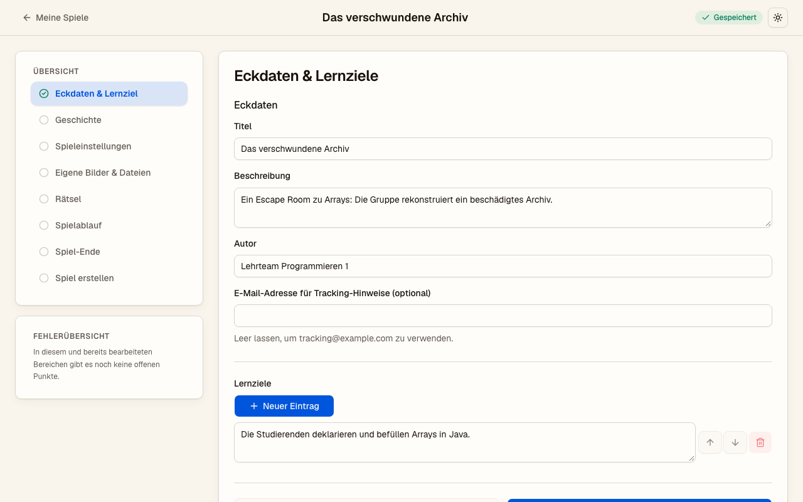

# Building an escape room with the Wizard

The Wizard lets educators build their own escape room in the browser, without programming and
without editing any files by hand. At the end it creates a single game file
(`<title>-WizardRoom.jar`) that you hand out to all players. This guide summarises the steps;
the full description of the authoring flow is in
[`v0/wizard-ui-flow-v0.md`](v0/wizard-ui-flow-v0.md) (German).

## Before you start

The Wizard currently runs as a local program and is meant to be set up with technical support:

-   [Java SE Development Kit 25 LTS](https://jdk.java.net/25/) and Node.js 22 are required.
-   Start it from the repository with `wizard/start_wizard_dev.sh` (Linux) or
    `wizard\start_wizard_dev.cmd` (Windows). The script builds the Wizard and opens it in your
    browser at `http://127.0.0.1:27777/`.
-   Your draft is saved automatically in the browser. Work in one browser tab at a time.
-   The pages of the Wizard are in German, and in this version the room content is German
    (`de-DE`) as well.

## Step by step

1.  **My games** (*Meine Spiele*): start a new draft with *Neues Spiel* or open one of your
    local drafts.
2.  **Basic details and learning objectives** (*Eckdaten & Lernziele*): title, description,
    author, an optional e-mail address for tracking notes, and at least one learning objective.
3.  **Story** (*Geschichte*): theme, mission and intro texts. Each text appears as its own
    screen.
4.  **Game settings** (*Spieleinstellungen*): target group, prior knowledge, number of players
    (1 to 4), time limit (5 to 240 minutes) and whether the limit is hard or only a guide.
5.  **Own images and files** (*Eigene Bilder & Dateien*): upload your own PNG or JPEG images,
    or pick images from the game library.
6.  **Puzzles** (*Rätsel*): each puzzle has a title, at least one learning objective, a time
    estimate, information sources and at least one input. Available inputs are a number code
    (*Zahleneingabe*, 1 to 8 digits), a multiple-choice question (*Auswahlfrage*, 2 to 6
    answers, one or more correct), a matching task (*Zuordnung*, 1 to 4 boxes, 2 to 8 items) and
    collecting all materials of an information source (*Sammeln*). Add hints in order; each gets
    one of the levels *Orientierung* (orientation), *Ansatz* (approach) or *Lösung* (solution).
    Players have to confirm before a hint is shown.
7.  **Game flow** (*Spielablauf*): connect the puzzles between the start and the end. An arrow
    means the next puzzle becomes available after the previous one; several incoming arrows
    mean all of them have to be solved first.
8.  **End of the game** (*Spiel-Ende*): name the exit, add questions for the debriefing and the
    texts shown on success (with a hard time limit also on failure). The exit opens as soon as
    all puzzles before the end are solved.
9.  **Create the game** (*Spiel erstellen*): the Wizard checks the draft in the background and
    lists all problems in the error overview (*Fehlerübersicht*); a click on a problem opens the
    step it belongs to. Warnings do not block. *Spiel erstellen und herunterladen* (create and
    download) builds the game file.

Before you hand out the game, check it yourself: can the solution be derived from the task and
the material, is the task clear for the target group, do difficulty and time fit the lesson,
does every hint help, and is the learning objective linked to the debriefing?

## Playing the room

Give the same `<title>-WizardRoom.jar` to the host and to every other player. With Java 25
installed, `java -jar <title>-WizardRoom.jar` opens the menu where one player hosts and the
others join. Everything in the file, including the solutions, can be read by anyone who has it.
